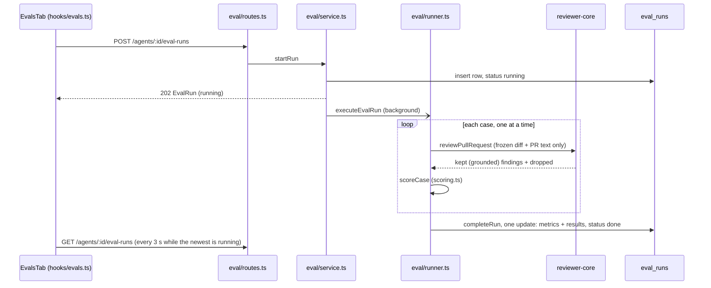

# Eval pipeline — regression protection for a reviewer agent

Change an agent's prompt, model or linked skills, run its eval cases, and read in numbers whether
it got better or worse. Scoring is code; no model judges the result.

It shares only the word "eval" with the root [`evals/`](../evals/README.md) package, which checks
the Claude Code harness (skills, subagents, instruction files). Different code, different data.

Intent and acceptance criteria: `specs/2026-10-12-eval-pipeline.md` (SPEC-03),
`specs/2026-10-12-case-editor.md` (SPEC-04), `client/specs/2026-10-12-eval-trend-charts.md` (SPEC-05),
`specs/2026-10-13-eval-case-modal.md` (SPEC-09: the case modal, per-case run, Run all agents, Promote,
dashboard sparkline; supersedes the one-click case creation of SPEC-03),
`specs/2026-10-13-skill-evals.md` (SPEC-10: evals for skills, see [Skill evals](#skill-evals)).
This page describes what the code does.

## Data model

Anchors without a directory are in `server/src/modules/eval/`. Tables in `server/src/db/schema/eval.ts`; migrations `0017_eval_pipeline`, `0018_eval_case_revision`, `0019_skill_evals`.

| Record | Holds | Anchor |
|---|---|---|
| Case (`eval_cases`) | one frozen diff (one file from a PR, or a pasted diff) + PR title/body (+ number/author when it came from a PR) + exactly one expectation: file, line range, severity, category, title; `expectation_type`; `revision`; owner (`owner_kind` `agent\|skill` + `owner_id`, no FK); `source_finding_id` (no FK: a case outlives its finding, review and PR) | `server/src/db/schema/eval.ts:49` |
| Run (`eval_runs`) | one row per suite run: `agent_version`, `skill_id` + `skill_version` (null for an agent run), `provider`, `model`, `skills` (names), `case_ids`, `results` (one outcome per case), `recall`, `precision`, `citation_accuracy`, case/finding counts, `cost_usd`, `duration_ms`, `status` `running\|done\|failed` | `server/src/db/schema/eval.ts:78` |

- `must_find` is made from an **accepted** finding, `must_not_flag` from a **dismissed** one
  (`helpers.ts:45`). The expectation type cannot be changed afterwards.
- `revision` starts at 1 and moves only when an edit changes what a run would score (see
  [Editing a case](#editing-a-case)). Every outcome stores the revision it was scored against.
- At most one run in flight per owner: partial unique indexes `eval_runs_one_running_agent_idx`
  (agent runs, `skill_id is null`) and `eval_runs_one_running_skill_idx` (one per skill)
  (`server/src/db/schema/eval.ts:116`, `:120`). The database refuses the second one.
- A run writes no review, finding, agent-run or trace row (`runner.ts:124`).

## One run

1. `startRun` refuses early (`eval_no_cases`, `eval_run_in_progress`, `eval_provider_unavailable`),
   stores the agent's current version, provider, model and linked-and-enabled skill names, and
   answers `202` at once (`service.ts:274`). The agent's `enabled` flag is not read.
2. Cases run one after another through the **same engine call as a live review**
   (`reviewPullRequest`, `runner.ts:87`), so the grounding gate is the real one.
3. The engine gets **only the frozen input**: system prompt, model, strategy, linked skills, the
   case diff, the PR description and a task line. No repo skeleton, callers, project context,
   intent or memory, and never the case's name, type or expectation (`helpers.ts:201`).
4. A throwing case becomes an `error` outcome and does not stop the others (`runner.ts:110`).
5. One `completeRun` update settles the run as `done` with all metrics and outcomes
   (`runner.ts:160`). `cost_usd` is `null` when any case reports no cost.
6. A run has no per-case deadline and no cancel — see [Known limits](#known-limits).

## Trying a case

`POST /agents/:id/eval-cases/try` (`routes.ts:163`, `service.ts:536`) runs the case content sent in the
body through the same `executeCase` as a suite run (`runner.ts:84`), on the agent's **current**
prompt, model, strategy and linked enabled skills. It answers `pass | fail | error`, `matched`, the
grounded findings, `duration_ms` and `cost_usd`, scored by the rules below. A skill has the same
try through a host agent ([Skill evals](#skill-evals)).

- **Stores nothing:** no case, run, review, finding, agent-run or trace row; `last_result`, the run
  list and the dashboard read the same afterwards.
- **One paid model call**, 10 per minute (the limit of starting a run). Every control that sends it
  says so in its title.
- Allowed while a run of the agent is in flight. A failed model call is a `200` with `status: error`.
- The model input comes from the body alone: no repo context, and the expectation never reaches it.

## Scoring

All of it is `server/src/modules/eval/scoring.ts`, pure functions.

**Match** (`scoring.ts:9`): a finding matches the expectation when it is in the **same file** and
its line range **overlaps** the expected range (inclusive, either order of start/end). Only
**grounded** findings (those the engine's gate kept) are matched; dropped ones count only as
"produced".

| Per case | Rule | `scoring.ts` |
|---|---|---|
| `must_find` | `pass` when at least 1 grounded finding matches, else `fail` | `:33` |
| `must_not_flag` | `pass` when 0 grounded findings match, else `fail` | `:33` |
| call threw | `error`, left out of every metric below | `:47` |

| Per run | Formula | Null when |
|---|---|---|
| recall | `must_find` cases passed / `must_find` cases scored | no `must_find` case scored |
| precision | `1 − (grounded findings matching a must_not_flag expectation) / (all grounded findings)` | no grounded finding |
| citation accuracy | grounded findings / produced findings (grounded + dropped) | no finding produced |
| cases passed / failed / errored | counts; errored are excluded from the three metrics above | — |

(`scoring.ts:63`.) Precision is over **findings**, the case counts are over **cases**, so they can
move in opposite directions (see the example).

**No model is called, by construction:** `scoring.ts` has no `import` statement, so it cannot reach
a provider or anything else. Nothing pins this with a test; keep the file import-free. The model
is called only in `runner.ts` through the engine, once per case. The Evals tab says the same
("Scoring is done in code, with no model call") and trend charts only read stored runs.

## Using it

1. **Make cases.**
   - From a PR: accept or dismiss a finding, then **Turn into eval case** on the finding card
     (`FindingCard/_components/EvalCaseAction/`). It is enabled only for a decided finding
     (accepted → "must find", dismissed → "must NOT comment"). The click stores nothing: it reads
     `GET /findings/:id/eval-case-draft` and opens the case modal
     (`client/src/components/eval-case-editor/`) prefilled with the finding's name, the file's diff,
     PR meta and expected output. A file with no patch in the PR diff, or lines outside the changed
     lines, no longer refuses the click: the draft carries `problem` (`file_not_in_diff` /
     `lines_outside_diff`) and the modal says so. A finding that already has a case opens that case
     for editing. One finding gives one case.
   - By hand: agent editor → **Evals** tab → **New eval case** (the same modal). Paste a unified
     diff with `---` / `+++` file lines and an `@@` hunk, choose the expectation type, the **file**
     (one of the diff's files), start/end **line**, finding title, severity and category.
     **Preview** renders the diff with the expected range marked. The range must sit on changed
     lines.
   - **Run case**, in all three modes (from a finding, new, edit): one [try](#trying-a-case) with the
     form's current content. The result region shows pass/fail, expected vs got, duration, cost and
     the agent's findings; a form edit after the run marks the result stale. Repeat until the case
     measures what it should.
   - **Save** stores the case (`POST /findings/:id/eval-case` with the form as body: 201 created, 200
     when the finding already has a case). **Cancel** stores nothing. The footer checkbox **Run
     after saving** is on by default: after a successful save one try is sent and the dialog stays
     open in edit mode; unchecked, the dialog closes. The finding card then links to the Evals tab.
2. **Run.** Evals tab → **Run all evals (N)**. The tab polls every 3 s until the run settles
   (`EVAL_RUN_POLL_MS`, `client/src/lib/hooks/evals.ts`).
3. **Read.** Tiles (recall, precision, citation accuracy, cases passed) with the change against
   the previous run, a trend chart of the last runs, the case list with each case's last result,
   and the run history (cost, version, cases passed). Each case row has its own run control: a
   trial result appears beside the stored one, stores nothing, and is dropped when the list is
   re-read.
4. **Compare.** Tick two completed runs in the history → **Compare**: older/newer/difference per
   metric, cost, provider, model and skills of each side, and a diff of the two system prompts.
   Cases only one run scored, and cases edited between the runs, are named and left out of the
   values (`helpers.ts:353`). **Promote vN** (the newer run's version; disabled while it is the
   agent's current one): after a confirm it reads that version's snapshot and sends
   `PUT /agents/:id` (`usePromoteAgentVersion`, `client/src/lib/hooks/agents.ts:102`). The agents
   API is unchanged, so a promotion always adds a new version carrying that configuration; earlier
   versions stay and the skill links are not touched.
5. **Dashboard.** Sidebar → **Eval Dashboard** (`/eval`): every agent's latest run with a recall
   sparkline (from two runs with a recall) and the six most recent runs. **Run all agents** opens a
   confirm dialog with the agent and case counts and the agents left out (no cases, or a run in
   progress), then sends one `POST /agents/:id/eval-runs` per eligible agent; the dashboard polls
   every 3 s while any agent has a run in progress. `/eval/<agentId>` is one agent's view; it shows **"Precision dipped N pts on vX"**
   with the newly failing must-not-flag cases when precision fell from the previous completed run
   (`client/src/app/eval/[agentId]/_components/AgentEvalView/helpers.ts:9`).

Screens: [Evals tab](../specs/fixtures/eval-pipeline/evals-tab.png),
[Evals tab after a save](../specs/fixtures/eval-pipeline/evals-tab-after-save.png),
[dashboard](../specs/fixtures/eval-pipeline/eval-dashboard.png),
[Run all agents dialog](../specs/fixtures/eval-pipeline/run-all-agents-dialog.png),
[agent view with the banner](../specs/fixtures/eval-pipeline/agent-view-banner.png),
[case editor](../specs/fixtures/eval-pipeline/case-editor.png),
[modal prefilled from a finding](../specs/fixtures/eval-pipeline/eval-case-modal-prefilled.png),
[modal after Run case](../specs/fixtures/eval-pipeline/eval-case-modal-run-case.png),
[finding card after Save](../specs/fixtures/eval-pipeline/eval-case-saved-card.png),
[Promote in the compare view](../specs/fixtures/eval-pipeline/compare-promote.png).

### Editing a case

| Edit | `revision` | `last_result` | In a comparison |
|---|---|---|---|
| diff, PR title, PR body, file, start line or end line changes | +1 (`helpers.ts:165`) | `null` until the case runs again (`helpers.ts:322`) | left out of both sides, listed as edited |
| only name, severity, category or finding title | unchanged | kept | compared as usual |

Old runs keep what they scored. Deleting a case keeps stored runs' results for it. Editing a case
or starting a second run while a run of its owner (the agent, or the skill for a skill case) is in
flight is refused (`eval_run_in_progress`); a try is not.

## Skill evals

A skill owns cases too (`eval_cases.owner_kind = 'skill'`), listed on the **Evals** tab of the Skill
Editor (`/skills/:id?tab=evals`, between Preview and Stats). A skill has no prompt, provider, model or
strategy, so its set runs through a **host agent** chosen per run; scoring, metrics, the frozen input
and the engine call are the agent code above.

| | Agent run | Skill run |
|---|---|---|
| Prompt, provider, model, strategy | the agent's | the host's; its `enabled` flag is not read |
| Skill blocks | the agent's linked enabled skills | the evaluated skill alone, enabled or not, linked or not; the host's own skills are left out (`service.ts:330`, `:775`) |
| Stored with the run | agent version, skill names | host as `agent_id` + `agent_version`, plus `skill_id` and `skill_version` |
| One run in flight | per agent | per skill, independent of the host's own run and of other skills on the same host |

- **The saved body is what runs.** The skill row is read once at start, so every case of a run gets
  that body and the run stores its `skill_version`; unsaved Config edits are not seen.
- **A disabled skill can be evaluated.** Imported skills arrive disabled; the body reaches a model
  only through the run and try routes, never in a live review. The tab says so.
- **Try:** `POST /skills/:id/eval-cases/try` with `host_agent_id` (`service.ts:554`): stores nothing,
  one paid call, 10 per minute, allowed while a run is in flight.
- **Compare:** `GET /skills/:id/eval-runs/compare?base&head` (`service.ts:452`) returns each side's
  skill body from the version snapshot (`service.ts:725`) plus host, version, provider and model.
  The metric values and the edited / only-in-one cases use the same `compareSides` as agents.
  Refused (`eval_runs_not_comparable`): a run not `done`, of another skill, an agent run, or at a
  skill version without a snapshot.
- **The agent side does not move.** Agent run list, `last_result`, trend, dashboard and "Run all
  agents" read agent runs only (`isNull(skill_id)` in `repository.ts`); the agent compare refuses a
  skill run (`service.ts:424`). The agent's run is never blocked by a skill run it hosts.
- **Deleting.** A skill delete removes its cases and runs in one transaction
  (`server/src/modules/skills/repository.ts:228`); the confirm dialog says so. A host agent delete
  removes the skill runs it hosted (cascade on `agent_id`); the skill's cases stay.

Client (`client/src/app/skills/_components/SkillDetail/_components/EvalsTab/`):

- Host selector: linked agents first; preselects the host of the newest run, then the first linked
  agent, then the first agent (`helpers.ts`). The host is chosen per run, never stored on the skill.
- Notice for a disabled skill, the four metric tiles, the case list with a per-row trial run,
  **Run all evals** (says the case count and the host in its title), **New eval case** (the same
  modal as for agents, with **Run case** and **Run after saving**), run history with a Host agent
  column, and a compare view that diffs the two skill **bodies** and lists host, version, provider
  and model differences. No Promote (the Versions tab restores a body), no trend chart.
- No agent in the workspace: cases can be created; every run control is disabled with a hint.
- The case list is shared with the agent tab: `client/src/components/eval-case-list/`.

Screens: [empty](../specs/fixtures/eval-pipeline/skill-evals-empty.png),
[case modal](../specs/fixtures/eval-pipeline/skill-evals-case-modal.png),
[tab](../specs/fixtures/eval-pipeline/skill-evals-tab.png),
[trial run](../specs/fixtures/eval-pipeline/skill-evals-trial.png).

## Routes

Eighteen routes, `server/src/modules/eval/routes.ts`; the module is `server/src/modules/eval/`. Client
hooks: `client/src/lib/hooks/evals.ts`; shared pieces: `client/src/components/eval-runs/`,
`client/src/components/eval-case-list/` and `client/src/components/eval-case-editor/`.

| Route | Does | Answers |
|---|---|---|
| `GET /findings/:id/eval-case-draft` | prefill for the modal; writes nothing, no model call | 200 `{ agent, case, draft }`; `draft` is null when the finding already has `case` |
| `POST /findings/:id/eval-case` | case from a decided finding, from the body (name, diff, PR title and body, expected output); type, PR number and author come from the finding | 201 new · 200 existing, unchanged |
| `POST /agents/:id/eval-cases` | case by hand | 201 |
| `POST /agents/:id/eval-cases/try` | one trial run of case content; stores nothing (10 per minute) | 200 |
| `GET /agents/:id/eval-cases` | the agent's cases with `last_result` | 200 |
| `GET /skills/:id/eval-cases` | the skill's cases with `last_result` | 200 |
| `POST /skills/:id/eval-cases` | skill case by hand | 201 |
| `POST /skills/:id/eval-cases/try` | one trial run of case content through `host_agent_id`; stores nothing (10 per minute) | 200 |
| `PUT /eval-cases/:id` | edit a case (agent or skill) | 200 |
| `DELETE /eval-cases/:id` | delete a case (agent or skill) | `{ ok: true }` |
| `POST /skills/:id/eval-runs` | start a run of the skill's set through `host_agent_id` (10 per minute) | 202 |
| `GET /skills/:id/eval-runs` | the skill's newest 20 runs | 200 |
| `GET /skills/:id/eval-runs/compare?base&head` | two done runs of the skill; the older is `base`; carries both skill bodies | 200 |
| `POST /agents/:id/eval-runs` | start a run (10 per minute) | 202 |
| `GET /agents/:id/eval-runs` | newest 20 runs | 200 |
| `GET /agents/:id/eval-runs/compare?base&head` | two done runs of the agent; the older is `base` | 200 |
| `GET /eval-runs/:id` | one run with per-case outcomes (agent or skill run) | 200 |
| `GET /eval/dashboard` | `agents[]`: latest run, `case_count`, `run_in_progress`, `trend` (≤ 20 completed runs, oldest first: recall, precision, citation accuracy); `recent_runs`: the 6 newest. Agent runs only | 200 |

## Refusals

All are HTTP 400 with a stable `code` (`constants.ts:10`).

| Code | Meaning | What to do |
|---|---|---|
| `finding_undecided` | draft or Save of a finding that is neither accepted nor dismissed and has no case | accept or dismiss it first |
| `eval_owner_missing` | draft or Save: the agent that produced the finding was deleted | make the case by hand on an existing agent |
| `expectation_outside_diff` | Save or Run case: the chosen file and lines are not on changed lines of the diff | pick lines the diff changed |
| `eval_diff_invalid` | the text has no `---`/`+++` file lines or no `@@` hunk | paste a real unified diff |
| `eval_no_cases` | the agent or skill has no cases | add a case first |
| `eval_provider_unavailable` | the agent's (for a skill: the host's) provider is not configured (run or try) | set its key in Settings |
| `eval_run_in_progress` | a run of this agent or skill is running (`details.run_id`) | wait for it, or see the first limit |
| `eval_runs_not_comparable` | a run is not `done`, belongs to another agent or skill, is a skill run in an agent compare (or the reverse), or its agent / skill version has no stored snapshot | see the second limit |
| `eval_host_agent_missing` | skill run or try: `host_agent_id` names no agent of the workspace | pick an existing agent |

A body that fails a schema rule gets 422 and nothing is stored; more than 10 starts or tries a
minute get 429. `eval_case_not_stored` is rare. A finding outside the diff is not a refusal at the
draft: it comes back as `problem`.

## Operations

| Task | Command (from `server/`) | Notes |
|---|---|---|
| Verify the feature | `pnpm verify:l06` | `vitest run src/modules/eval/ test/eval-`: scoring and helper units plus the `eval-*.it.test.ts` integration files (Docker; they self-skip without it, so green is not proof they ran) |
| Fixture cases | `pnpm exec tsx src/db/eval-fixtures.ts --agent "<name>"` | inserts the 8 fixture cases (4 `must_find`, 4 `must_not_flag`) the agent does not hold yet, by name; additive and idempotent; never run by the seed, `dev.sh` or the API |

On boot the API marks any run left `running` as `failed` with error `interrupted` (`server/src/app.ts:95`).

## Worked example

Test Quality Reviewer, 8 cases (4 `must_find`, 4 `must_not_flag`), `deepseek/deepseek-v4-flash`,
measured on the dev stack on 2026-10-12.

| Prompt | Recall | Precision | Citation | Cases passed | Cost |
|---|---|---|---|---|---|
| baseline | 100% | 62.5% | 100% | 7/8 | $0.0086 |
| improved ("What not to report" paragraph) | 100% | 81.8% | 100% | 6/8 | $0.0072 |
| deliberately broken ("comment on every test block"), 32 findings | 100% | 56.7% | 93.75% | 4/8 | $0.0104 |

Reading it: the broken prompt keeps recall but floods the suite with findings, so precision and
cases passed fall, and citation drops (2 of the 32 findings failed the grounding gate). The
improved prompt raises precision — a smaller share of findings lands on must-not-flag lines — while
one more case fails (7 → 6). Recall is 100% in both, so the failing cases are `must_not_flag`
ones: precision counts findings, "cases passed" counts cases, and the same matches can spread over
more cases. Screens:
[baseline vs improved](../specs/fixtures/eval-pipeline/compare-baseline-vs-improved.png),
[improved vs broken](../specs/fixtures/eval-pipeline/compare-improved-vs-broken.png).

A case from a finding: the accepted finding "formatDuration returns wrong seconds when minutes > 0"
(CRITICAL) opens the modal prefilled with that file's diff and a `must-find-…` name ([prefilled](../specs/fixtures/eval-pipeline/eval-case-modal-prefilled.png)).
**Run case** shows "Passed, expected 1, got 1" with the agent's two findings, 36 s and $0.0005
([after Run case](../specs/fixtures/eval-pipeline/eval-case-modal-run-case.png)); **Save** adds the
case to the Evals tab ([after save](../specs/fixtures/eval-pipeline/evals-tab-after-save.png)).

## Known limits

Measured on 2026-10-12 unless stated.

- **No per-case deadline, no cancel.** A provider call that never returns keeps the run `running`;
  the unique index then refuses a new run of that agent until the API restarts and the boot reaper
  marks it `failed` / `interrupted` (`server/INSIGHTS.md`). A per-case timeout in `runner.ts` is
  the fix and is not built.
- **Compare needs a stored snapshot of the agent version** (`service.ts:700`). A seeded agent that
  was never edited has none for version 1: compare answers `eval_runs_not_comparable`. Save the
  agent once before the first run. Skills created through the API or the seed have one per version.
- **A skill link change does not bump the agent version.** The run stores skill names, so the
  compare view shows the difference.
- **A case keeps at most what the stored PR diff holds**: a PR's first 100 files
  (`server/INSIGHTS.md`).
- **Promote always adds a version.** `PUT /agents/:id` with the snapshot's configuration is never a
  no-op, so the "already has this configuration" branch of the compare view is not reached from the
  API (declared deviation F1, `specs/2026-10-13-eval-case-modal-plan.md` § 7).
- **A try has no deadline either**, and no cancel; closing the modal discards its answer. The same
  holds for a skill run: a hung call blocks new runs and case edits of that skill only.
- **A skill result belongs to its host.** Another host, or a changed host prompt or model, gives
  other numbers; each run stores the host, so the compare view lists the difference.
- **Not built, on purpose** (in the design frames): the case editor's "Files" input tab and "Linked
  issue" field, the JSON "Expected output" editor (the type, file and lines are form fields) and the
  "30 days" range control.
- **Not built for skills** (SPEC-10 non-goals): a without-skill baseline, a skill case from a finding,
  skills on the Eval Dashboard or in "Run all agents", the trend chart and Promote on the skill tab,
  an MCP tool, an e2e flow, a deadline or cancel.
