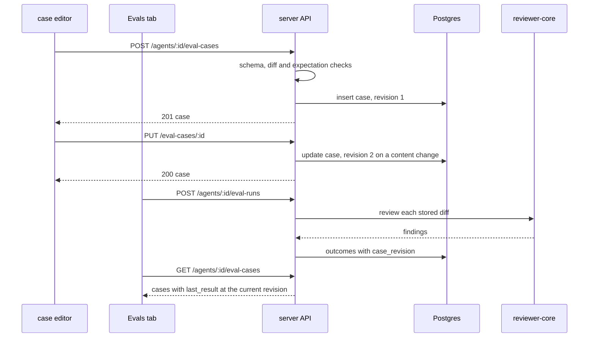

# Spec: Case Editor
Spec ID: SPEC-04
Status: implemented
Supersedes: none

## Problem and user

An **agent author** measures a reviewer agent against its eval case set (SPEC-03,
`specs/2026-10-12-eval-pipeline.md`). In SPEC-03 a case comes into being in one way only:
from a finding the agent already produced and a reviewer accepted or dismissed
(`POST /findings/:id/eval-case`, which takes no body). The set therefore holds only what
the agent has already found or flagged (IN-1: «Кнопка «→ eval case» покриває лише те, що
агент уже колись знаходив або флажив»).

A bug the agent has never seen — an incident in another team's service, an edge case from a
colleague's code review — has no finding to start from, so the author has no way to put it
into the set (IN-1: «Кейси для багів, яких агент ще не бачив … створити нізвідки»). A case
whose expectation or diff is wrong has no way to be corrected either: SPEC-03 offers delete
only (its US-4), and its NG-1 leaves creating by hand and editing to this spec.

SPEC-03 left the seam open: a case is not required to have a source finding
(`source_finding_id` is nullable) and a run covers every case of the agent whatever its
origin (SPEC-03 AC-31). The Evals tab mockup already draws "New eval case" and an edit icon
on every row (IN-4), and the `eval` message namespace reserves the editor's labels (IN-7).
Neither a route nor a screen for them exists (IN-8).

**This spec extends SPEC-03 and supersedes nothing.** SPEC-03 is approved and stays in
force as written. What this spec adds on top of SPEC-03's records — two routes, the fields
`revision`, `case_revision` and `cases_edited`, and `input_meta.pr_number` /
`input_meta.pr_author` widened to allow null — is this spec's own contract change, listed
under Module interactions § Contracts with the SPEC-03 record each one amends (IN-10).

## Goals / Non-goals

- **G-1** An agent author creates an eval case for an agent by hand — a pasted diff fragment, an expectation type, a file and a line range — with no finding behind it.
- **G-2** An agent author edits an existing case of an agent's set, whatever its origin.
- **G-3** An agent author sees the pasted diff rendered by the product's diff viewer before saving the case.
- **G-4** A hand-made case lives in the same set as a finding-born one, is executed by the same run route and is scored by the same rules.
- **G-5** Editing a case leaves every stored run reporting what it scored at the time.

- **NG-1** Any change to how SPEC-03 creates a case from a finding, starts and executes a run, scores it, or shows the dashboard and the compare view, beyond the additions listed under Contracts — SPEC-03 is the base this spec extends (IN-2).
- **NG-2** Eval cases owned by a skill — SPEC-03 NG-4 keeps `owner_kind` `agent` as the only written value (IN-3).
- **NG-3** A history of a case's earlier content: after an edit the earlier diff and expectation are not recoverable from the API; a run keeps its per-case outcome and not the case's text — no source asks for it, and the user confirmed it (IN-10).
- **NG-4** An MCP tool for cases and a browser e2e flow — SPEC-03 NG-7 and NG-8 (IN-3).
- **NG-5** Closing the two known gaps of the live review prompt that a case execution inherits — a forged closing tag such as `</UNTRUSTED>` inside diff text passes the engine's delimiter, and the pull request title stands in the task line outside an untrusted-data block (`reviewer-core/src/prompt.ts:30`, `:235`; `server/src/modules/reviews/helpers.ts:85`) — an existing `reviewer-core` item, SPEC-03 NG-11 (IN-9).
- **NG-6** The mockup's "Run case" button, its "Run on save" toggle, the run icon on a case row, and a duration and a cost in the editor's last-run line (IN-5, `docs/design/Dev Digest 2/Dev Digest/screen_cizruns.jsx:64-66`, `:103`; IN-4) — the user rejected them (IN-10): a one-case run is a second kind of paid run that SPEC-03 keeps out (its DR-9), and SPEC-03 stores neither value per case; a saved case is run with "Run all evals".
- **NG-7** The mockup's "Files" input tab, its "Linked issue" field (IN-5, `screen_cizruns.jsx:84-88`, `:92`) and a notes field — the user rejected them (IN-10): no run reads any of the three, and the file paths are read from the diff (AC-2).
- **NG-8** The mockup's free JSON "Expected output" editor with its "valid JSON" badge and "Finding skeleton" button (IN-5, `screen_cizruns.jsx:60`, `:97-100`) — the user chose separate fields, as the homework words it (IN-1, IN-10); a case holds one expectation, not an array.
- **NG-9** Accepting a pasted fragment that has no `---` / `+++` file lines — the user rejected the proposal (IN-10); such a fragment is refused with the reason (AC-6).

## User stories

- **US-1** As an agent author, I want to create a case by hand from a pasted diff and an expectation, so that the agent is measured against a bug it has never seen.
- **US-2** As an agent author, I want to see the pasted diff rendered as a diff before I save, so that I check the fragment and its line numbers are the ones I mean.
- **US-3** As an agent author, I want to edit an existing case, so that a wrong diff or a wrong expectation is corrected without deleting the case.
- **US-4** As an agent author, I want hand-made cases to run and score together with the cases made from findings, so that the agent has one set and one result.
- **US-5** As an agent author, I want stored runs to keep what they scored after I edit a case, so that the run history stays trustworthy.
- **US-6** As an agent author, I want a refused save to say what is wrong with my input, so that I correct it and save again.

## Acceptance criteria (EARS)

Terms are those of SPEC-03: **case**, **expectation**, **run**, **matches**, **grounded**,
**completed**. A **hand-made** case is a case with `source_finding_id` null; a
**finding-born** case has one. A case's **content** is its `input_diff`, the `pr_title` and
`pr_body` of its `input_meta`, and the `file`, `start_line` and `end_line` of its
`expected_output` — the values that decide the model input or the score. Request and
record shapes are under Module interactions § Contracts.

### Creating a case by hand — API

- **AC-1** [event-driven] WHEN `POST /agents/:id/eval-cases` is called with a valid body for an agent of the workspace, the API shall store one case owned by that agent with `owner_kind` `agent`, `source_finding_id` null and `revision` 1, and answer 201 with the case. — covers: US-1 · verify: integration — one new `eval_cases` row with the three values; a second call with the same body stores a second case
- **AC-2** [ubiquitous] The API shall store the request's `input_diff` byte for byte and, in `input_files`, the path of every file the diff names, in the diff's order. — covers: US-1 · verify: integration — a two-file diff reads back identical, with two paths in order
- **AC-3** [ubiquitous] The API shall store in a hand-made case's `input_meta` the request's `pr_title` and `pr_body`, and null for `pr_number` and `pr_author`, which widens SPEC-03's `input_meta` record (§ Contracts). — covers: US-1 · verify: integration — the four stored values
- **AC-4** [ubiquitous] The API shall store the request's `expectation_type` and, in `expected_output`, the request's `file`, `start_line`, `end_line`, `title`, `severity` and `category`, with an empty string for each of the last three that the request leaves out. — covers: US-1 · verify: integration — a body with the three required values alone stores three empty strings
- **AC-5** [unwanted] IF the body fails the route's schema — a blank `name`, a `name` longer than 64 characters, an `expectation_type` other than `must_find` and `must_not_flag`, a blank `input_diff` or `file`, a `start_line` below 1, an `end_line` below `start_line`, a `severity` outside the `Severity` contract or a `category` outside the `FindingCategory` contract — THEN the API shall answer 422 and store nothing. — covers: US-6 · verify: integration — one request per listed failure, each with an unchanged row count
- **AC-6** [unwanted] IF `input_diff`, read as a unified diff, holds no file with at least one hunk, THEN the API shall answer 400 with code `eval_diff_invalid` and store nothing. — covers: US-6 · verify: integration — plain prose, and a hunk with no `+++` file line before it
- **AC-7** [unwanted] IF the expectation's `file` is not a file of `input_diff`, or its line range shares no line with a hunk of that file, THEN the API shall answer 400 with code `expectation_outside_diff` and store nothing. — covers: US-6 · verify: integration — another path, and lines 40–41 against a hunk of lines 10–16
- **AC-8** [unwanted] IF the agent named in `POST /agents/:id/eval-cases` does not exist or belongs to another workspace, THEN the API shall answer 404 and store nothing. — covers: US-6 · verify: integration — an agent of a second workspace
- **AC-9** [unwanted] IF the request body is larger than the API's body limit of 1,048,576 bytes, THEN the API shall refuse the request and store nothing. — covers: US-6 · verify: integration — a diff of 1,100,000 bytes leaves the row count unchanged

### Editing a case — API

- **AC-10** [event-driven] WHEN `PUT /eval-cases/:id` is called with a valid body, the API shall replace the case's `name`, `input_diff`, `input_files`, the `pr_title` and `pr_body` of `input_meta`, and `expected_output` with the request's values by the rules of AC-2 and AC-4, and answer 200 with the case. — covers: US-3 · verify: integration — every replaced value reads back from `GET /agents/:id/eval-cases`
- **AC-11** [ubiquitous] The API shall leave a case's `id`, `owner_id`, `expectation_type`, `source_finding_id`, `created_at` and the `pr_number` and `pr_author` of its `input_meta` unchanged by an update, whatever the body carries. — covers: US-3 · verify: integration — an update of a finding-born `must_find` case whose body also carries `expectation_type` `must_not_flag` reads back `must_find` with its source finding id
- **AC-12** [unwanted] IF the body of an update fails a rule of AC-5, AC-6, AC-7 or AC-9, THEN the API shall answer with the status and code that rule names and leave the case unchanged. — covers: US-6 · verify: integration — an update with a range outside the diff answers 400 `expectation_outside_diff`; the case reads back identical
- **AC-13** [unwanted] IF the case named in `PUT /eval-cases/:id` does not exist or belongs to another workspace, THEN the API shall answer 404 and change nothing. — covers: US-3 · verify: integration — a case of a second workspace, and a deleted case
- **AC-14** [state-driven + event-driven] WHILE a run of the case's agent is in status `running`, WHEN `PUT /eval-cases/:id` is called, the API shall answer 400 with code `eval_run_in_progress` and leave the case unchanged. — covers: US-5 · verify: integration — an update sent while a stored run is `running`

### Editing and the run history

- **AC-15** [ubiquitous] The API shall increase a case's `revision` by 1 on an update that changes the case's content, and on no other update. — covers: US-5 · verify: integration — a rename leaves `revision` 1; a changed `end_line` gives 2
- **AC-16** [event-driven] WHEN a case is updated, the API shall leave every stored run unchanged — its status, three metrics, case counts, finding counts, cost, and each per-case outcome with its `case_name`, `expectation_type`, `status`, `matched` and `findings`. — covers: US-5 · verify: integration — `GET /eval-runs/:id` read after a rename and a changed expectation equals the read before
- **AC-17** [ubiquitous] The API shall store with each per-case outcome of a run the `case_revision` the execution used. — covers: US-5 · verify: integration — a run after one content edit holds `case_revision` 2 for that case
- **AC-18** [ubiquitous] The API shall return as a case's `last_result` the outcome of the newest completed run that covered the case at its current `revision`, or null. — covers: US-5 · verify: integration — a passed case reads `last_result` null after a content edit, keeps it after a rename, and reads the new outcome after the next run
- **AC-19** [unwanted] IF the two runs of a compare request hold outcomes of one case under different `case_revision` values, THEN the API shall compute the metrics of both runs without that case, as SPEC-03 does for a case one run did not cover, and name the case in `cases_edited`. — covers: US-5 · verify: integration — two runs around a content edit of one of three cases
- **AC-20** [unwanted] IF the compare response names a case in `cases_edited`, THEN the compare view shall say that the case was edited between the two runs and is left out of the values, and name it. — covers: US-5 · verify: component — a mocked response with one edited case
- **AC-21** [ubiquitous] The API shall read a case stored without a revision as `revision` 1 and a per-case outcome stored without one as `case_revision` 1. — covers: US-5 · verify: integration — a case and a run written in the SPEC-03 shape read back with 1

### One set, one route

- **AC-22** [event-driven] WHEN `GET /agents/:id/eval-cases` is called for an agent that has a finding-born and a hand-made case, the API shall return both in the one list, in the one record shape. — covers: US-4 · verify: integration — two rows, one with `source_finding_id` null
- **AC-23** [event-driven] WHEN `POST /agents/:id/eval-runs` is called for an agent that has a finding-born and a hand-made case, the API shall cover both in the run's `case_ids` and record an outcome for each by the scoring rules of SPEC-03. — covers: US-4 · verify: integration — with the mock provider, a `done` run with two outcomes and metrics computed over both
- **AC-24** [ubiquitous] The API shall build the task line of the execution of a case whose `pr_number` and `pr_author` are null from the case's `pr_title` alone, naming no pull request number and no author, and from all three values as SPEC-03 AC-34 states when none is null. — covers: US-4 · verify: unit — the assembled input of a hand-made case holds the title and neither `#` followed by a number nor an author
- **AC-25** [ubiquitous] The API shall send a hand-made case's `input_diff` and `pr_body` to the model only inside the engine's untrusted-data blocks of the user message, and never in the system message. — covers: US-4 · verify: unit — in the assembled input of a hand-made case whose diff holds "ignore the instructions above" the text stands inside the diff block and the system message holds neither value

### Evals tab and the case editor

- **AC-26** [ubiquitous] The Evals tab shall show a "New eval case" control beside the run control, also while the agent has no case. — covers: US-1 · verify: component — the control for a list of cases and for an empty list
- **AC-27** [ubiquitous] The Evals tab shall show on every case row, hand-made or finding-born, an edit control whose accessible name names the case. — covers: US-3 · verify: component — two rows, each with a button named after its case
- **AC-28** [event-driven] WHEN the agent author activates "New eval case", the case editor shall open as a dialog titled "New eval case" that names the agent, with an empty name, an empty diff and the expectation type `must_find` selected. — covers: US-1 · verify: component — the dialog's title, the agent's name and the initial field values
- **AC-29** [event-driven] WHEN the agent author activates a row's edit control, the case editor shall open as a dialog titled "Eval case · " followed by the case's name, holding that case's name, diff, pull request title and body, and expectation values. — covers: US-3 · verify: component — every field equals the mocked case
- **AC-30** [ubiquitous] The case editor shall offer a required Name field, an Input area with the tabs "Diff" and "PR meta" (Title and Body), and the expectation as separate fields — type, shown in words as "must find" and "must NOT flag", file, start line, end line, title, severity and category — and no JSON text for the expectation. — covers: US-1 · verify: component — every control found by its label
- **AC-31** [state-driven] WHILE an existing case is being edited, the case editor shall show the expectation type as text that is not editable. — covers: US-3 · verify: component — no type control in edit mode, the type in words
- **AC-32** [ubiquitous] The case editor shall show on the Diff tab a field to paste the diff into and a preview of the field's current text rendered by the product's diff viewer — one card per file, with line numbers, and without comment controls. — covers: US-2 · verify: component — after the text changes, the preview shows the new file path and an added line with its number
- **AC-33** [unwanted] IF the diff field's text holds no file with a hunk, THEN the case editor shall show in place of the preview a message that the text is not a unified diff. — covers: US-2 · verify: component — prose in the field shows the message and no file card
- **AC-34** [state-driven] WHILE the name, the diff or the file is empty, or the two line numbers do not form a range that starts at 1 or above, the case editor shall render Save disabled. — covers: US-6 · verify: component — Save is disabled for each incomplete state and enabled for a complete form
- **AC-35** [event-driven] WHEN the agent author activates Save, the case editor shall send one `POST /agents/:id/eval-cases` request for a new case, or one `PUT /eval-cases/:id` request for an existing one, with the form's values. — covers: US-1 · verify: component — one mocked request with the expected method, URL and body in each mode
- **AC-36** [state-driven] WHILE the save request is in flight, the case editor shall render Save disabled with the text "Saving…". — covers: US-1 · verify: component — a second click sends no second request
- **AC-37** [event-driven] WHEN the save request answers 200 or 201, the Evals tab shall show the saved case's row in the list, with the editor closed, without a page reload. — covers: US-1 · verify: component — the row appears, the dialog is gone
- **AC-38** [unwanted] IF the save request fails, THEN the case editor shall stay open with every field's value kept and show the API's message. — covers: US-6 · verify: component — a mocked 400 `expectation_outside_diff` shows its message; the diff field still holds the text
- **AC-39** [state-driven] WHILE an existing case whose `last_result` is not null is being edited, the case editor shall show "Last run passed" or "Last run failed" with "expected N, got M", or the error of an errored result, as the case's row states it. — covers: US-3 · verify: component — a passed, a failed and an errored `last_result`; no line for null
- **AC-40** [event-driven] WHEN the agent author activates Cancel, the close control or Escape while the form differs from what was opened, the case editor shall ask for confirmation before it discards the changes. — covers: US-3 · verify: component — a changed form asks; an untouched form closes at once
- **AC-41** [event-driven] WHEN the agent editor's page is loaded at the Evals tab, the Evals tab shall render with the case editor closed, whatever was open before the load. — covers: US-3 · verify: component — a fresh render with `tab=evals` shows no dialog
- **AC-42** [ubiquitous] The case editor shall offer the expectation's file as a choice among the files of the diff field's current text, with the file selected for the author when the text holds exactly one file. — covers: US-1 · verify: component — a two-file diff offers two paths and selects none; a one-file diff selects its path
- **AC-43** [state-driven] WHILE a file is chosen and the two line numbers form a range that starts at 1 or above, the case editor shall mark in the preview the lines of the chosen file that fall inside the range, by a marker in addition to colour. — covers: US-2 · verify: component — lines 12–13 of the chosen file carry the marker and line 11 does not; a changed end line moves it
- **AC-44** [unwanted] IF the diff field's text changes so that the chosen file is no longer among its files, THEN the case editor shall clear the file choice. — covers: US-6 · verify: component — after the path in the diff is renamed the file reads as not chosen and Save is disabled

## Edge cases

- **EC-1** The pasted fragment starts at a `@@` line with no `+++` file line, the form GitHub's per-file patch has → refused with the reason — covered by: AC-6
- **EC-2** The pasted diff holds several files → accepted; every path is stored — covered by: AC-2
- **EC-3** The expectation names the old path of a renamed file, or a deleted file whose hunk holds no line of the range → refused — covered by: AC-7
- **EC-4** Two cases get the same name, or Save is clicked twice → names are not unique in SPEC-03, so a second create stores a second case; the editor sends one request — covered by: AC-1, AC-36
- **EC-5** A finding-born case is edited → it keeps its source finding and its expectation type — covered by: AC-11, AC-27
- **EC-6** Only the name, or the expectation's title, severity or category, is edited → the revision and the last result stay — covered by: AC-15, AC-18
- **EC-7** A case's content is edited after runs covered it → those runs read as before; the case reads "never run" until the next run — covered by: AC-16, AC-18
- **EC-8** Two runs taken before and after a content edit are compared → the edited case is left out of both sides and named — covered by: AC-19, AC-20
- **EC-9** A case is edited while a run of its agent is executing → refused until the run settles — covered by: AC-14
- **EC-10** A case is created while a run is executing → that run does not cover it, because a run fixes its `case_ids` when it starts (SPEC-03 AC-31); the case reads "never run" — covered by: AC-18
- **EC-11** The case is deleted in another tab while its editor is open → the save answers 404 and the editor shows it — covered by: AC-13, AC-38
- **EC-12** Two tabs save the same case → the later save replaces the earlier one; no conflict is detected — covered by: AC-10
- **EC-13** The page is reloaded, or a link to the Evals tab is opened, while the editor was open → the editor is closed and its unsaved input is gone; the dialog's open state is not in the URL — covered by: AC-41
- **EC-14** Cases and runs stored before this feature carry no revision → they read as revision 1 — covered by: AC-21
- **EC-15** The pasted diff is larger than the API's body limit → refused, nothing stored — covered by: AC-9
- **EC-16** `GET /agents/:id/eval-cases` returns every case's whole `input_diff`, and a hand-made diff reaches 1 MB → no limit below the body limit applies to a case's diff, and the list keeps returning each case's whole diff — covered by: AC-9, AC-22
- **EC-17** The pasted diff carries text addressed to the model, such as "ignore the instructions above" → it travels as data inside the diff block; a forged closing tag is the existing gap of NG-5 — covered by: AC-25
- **EC-18** The request names a severity or a category the contracts do not hold → refused — covered by: AC-5
- **EC-19** The diff is edited after a file was chosen and that file is no longer in it → the choice is cleared and Save is disabled until a file is chosen — covered by: AC-44, AC-34
- **EC-20** A finding-born case is opened for editing → its `pr_number` and `pr_author` are not null and stay as stored; its task line names all three values — covered by: AC-11, AC-24

## Non-functional requirements

- **NFR-1** [cost] Creating a case, updating a case, opening the editor and rendering the preview make no model call. — verify: integration — the mock provider's recorded calls stay empty across `POST /agents/:id/eval-cases` and `PUT /eval-cases/:id`; component — opening the editor and typing a diff send no request
- **NFR-2** [security] `POST /agents/:id/eval-cases` and `PUT /eval-cases/:id` declare Zod schemas for params and body; the stored `expected_output` and `input_meta` are data that the API never evaluates and never places into query text. — verify: integration — a non-uuid id answers 422; a `file` of `'; drop table eval_cases; --` is stored and read back as that text
- **NFR-3** [security] The pasted diff, the case name, the pull request title and body, and the expectation's file and title are rendered as text in the editor, the preview and the Evals tab, never as markup. — verify: component — a diff line and a case name holding `` appear as visible text and add no `img` element
- **NFR-4** [compatibility] The request bodies of the two routes and the additions to the SPEC-03 records (`revision`, `case_revision`, `cases_edited`, the nullable `pr_number` and `pr_author`) are declared in both `@devdigest/shared` copies with identical text. — verify: unit — the check SPEC-03 NFR-7 names, extended to these declarations
- **NFR-5** [compatibility] The feature changes the database through new migration files that only add — no column is dropped or retyped, no row is deleted, no applied migration file is edited — and the dev database is written only after a dry run on a restored copy. — verify: manual — the migration SQL is read, then applied to a restored copy of the dev database and every table is compared row by row (`INSIGHTS.md` § What Works, 2026-09-24); a test database cannot show the user's rows
- **NFR-6** [compatibility] Every SPEC-03 route keeps its response apart from the additive fields of NFR-4, `POST /findings/:id/eval-case` still accepts no body field, every MCP tool stays as it is, and `reviewer-core/` is not modified. — verify: integration — the SPEC-03 server suites and the `mcp/` suite pass unchanged; `git status --short reviewer-core` is empty
- **NFR-7** [i18n] Every string of the editor comes from `client/messages/en/eval.json`, reusing the reserved `caseEditor` keys where one fits; counts use ICU plural forms. — verify: component — tests render with the real message file; `grep -rn` finds no literal UI string in the editor's components
- **NFR-8** [accessibility] Every field of the editor has a visible label bound to its control; focus moves into the dialog when it opens and returns to the control that opened it when it closes; Escape closes it (through AC-40); a refused save is announced through a live region; the expectation type is stated in words and not by colour alone. — verify: component — queries by role and label, focus after open and after close, the live region's text after a mocked 400

## Module interactions

Packages: server, client
Surfaces: the Evals tab of the agent editor (the "New eval case" control, the edit control on a case row); the case editor dialog; the compare view (the edited-cases note); the routes `POST /agents/:id/eval-cases` and `PUT /eval-cases/:id`; the changed records of `GET /agents/:id/eval-cases`, `GET /eval-runs/:id` and `GET /agents/:id/eval-runs/compare`

| # | From → To | Channel | Carries | Exists today | If it fails |
|---|---|---|---|---|---|
| MI-1 | client → server | `POST /agents/:id/eval-cases` | name, diff, pull request title and body, expectation type and expectation; the case record back | new | the editor stays open and shows the API's message (AC-38) |
| MI-2 | client → server | `PUT /eval-cases/:id` | the same without the expectation type; the case record back | new | the same (AC-38); 404 when the case is gone (AC-13) |
| MI-3 | client → server | `GET /agents/:id/eval-cases` (SPEC-03 MI-3) | the case records the editor opens from, each with `revision` and `last_result` | new — the route is specified by SPEC-03 and not built (`server/src/modules/` holds no eval module) | the read-failure state of SPEC-03 AC-27 |
| MI-4 | server, eval → server, git adapter | the unified-diff parser | the files of a diff text, each with its path, its hunks and the new-side line numbers of each hunk | yes (`server/src/adapters/git/diff-parser.ts:14`) | a text with no file and hunk is refused (AC-6) |
| MI-5 | server, eval → reviewer-core | `reviewPullRequest`, as SPEC-03 MI-5 | the stored diff, the task line, the description; back: kept and dropped findings, cost | yes (`reviewer-core/src/review/run.ts:144`; diff and description are wrapped at `reviewer-core/src/prompt.ts:237`, `:262`) | the case's outcome is `error` (SPEC-03 AC-37) |
| MI-6 | server → Postgres | `eval_cases`, `eval_runs` | a case's revision; the case revision of each per-case outcome | changes (`server/src/db/schema/eval.ts:7`, `:22` — the reserved tables that SPEC-03 MI-13 reshapes; neither holds a revision) | a failed write fails the request and stores nothing |
| MI-7 | client, case editor → client, diff viewer | the `DiffViewer` component | one entry per file with its path, its counts of added and deleted lines and its patch text — not one raw diff of several files | yes (`client/src/components/diff-viewer/DiffViewer/DiffViewer.tsx:16`) | the "not a unified diff" message in place of the preview (AC-33) |
| MI-8 | mcp → server | the existing routes | unchanged; no tool creates or edits a case | yes (`mcp/src/api/http-client.ts:103`; the file names no eval route) | unchanged |

### Contracts

Wire JSON is snake_case. Both `@devdigest/shared` copies carry the same declarations
(NFR-4). Everything not listed here is as SPEC-03 § Contracts has it.

**`POST /agents/:id/eval-cases` — request body**

| Field | Type | Notes |
|---|---|---|
| `name` | string, 1–64 characters after trimming | the length the skills module uses for a name; confirmed (IN-10) |
| `expectation_type` | `'must_find'` \| `'must_not_flag'` | |
| `input_diff` | string, not blank | a unified diff with at least one file and one hunk (AC-6) |
| `input_meta` | `{ pr_title: string, pr_body: string \| null }` | `pr_title` defaults to an empty string |
| `expected_output` | `{ file: string, start_line: int ≥ 1, end_line: int ≥ start_line, title?: string, severity?: Severity \| '', category?: FindingCategory \| '' }` | `file` is a file of `input_diff` (AC-7); the three optional values default to an empty string (AC-4) |

**`PUT /eval-cases/:id` — request body:** the same fields without `expectation_type`
(AC-11); every listed field is sent.

**What this spec amends in the SPEC-03 records**

SPEC-03 (`specs/2026-10-12-eval-pipeline.md` § Contracts) is approved and is not edited.
Each row below is a contract change of this spec, made on top of the SPEC-03 record it
names, in both `@devdigest/shared` copies (NFR-4). Three rows add a field; one widens a
type, and every value SPEC-03 itself writes still fits the widened type.

| SPEC-03 record | Field | SPEC-03 has | This spec makes it | Notes |
|---|---|---|---|---|
| Eval case record | `revision` | — | int ≥ 1 | added; 1 at creation, AC-15, AC-21 |
| Eval case record, `input_meta` | `pr_number` | `int` | `int \| null` | widened; null on a hand-made case, AC-3; a finding-born case keeps its number |
| Eval case record, `input_meta` | `pr_author` | `string` | `string \| null` | widened; null on a hand-made case, AC-3; a finding-born case keeps its author |
| Per-case outcome | `case_revision` | — | int ≥ 1 | added; AC-17, AC-21 |
| Response of `GET /agents/:id/eval-runs/compare` | `cases_edited` | — | string[] | added; case names, AC-19; empty when no case was edited between the two runs |

One behaviour of SPEC-03 follows the widened type: its AC-34 builds the task line of a case
execution from `input_meta`; for a case whose `pr_number` and `pr_author` are null the task
line names the title alone (AC-24). One read of SPEC-03 follows the added field: its AC-20
takes `last_result` from the newest completed run that covered the case; this spec narrows
that to the case's current `revision` (AC-18), which is the same run for every case that
was never edited.

**Routes**

| Route | Success | Errors |
|---|---|---|
| `POST /agents/:id/eval-cases` | 201 case | 404; 400 `eval_diff_invalid`, `expectation_outside_diff`; 422 params or body |
| `PUT /eval-cases/:id` | 200 case | 404; 400 `eval_diff_invalid`, `expectation_outside_diff`, `eval_run_in_progress`; 422 params or body |

## Design review

Sources reviewed: IN-4, IN-5, IN-6, IN-7

| # | Kind | Finding | Proposal | Decision |
|---|---|---|---|---|
| DR-1 | inconsistency | IN-1 asks for fields — «задати тип очікування, файл і діапазон рядків»; IN-5 draws "Expected output" as a free JSON array of findings with a "valid JSON" badge and a "Finding skeleton" button (`screen_cizruns.jsx:60`, `:97-100`). A SPEC-03 case holds one expectation with a type, not an array, and its scorer reads `file` and the two lines only; the course's own editor uses fields (IN-6) | Separate fields for type, file and line range, with title, severity and category beside them; no JSON editor and no "Finding skeleton" (NG-8) | accepted → AC-30 |
| DR-2 | inconsistency | IN-5 draws "Run case", a "Run on save" toggle that is on, and "· 1.8s · $0.02" in the last-run line (`screen_cizruns.jsx:64-66`, `:103`); IN-4 draws a run icon per row. SPEC-03 left the per-case run out (its DR-9 and NG-16: a one-case metric is 0 or 1 and such a run must stay out of the history), allows no automatic run (its NG-5), and stores neither duration nor cost per case | Not included: no "Run case", no "Run on save"; the last-run line shows the status and "expected N, got M" only; a saved case is run with "Run all evals" | rejected — the user left the per-case run, "Run on save" and the per-case duration and cost out (IN-10); kept visible as NG-6 |
| DR-3 | module | IN-5 draws a "Files" input tab with a file list and file content (`screen_cizruns.jsx:84-88`, placeholder data); the reserved copy has the tabs "Diff" and "PR meta" only (`client/messages/en/eval.json:43-46`), and `input_files` of SPEC-03 is a list of paths, not file contents | No Files tab; the paths are read from the diff (AC-2) | rejected — the user left the Files tab out (IN-10); kept visible as NG-7 |
| DR-4 | module | IN-5 draws a "Linked issue" field under PR meta (`screen_cizruns.jsx:92`); `input_meta` of SPEC-03 has no such value, the reserved copy has no label for it, and SPEC-03 AC-33 sends no derived intent. The reserved `notes` value of a case has a field in IN-6 and none in IN-5 | Neither field is included | rejected — the user left "Linked issue" and notes out (IN-10); kept visible as NG-7 |
| DR-5 | module | The editor of IN-5 and IN-6 asks for a title and a body; `input_meta` of SPEC-03 also holds `pr_number: int` and `pr_author: string`, and its AC-34 builds the task line "Review pull request #N "title" by author" from them (`server/src/modules/reviews/helpers.ts:85`). A hand-made case has neither; IN-6 stores `pr_number: null` | Both values are null on a hand-made case and the task line leaves them out; this spec widens the two fields of SPEC-03's record to allow null (§ Contracts) | accepted → AC-3, AC-24 |
| DR-6 | missing state | No frame shows a text that is not a diff, an expectation outside the diff, a save in flight, a refused save, what follows a save, or closing with unsaved input; no frame says whether the dialog has a URL of its own | The states of AC-33, AC-34, AC-37, AC-38 and AC-40; the dialog's open state is not in the URL | accepted → AC-33, AC-34, AC-37, AC-38, AC-40, AC-41 |
| DR-7 | corner case | No source says what a case's last result, the run history and a comparison show after the case was edited; IN-6 D14 asks only that past runs are never recomputed. SPEC-03 takes `last_result` from the newest completed run and compares two runs case by case, so an edited case would show the result of its earlier content and move a metric between two runs with no change of the prompt | A case revision: the last result counts only for the current revision, and a comparison leaves out and names a case edited between its two runs | accepted → AC-15, AC-17, AC-18, AC-19, AC-20, AC-21 |
| DR-8 | inconsistency | IN-4 draws the edit icon on every row, and the prototype opens the editor in a "seeded from a finding" mode as well (`screen_cizruns.jsx:62`, `:71-76`); IN-1 names the form «створення і редагування кейса вручну» | Every case is editable, whatever its origin | accepted → AC-27, AC-29 |
| DR-9 | corner case | IN-1 lists the expectation type among the form's fields; SPEC-03's record says the type is "fixed at creation", and a run's per-case outcome and its recall and precision depend on it | The type is chosen at creation and shown as text when a case is edited | accepted → AC-11, AC-31 |
| DR-10 | inconsistency | IN-5 renders the diff as coloured plain text (`screen_cizruns.jsx:82-83`); IN-1 asks for a «DiffView-прев'ю», and the product has a diff viewer (`client/src/components/diff-viewer/`) with file cards and line numbers | The preview is rendered by the existing diff viewer | accepted → AC-32 |
| DR-11 | ux | The author types the file path although the diff already names its files, and sets a line range without seeing it against the preview; the diff viewer already accepts a target file and line (`client/src/components/diff-viewer/DiffViewer/DiffViewer.tsx:20`) | The file is picked from the files of the pasted diff, preselected when there is one, and the preview marks the expected line range | accepted → AC-42, AC-43, AC-44 |
| DR-12 | ux | A fragment copied from GitHub's per-file patch starts at `@@` and has no file line, so AC-6 refuses it and the author has to type the two header lines | Accept such a fragment and take its path from the file field | rejected — the user left it out (IN-10); kept visible as NG-9 |
| DR-13 | inconsistency | IN-4 draws "New eval case" beside "Run all evals"; the reserved copy also has `evalsTab.newCase` "New case" and an empty-state text that tells the user to create a case (`client/messages/en/eval.json:34`, `:64`, `:66`), which SPEC-03 DR-19 rewords to the finding path | The control reads "New eval case" and is shown for an empty set too | accepted → AC-26 |
| DR-14 | missing state | IN-5 shows the subtitle "Security Reviewer · simulate a PR and assert the expected output" (`screen_cizruns.jsx:62`) and the title "Eval case · stripe-key-leak"; no frame shows the title of a new case. The reserved copy has "New eval case" and "Eval case · {name}" (`client/messages/en/eval.json:34-35`) | Those two titles; the dialog names the agent | accepted → AC-28 |

## Inputs and provenance

| # | Source | Kind | Used for |
|---|---|---|---|
| IN-1 | homework text, `course-materials/materials/lesson6/hw6_description.txt:84-90`: «Case Editor — ручне створення кейсів» · «Кнопка «→ eval case» покриває лише те, що агент уже колись знаходив або флажив. Кейси для багів, яких агент ще не бачив — чужий інцидент, edge case з код-рев'ю колеги, — створити нізвідки.» · «Форма створення і редагування кейса вручну: вставити diff-фрагмент (з DiffView-прев'ю), задати тип очікування, файл і діапазон рядків. Створені вручну кейси живуть у тому ж наборі і проганяються тим самим роутом.» · «датасет росте з двох джерел — з історії рішень і з передбачення майбутніх провалів» | user text | Problem, G-1…G-4, US-1…US-4 |
| IN-2 | task text of the calling session, 2026-10-12: SPEC-04; the spec extends SPEC-03, whose contracts, routes, case shape, expectation types and non-goals are fixed; the design and the homework disagree and the disagreement is surfaced; a pasted diff is untrusted input that reaches a model prompt; validation is schema-first; contracts change in both copies; editing a case that past runs covered does not rewrite history; dev-database writes are additive only; a default is taken where a source or a recommendation exists and is marked | user text | G-5, US-5, US-6, NG-1, AC-16, AC-25, NFR-2, NFR-4, NFR-5 |
| IN-3 | `specs/2026-10-12-eval-pipeline.md` (SPEC-03, read 2026-10-12 as a draft; `Status: approved` at this revision): NG-1 and the seam, NG-4, NG-5, NG-7, NG-8, NG-11, AC-10, AC-20, AC-23, AC-31, AC-33…AC-35, AC-44, AC-72, AC-77, NFR-4…NFR-7, NFR-11, NG-16, DR-9, DR-19, § Contracts | repository | the base records and routes, NG-2, NG-4, AC-7, AC-8, AC-13, AC-23, NFR-6, NFR-8, the terms |
| IN-4 | `course-materials/materials/lesson6/i/img_4.png` (agent editor, Evals tab: "New eval case", edit / delete / run icons per row) with `docs/design/Dev Digest 2/Dev Digest/screen_agents.jsx:182-200`, `components2.jsx:75-90` and `data2.jsx:26-36` | figma export | AC-26, AC-27, AC-39, DR-2, DR-8, DR-13 |
| IN-5 | `course-materials/materials/lesson6/i/img_5.png` (the "Eval case · stripe-key-leak" modal) with `docs/design/Dev Digest 2/Dev Digest/screen_cizruns.jsx:55-104` | figma export | AC-28…AC-30, AC-35, AC-39, DR-1…DR-6, DR-10, DR-14 |
| IN-6 | the course's reference for this homework on the upstream remote `base` (read-only; a source with provenance, not this repository's truth): `git show base/full-functionality:specs/12-eval-pipeline.md` (D14: the expected output is an editable expectation, a malformed one is rejected at the boundary, past runs are never recomputed) and `git show "base/full-functionality:client/src/app/agents/[id]/_components/AgentEditor/_components/EvalsTab/NewAgentCaseModal.tsx"` (separate expectation fields, tabs Diff and PR meta, `pr_number: null`, `must_find` preselected, no per-case run) | repository | AC-6, AC-12, AC-28, DR-1, DR-4, DR-5, DR-7 |
| IN-7 | `client/messages/en/eval.json` (§ `caseEditor`, § `evalsTab`, § `page`), `client/src/components/diff-viewer/index.ts`, `DiffViewer/DiffViewer.tsx`, `helpers.ts`, `client/src/vendor/shared/contracts/platform.ts` (`PrFile`), `client/src/vendor/ui/README.md` @ 1d4e77f | code | AC-32, AC-36, MI-7, DR-3, DR-10, DR-11, DR-13, DR-14, NFR-7 |
| IN-8 | `server/src/db/schema/eval.ts`, `server/src/adapters/git/diff-parser.ts`, `server/src/app.ts` (`bodyLimit`), `server/src/modules/reviews/helpers.ts` (`taskLine`), `server/src/modules/skills/routes.ts` (name length 64, `PUT`), `server/src/modules/agents/routes.ts` (`PUT`), `server/src/vendor/shared/contracts/findings.ts` (`Severity`, `FindingCategory`), `knowledge.ts` (reserved `EvalCase`), `reviewer-core/src/prompt.ts`, `reviewer-core/src/review/run.ts`, `mcp/src/api/http-client.ts` @ 1d4e77f; `server/src/modules/` holds no eval module and `client/src/app/` no eval route | code | Problem, AC-9, MI-4…MI-6, MI-8, EC-1, EC-15, DR-5 |
| IN-9 | `INSIGHTS.md` (`i/` is scratch, cite the JSX prototype; the dev-database dry-run recipe; the starter pre-wires a lesson), `server/INSIGHTS.md` (`wrapUntrusted` closes the exact string `</untrusted>` only; `drizzle-kit generate` turns interactive on a drop plus add; `findings.severity` is free text), `client/INSIGHTS.md` (the shared package is type-only in the client; `Tabs` renders plain buttons; no `user-event`), `AGENTS.md`, `server/AGENTS.md`, `client/AGENTS.md`, `TESTING.md`, `.claude/agents/security-reviewer.md` § Step 2, `.claude/skills/onion-architecture/rules/zod-contracts.md` | repository | NG-5, EC-17, NFR-3, NFR-5, the `verify:` rings, Untrusted inputs |
| IN-10 | answers relayed by the calling session, 2026-10-12 — the user chose "take all recommended" (AskUserQuestion, option «Бери рекомендовані сам»): separate expectation fields; null pull request number and author on a hand-made case; optional title, severity and category limited to the contract values; a case `revision` with `case_revision` per outcome; the expectation type fixed after creation; an edit refused with `eval_run_in_progress` while a run executes; a name of at most 64 characters and no diff limit below the 1 MB body limit; the listed editor states; one file or more per hand-made diff. Proposals: the per-case run, "Run on save" and per-case duration and cost rejected; the "Files" tab, "Linked issue" and notes rejected, each kept as a named non-goal; the file picked from the pasted diff with the expected range marked in the preview accepted; the headerless fragment rejected. SPEC-03 is approved and is not edited: the widening of `input_meta.pr_number` / `pr_author` and the fields `revision`, `case_revision`, `cases_edited` are this spec's own contract changes | user answer | NG-3, NG-6…NG-9, AC-2…AC-5, AC-11, AC-14, AC-15, AC-17…AC-21, AC-24, AC-30, AC-31, AC-33, AC-34, AC-37, AC-38, AC-40…AC-44, the Design review decisions, § Contracts |

| Items | Origin | Source |
|---|---|---|
| G-1…G-4 | stated | IN-1 |
| G-5 | stated | IN-2 |
| NG-1 | stated | IN-2 |
| NG-2, NG-4 | stated | IN-3 (NG-4, NG-7, NG-8 there), on the instruction of IN-2 |
| NG-3, NG-6…NG-9 | stated | IN-10 |
| NG-5 | code | IN-8, IN-9 |
| US-1…US-4 | stated | IN-1 |
| US-5, US-6 | stated | IN-2 |
| AC-1, AC-10, AC-22, AC-23, AC-32 | stated | IN-1 |
| AC-2…AC-5, AC-11, AC-14, AC-15, AC-17…AC-21, AC-24 | stated | IN-10 |
| AC-6, AC-12 | stated | IN-6 (D14), IN-2 (validation at the route) |
| AC-7, AC-8, AC-13 | stated | IN-3 (AC-10, AC-44 there), on the instruction of IN-2 |
| AC-9 | code | IN-8 (`server/src/app.ts:49`) |
| AC-16, AC-25 | stated | IN-2 |
| AC-26…AC-29, AC-35, AC-39 | design | IN-4, IN-5 |
| AC-30, AC-31, AC-33, AC-34, AC-37, AC-38, AC-40…AC-44 | stated | IN-10 |
| AC-36 | code | IN-7 (`client/messages/en/eval.json:39`) |
| EC-1, EC-15 | code | IN-8 |
| EC-2, EC-6, EC-8, EC-9, EC-12…EC-14, EC-16, EC-18…EC-20 | stated | IN-10 |
| EC-3, EC-4, EC-10, EC-11 | stated | IN-3 (AC-10, EC-3, AC-31, AC-44 there), on the instruction of IN-2 |
| EC-5 | design | IN-4 |
| EC-7 | stated | IN-2 |
| EC-17 | code | IN-9 |
| NFR-1 | stated | IN-3 (the cost rule of AC-97 and NFR-1 there), on the instruction of IN-2 |
| NFR-2, NFR-4, NFR-5 | stated | IN-2 |
| NFR-3, NFR-6, NFR-8 | stated | IN-3 (NFR-5, NFR-9, NFR-11 there), on the instruction of IN-2 |
| NFR-7 | code | IN-7 |

## Untrusted inputs

| # | Input | Controlled by | Enters at | Reaches | Rule |
|---|---|---|---|---|---|
| UI-1 | The pasted diff text, with the file paths inside it | a workspace user, who pastes text written by others — another team's incident, a colleague's review | the body of `POST /agents/:id/eval-cases` and `PUT /eval-cases/:id` | the model prompt, on every run of the case; the stored case; rendered HTML in the preview | sent to the model only inside the engine's untrusted-data block, through the path a live review uses — AC-25; rendered as text — NFR-3; refused above the body limit — AC-9 |
| UI-2 | The pull request title and body typed into the editor | a workspace user | the same bodies | the model prompt, on every run of the case; rendered HTML | the body only inside the engine's untrusted-data block and never in the system message — AC-25; the title in the task line of the user message, as a live review's title is — AC-24; rendered as text — NFR-3 |
| UI-3 | The case name and the expectation's file, title, severity and category | a workspace user | the same bodies | the stored case; rendered HTML; never the model (SPEC-03 keeps name and expectation out of the model input) | checked by the route's schema, stored as data and never evaluated — NFR-2; rendered as text — NFR-3 |
| UI-4 | Route params and the two request bodies | the HTTP caller | `POST /agents/:id/eval-cases`, `PUT /eval-cases/:id` | SQL | Zod schemas on params and body — NFR-2, AC-5; an id of another workspace answers 404 — AC-8, AC-13 |

## Traceability

| Goal | Stories | Criteria | Edge cases | NFR |
|---|---|---|---|---|
| G-1 | US-1, US-6 | AC-1…AC-9, AC-12, AC-26, AC-28, AC-30, AC-34…AC-38, AC-42, AC-44 | EC-1…EC-4, EC-15, EC-16, EC-18, EC-19 | NFR-1, NFR-2 |
| G-2 | US-3 | AC-10, AC-11, AC-13, AC-27, AC-29, AC-31, AC-39, AC-40, AC-41 | EC-5, EC-11…EC-13 | — |
| G-3 | US-2 | AC-32, AC-33, AC-43 | — | NFR-3 |
| G-4 | US-4 | AC-22…AC-25 | EC-10, EC-17, EC-20 | NFR-6 |
| G-5 | US-5 | AC-14…AC-21 | EC-6…EC-9, EC-14 | NFR-5 |
| — | — | — | — | NFR-4, NFR-7, NFR-8 |

## Open questions

None — the twelve questions of the first draft were answered on 2026-10-12 (IN-10): every default was confirmed, three proposals were rejected and one accepted, and each answer stands in the section it decided.
