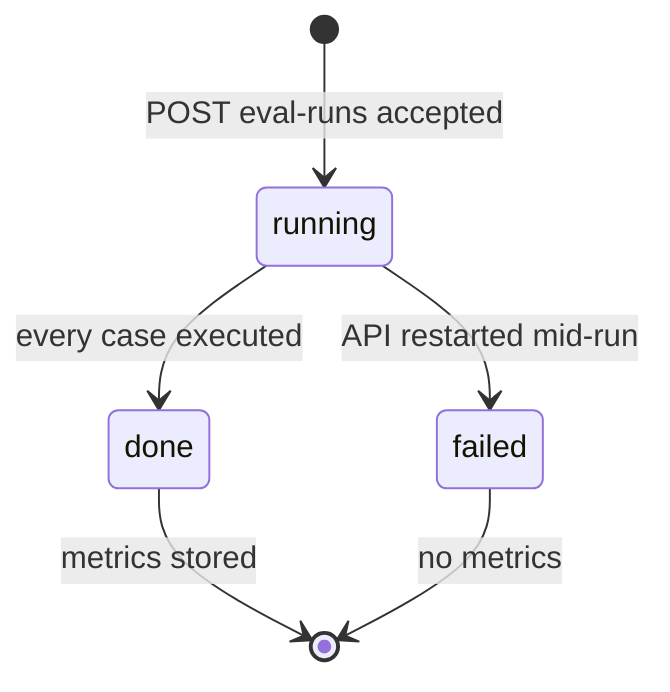
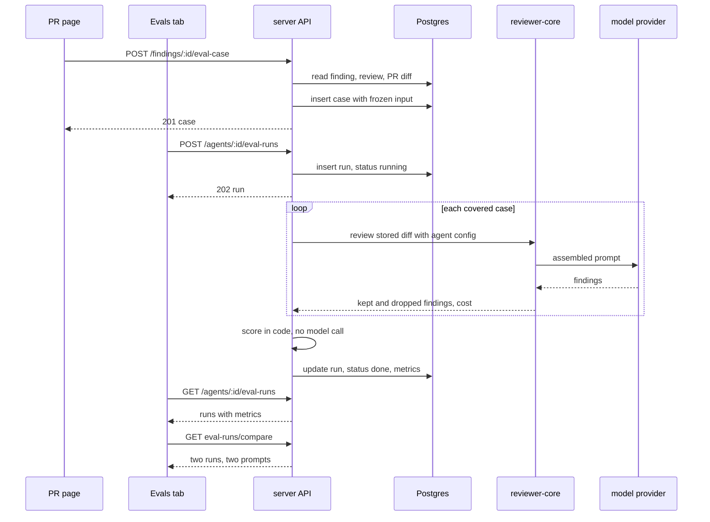

# Spec: Eval Pipeline
Spec ID: SPEC-03
Status: implemented
Supersedes: none

## Problem and user

An **agent author** edits a reviewer agent's system prompt, model or linked skills in the
agent editor, and every config change is already snapshotted as an agent version (IN-10).
Nothing tells the author whether the edit made the agent better or worse: the only check
today is to re-run the agent on pull requests and read the findings by eye (IN-1, IN-9).

A **reviewer** reading a PR already labels the agent's output: `POST /findings/:id/accept`
and `POST /findings/:id/dismiss` store `accepted_at` / `dismissed_at` on the finding
(IN-10). Those decisions are a labelled dataset that the product never reads back — an
accepted finding says "this is a real problem at this file and these lines", a dismissed
one says "this is noise" (IN-1: «Ваші accept/dismiss-рішення з L01–L05 і є датасет»).

A **repo owner** pays for every model call, so a regression check that costs one review
per case has to be started on purpose and never by opening a screen (IN-9).

The space is reserved and unused: the tables `eval_cases` and `eval_runs`, the `Eval*`
contracts in both `@devdigest/shared` copies, the `eval` message namespace, the `/eval`
sidebar key and the "Evals" tab label exist, and no route, screen or writer uses them
(IN-10, IN-11, IN-13).

The `evals/` package at the repository root is a different system (evals of the Claude
Code harness). This feature is a product feature in `server/` and `client/` and shares
nothing with it (NG-10).

## Goals / Non-goals

- **G-1** A reviewer turns an accepted or a dismissed finding into an eval case of the agent that produced it with one click, and the expectation type follows the decision: accepted → `must_find`, dismissed → `must_not_flag`.
- **G-2** An agent author sees every eval case of an agent's set in the agent editor and removes one created by mistake.
- **G-3** An agent author runs the agent on all cases of its set as one eval run whose inputs are frozen, so that runs of different agent versions are comparable.
- **G-4** Each eval run reports recall, precision and citation accuracy computed in code, with no model call in the scoring and no model call on any read.
- **G-5** An agent author opens the run history of an agent and compares two runs side by side — metric differences and the difference between the two system prompts.
- **G-6** A page in the left sidebar, Eval Dashboard, shows every agent's latest eval run and the most recent eval runs across agents.
- **G-7** The homework's acceptance bar is checkable: a set of at least 8 cases with both expectation types runs and scores as one run, and one command reports whether the feature's checks are green.

- **NG-1** Creating a case by hand or editing a case (the "New eval case" button, the edit icon, the case editor modal with its "Run on save" toggle) — it is the Case Editor stretch task with its own spec (IN-1, IN-2). Seam: a case is not required to have a source finding, and a run covers every case of the agent whatever its origin (AC-31).
- **NG-2** Trend visualisations: the METRIC TREND chart, the sparklines in metric tiles and in dashboard rows, the "30 days" range control — the trend-charts stretch task with its own spec (IN-1, IN-2). Seam: the run list returns each run's metrics, agent version, start time and cost (AC-64).
- **NG-3** Any model-based grading or model-written explanation of a metric — the homework's defining constraint (IN-1).
- **NG-4** Eval cases owned by a skill — the reserved `owner_kind` admits `skill`; only `agent` is written here (IN-9).
- **NG-5** Automatic runs — on prompt save, on opening a screen, on a schedule or in CI; every run is an explicit user action (IN-9 D11).
- **NG-6** Changing how reviews, findings, accept / dismiss, grounding or agent versioning work, and any change in `reviewer-core/` — the feature only consumes them (IN-9 N7, D6).
- **NG-7** An MCP tool for cases, runs or metrics — not in the homework (IN-1, IN-9 N9).
- **NG-8** A browser e2e flow — not in the homework; `e2e/` runs without a model (IN-14).
- **NG-9** Gating anything on a metric, such as a run that blocks a save, a merge or CI — the homework asks to read the numbers first; thresholds come later (IN-1 line 100, IN-9 N8).
- **NG-10** The other stretch tasks (a skill eval in `evals/`, the PreToolUse hook, mutation testing) and anything inside `evals/` — separate tasks (IN-1 lines 63+, IN-2).
- **NG-11** Closing the known gap of the engine's untrusted-data delimiter (a forged closing tag in author text) — an existing `reviewer-core` item that a live review carries today (IN-14, `server/INSIGHTS.md`).
- **NG-12** Showing eval runs on the existing run surfaces (PR run timeline, trace drawer, agent card statistics) — cost is shown on the eval screens only (IN-9 N13).
- **NG-13** Performing the homework experiment and recording the screenshot and the video — the user does it with the feature; the spec makes it possible (AC-79, AC-80).
- **NG-14** The "Run all agents" control of the Eval Dashboard frame (IN-4) — the user rejected it: it is not in the homework and one click starts agents × cases model calls (IN-15, DR-7). A run is started per agent (AC-45, AC-89).
- **NG-15** The "Promote vN" control of the Compare runs frame (IN-6) — the user rejected it: it is not in the homework (IN-15, DR-8). The compare view closes with Close only.
- **NG-16** The per-case run icon on the case rows of the Evals tab frame (IN-7) — the user rejected it: the homework asks for a run of all cases, and a metric over one case is 0 or 1 (IN-15, DR-9).

## User stories

- **US-1** As a reviewer, I want to turn an accepted finding into an eval case with one click, so that the agent is checked to keep finding that problem at that file and those lines.
- **US-2** As a reviewer, I want to turn a dismissed finding into an eval case with one click, so that the agent is checked to stop commenting there.
- **US-3** As an agent author, I want to see all cases of an agent's set, so that I know what the agent is measured against.
- **US-4** As an agent author, I want to delete a case, so that a case created by mistake does not skew the metrics.
- **US-5** As an agent author, I want to run the agent on all cases of its set, so that I get one comparable result per agent version.
- **US-6** As an agent author, I want to see recall, precision and citation accuracy of a run, so that I read the agent's quality as numbers.
- **US-7** As an agent author, I want to open the run history of an agent, so that I see how earlier versions scored.
- **US-8** As an agent author, I want to compare two runs side by side, so that I see what an old prompt and a new prompt each scored and how the prompts differ.
- **US-9** As an agent author, I want a system prompt change to move the metrics between two runs, so that a deliberately broken prompt shows as a lower precision.
- **US-10** As an agent author, I want an Eval Dashboard page in the sidebar, so that I see the latest eval runs of all agents in one place.
- **US-11** As an agent author, I want one agent's eval view on the dashboard, so that I read its latest metrics against the previous run and reach its runs from there.
- **US-12** As a repo owner, I want only an explicit run to call a model, so that opening eval screens and scoring cost nothing.
- **US-13** As a maintainer, I want one command and a set of at least 8 cases, so that the homework's acceptance bar is checked mechanically.
- **US-14** As an agent author, I want a run that partly failed to say which cases failed, so that I do not read a skewed score as the agent's quality.

## Acceptance criteria (EARS)

Terms. A **case** is a stored eval case owned by one agent. Its **expectation** is the
file and the line range in `expected_output`, with the type `must_find` or `must_not_flag`.
A **run** is one execution of an agent on a set of cases. A finding **matches** an
expectation when its `file` equals the expectation's `file` and its `start_line`–`end_line`
range shares at least one line with the expectation's range. A finding is **grounded**
when the engine's citation-grounding gate kept it (`reviewer-core/src/grounding.ts`). A
**completed** run is a run in status `done`.

### Creating a case from a finding — API

- **AC-1** [event-driven] WHEN `POST /findings/:id/eval-case` is called for an accepted finding that has no case, the API shall store one case owned by the agent of the finding's review with `expectation_type` `must_find` and answer 201 with the case. — covers: US-1 · verify: integration — an accepted finding yields one `eval_cases` row with `owner_kind` `agent`, the review's `agent_id` and `must_find`
- **AC-2** [event-driven] WHEN `POST /findings/:id/eval-case` is called for a dismissed finding that has no case, the API shall store one case owned by the agent of the finding's review with `expectation_type` `must_not_flag` and answer 201 with the case. — covers: US-2 · verify: integration — a dismissed finding yields one row with `must_not_flag`
- **AC-3** [ubiquitous] The API shall store in a created case's `expected_output` the source finding's `file`, `start_line`, `end_line`, `severity`, `category` and `title`. — covers: US-1 · verify: integration — the stored object equals the six values of the finding row
- **AC-4** [ubiquitous] The API shall store in a created case's `input_diff` the unified diff of the source finding's file alone, taken from the pull request's diff at creation time, and in `input_files` that one path. — covers: US-1 · verify: integration — for a PR with three changed files the stored diff holds the hunks of the finding's file and no other file
- **AC-5** [ubiquitous] The API shall store in a created case's `input_meta` the pull request's number, title, author and description as they are at creation time. — covers: US-1 · verify: integration — the four values equal the pull request row
- **AC-6** [ubiquitous] The API shall name a created case `must-find-` (for `must_find`) or `no-` (for `must_not_flag`) followed by the finding's title in lower case with every run of characters other than `a-z` and `0-9` replaced by one hyphen, cut to 34 characters. — covers: US-1 · verify: unit — "Hardcoded Stripe secret key in commit" accepted gives `must-find-hardcoded-stripe-secret-key-in-co`
- **AC-7** [unwanted] IF the finding is neither accepted nor dismissed, THEN the API shall answer 400 with code `finding_undecided` and store no case. — covers: US-1 · verify: integration — status, code and an unchanged row count
- **AC-8** [unwanted] IF a case with the same `source_finding_id` exists, THEN the API shall answer 200 with that case and store no second case. — covers: US-1 · verify: integration — two calls for one finding leave one row and return the same `id`
- **AC-9** [unwanted] IF the finding's review has no agent, or that agent no longer exists in the workspace, THEN the API shall answer 400 with code `eval_owner_missing` and store no case. — covers: US-1 · verify: integration — a review whose agent was deleted
- **AC-10** [unwanted] IF the finding's file is absent from the pull request's diff at creation time, or the finding's line range shares no line with a hunk of that file, THEN the API shall answer 400 with code `expectation_outside_diff` and store no case. — covers: US-1 · verify: integration — a finding whose lines lie outside every hunk of the stored patch
- **AC-11** [unwanted] IF the finding does not exist or belongs to another workspace, THEN the API shall answer 404 and store no case. — covers: US-1 · verify: integration — a finding of a second workspace
- **AC-12** [event-driven] WHEN the source finding's decision changes, or the finding, its review or its pull request is deleted, the API shall return the case with its `expectation_type`, `expected_output`, `input_diff`, `input_files` and `input_meta` unchanged. — covers: US-1 · verify: integration — dismiss a finding whose case is `must_find`, then delete its review; the case reads back identical

### Creating a case from a finding — PR page

- **AC-13** [ubiquitous] The PR page shall show a "Turn into eval case" control in the action row of every expanded finding card, after the Dismiss control. — covers: US-1 · verify: component — the control's accessible name and its position in the action row
- **AC-14** [state-driven] WHILE a finding is neither accepted nor dismissed, the PR page shall render the "Turn into eval case" control disabled with a hint that says to accept or dismiss the finding first. — covers: US-1 · verify: component — the control is disabled and carries the hint text
- **AC-15** [ubiquitous] The PR page shall give the "Turn into eval case" control the title "Create a 'must find' eval case from this finding" on an accepted finding and "Create a 'must NOT comment' eval case from this dismissal" on a dismissed finding. — covers: US-2 · verify: component — the two titles for the two decisions
- **AC-16** [event-driven] WHEN the reviewer activates the "Turn into eval case" control, the PR page shall send one `POST /findings/:id/eval-case` request for that finding without asking for any input. — covers: US-1 · verify: component — one mocked request, no dialog or form rendered
- **AC-17** [state-driven] WHILE the creation request of a finding is in flight, the PR page shall render that finding's "Turn into eval case" control disabled. — covers: US-1 · verify: component — a second click sends no second request
- **AC-18** [event-driven] WHEN the creation request answers 200 or 201, the PR page shall show beside the control a confirmation that names the expectation type and links to the Evals tab of the owning agent. — covers: US-1 · verify: component — the confirmation text and the link's `href` with `tab=evals`
- **AC-19** [unwanted] IF the creation request fails, THEN the PR page shall show the API's message beside the control and leave the control enabled. — covers: US-1 · verify: component — a mocked 400 `expectation_outside_diff` shows its message

### The case set — API and Evals tab

- **AC-20** [event-driven] WHEN `GET /agents/:id/eval-cases` is called, the API shall return every case of that agent, oldest first, each with `last_result` taken from the newest completed run that covered it, or null. — covers: US-3 · verify: integration — two cases, one covered by a run and one created after it
- **AC-21** [ubiquitous] The agent editor shall show an Evals tab after the Context tab, selected through the `tab=evals` URL parameter by the editor's existing tab mechanism. — covers: US-3 · verify: component — tab order and the tab rendered for `tab=evals`
- **AC-22** [ubiquitous] The Evals tab shall list every case of the agent with its name, its expectation type in words, the expectation's file with its line range, and the source finding's severity and category. — covers: US-3 · verify: component — a `must_find` and a `must_not_flag` row from a mocked response
- **AC-23** [ubiquitous] The Evals tab shall show on each case row the case's `last_result` as an icon with a text — passed or failed with "expected N, got M" where M is the number of matching findings, errored with its reason, or "never run" when `last_result` is null. — covers: US-3 · verify: component — the four states
- **AC-24** [ubiquitous] The Evals tab shall show above the list the number of cases and "P / R passing", where R is the number of cases that have a `last_result` and P the number of those that passed. — covers: US-3 · verify: component — 5 cases, 4 run, 3 passed gives "3 / 4 passing" and "5 cases"
- **AC-25** [state-driven] WHILE the agent has no case, the Evals tab shall show a message that a case is created from an accepted or a dismissed finding on a pull request, no metric value, and the run control disabled. — covers: US-3 · verify: component — an empty list response
- **AC-26** [state-driven] WHILE the case list is loading, the Evals tab shall show the loading text of the `eval` namespace in place of the list. — covers: US-3 · verify: component — a pending request
- **AC-27** [unwanted] IF a read of the Evals tab fails, THEN the Evals tab shall show the failure with a retry control in place of the block that failed. — covers: US-3 · verify: component — a mocked 500 and one more request after retry
- **AC-28** [event-driven] WHEN the agent author activates a case's delete control, the Evals tab shall ask for confirmation in a dialog that names the case before sending `DELETE /eval-cases/:id`. — covers: US-4 · verify: component — no request before confirm, one after
- **AC-29** [event-driven] WHEN `DELETE /eval-cases/:id` is called, the API shall delete the case and leave every stored run, its metrics and its per-case outcome with the case's name unchanged. — covers: US-4 · verify: integration — a run read after the deletion equals the run read before
- **AC-30** [event-driven] WHEN an agent is deleted, the API shall delete that agent's cases and runs. — covers: US-4 · verify: integration — `eval_cases` and `eval_runs` hold no row of the deleted agent

### Running the set — API

- **AC-31** [event-driven] WHEN `POST /agents/:id/eval-runs` is called for an agent that has at least one case and no run in status `running`, the API shall store a run in status `running` with the agent's current version and the ids of every case of the agent, whatever the agent's `enabled` flag, and answer 202 with the run before any case is executed. — covers: US-5 · verify: integration — the 202 body carries `status` `running`, `agent_version` and `case_ids`
- **AC-32** [ubiquitous] The API shall execute each covered case as one review of the case's `input_diff` by the review engine with the agent's current system prompt, provider, model, strategy and linked enabled skills. — covers: US-5 · verify: integration — with the mock provider, one structured call per case whose system message holds the agent's prompt and whose user message holds the case's diff
- **AC-33** [ubiquitous] The API shall build the model input of a case execution without a repo skeleton, a callers digest, a file-rank note, project context documents and a derived intent. — covers: US-5 · verify: integration — for an agent with repo intel on and attached documents, the recorded request holds none of those sections
- **AC-34** [ubiquitous] The API shall build the task line and the pull-request description of a case execution from the case's `input_meta` and from no live pull request row. — covers: US-5 · verify: integration — after the source pull request's title is changed, the recorded request still holds the stored title
- **AC-35** [ubiquitous] The API shall build the model input of a case execution without the case's name, `expectation_type` and `expected_output`. — covers: US-5 · verify: unit — the assembled input of a case holds none of the three values
- **AC-36** [ubiquitous] The API shall produce byte-identical model input for the same case in two runs between which the agent's config and its linked skills did not change. — covers: US-5 · verify: unit — assemble the input twice and compare the strings
- **AC-37** [unwanted] IF the execution of one case fails, THEN the API shall record that case's outcome as `error` with the failure's message and execute the remaining cases. — covers: US-14 · verify: integration — a provider that throws on the second of three cases yields two scored outcomes and one `error`
- **AC-38** [event-driven] WHEN every covered case has been executed, the API shall store the run with status `done`, its three metrics, its per-case outcomes, the counts of cases passed, failed and errored, the counts of findings produced and grounded, its duration and the sum of the executions' costs, the cost being null when any execution's cost is unknown. — covers: US-5 · verify: integration — `GET /eval-runs/:id` after the run settles
- **AC-39** [unwanted] IF the agent has no case, THEN the API shall answer 400 with code `eval_no_cases` and store no run. — covers: US-5 · verify: integration — status, code and an unchanged row count
- **AC-40** [unwanted] IF no key is configured for the agent's provider, THEN the API shall answer 400 with code `eval_provider_unavailable` and store no run. — covers: US-5 · verify: integration — a container whose provider lookup throws
- **AC-41** [state-driven + event-driven] WHILE a run of the agent is in status `running`, WHEN `POST /agents/:id/eval-runs` is called, the API shall answer 400 with code `eval_run_in_progress` and the id of the running run, and start no second run. — covers: US-5 · verify: integration — two calls in a row produce one run
- **AC-42** [event-driven] WHEN the API starts, the API shall set every run still in status `running` to `failed` with the error "interrupted". — covers: US-14 · verify: integration — a `running` row present before the app is built reads `failed` after
- **AC-43** [ubiquitous] The API shall write no row to `reviews`, `findings`, `agent_runs` and `run_traces` while it executes a run. — covers: US-12 · verify: integration — the four row counts before and after a run
- **AC-44** [unwanted] IF a case, a run or an agent named in a request to any eval route belongs to another workspace, THEN the API shall answer 404 and read, change and start nothing for it. — covers: G-3 · verify: integration — each eval route called with ids of a second workspace

### Running the set — Evals tab

- **AC-45** [ubiquitous] The Evals tab shall show a "Run all evals" control that states the number of cases the run will execute. — covers: US-5 · verify: component — the control's text for an agent with 8 cases
- **AC-46** [event-driven] WHEN the agent author activates the run control, the Evals tab shall send one `POST /agents/:id/eval-runs` request. — covers: US-5 · verify: component — one mocked request
- **AC-47** [state-driven] WHILE the agent's newest run is in status `running`, the Evals tab shall show a running state and render the run control disabled, also after the page is left and opened again. — covers: US-5 · verify: component — a run list whose first row is `running`
- **AC-48** [event-driven] WHEN the running run reaches status `done`, the Evals tab shall show that run's metrics, case outcomes and history row without a page reload. — covers: US-5 · verify: component — a run read that changes from `running` to `done`
- **AC-49** [unwanted] IF the start request is refused or the run ends in status `failed`, THEN the Evals tab shall show the API's message or the run's error and render the run control enabled. — covers: US-14 · verify: component — a mocked 400 `eval_run_in_progress` and a `failed` run

### Scoring

- **AC-50** [ubiquitous] The API shall count a finding as matching a case's expectation when the finding's `file` equals the expectation's `file` and the two line ranges share at least one line. — covers: US-6 · verify: unit — same file with ranges 10–12 and 12–20 matches; another file, or ranges 10–11 and 12–20, does not
- **AC-51** [ubiquitous] The API shall match against expectations only the findings that the engine's grounding gate kept. — covers: US-6 · verify: unit — a finding listed as dropped that overlaps the expectation yields no match
- **AC-52** [ubiquitous] The API shall record a `must_find` case as `pass` when at least one grounded finding of its execution matches its expectation, and as `fail` otherwise. — covers: US-6 · verify: unit — one match, and none
- **AC-53** [ubiquitous] The API shall record a `must_not_flag` case as `pass` when no grounded finding of its execution matches its expectation, and as `fail` otherwise. — covers: US-6 · verify: unit — none, and one match
- **AC-54** [ubiquitous] The API shall record with each case outcome `matched`, the number of grounded findings of that execution that match the expectation. — covers: US-6 · verify: unit — two overlapping findings give 2
- **AC-55** [ubiquitous] The API shall compute a run's `recall` as the number of `must_find` cases recorded as `pass` divided by the number of `must_find` cases recorded as `pass` or `fail`. — covers: US-6 · verify: unit — 3 of 4 gives 0.75
- **AC-56** [ubiquitous] The API shall compute a run's `precision` as one minus the number of grounded findings that match the expectation of their own `must_not_flag` case divided by the number of all grounded findings of the run. — covers: US-6 · verify: unit — one `must_not_flag` case with four grounded findings, one of them matching, gives 0.75
- **AC-57** [ubiquitous] The API shall compute a run's `citation_accuracy` as the number of grounded findings divided by the number of findings the executions produced before the grounding gate. — covers: US-6 · verify: unit — 3 kept and 1 dropped gives 0.75
- **AC-58** [unwanted] IF the divisor of a metric is zero, THEN the API shall store that metric as null. — covers: US-6 · verify: unit — a run of `must_not_flag` cases only has `recall` null; a run without findings has `precision` and `citation_accuracy` null
- **AC-59** [ubiquitous] The API shall leave the findings and the expectation of a case recorded as `error` out of every metric of the run. — covers: US-14 · verify: unit — three cases with one `error` score as the other two alone
- **AC-60** [ubiquitous] The Evals tab shall show tiles with recall, precision and citation accuracy of the agent's newest completed run as percentages, each with its difference in points from the previous completed run and the direction of that difference, and a tile with the cases passed of the cases covered. — covers: US-6 · verify: component — two completed runs give "82%" with "4pt" and an up marker; the fourth tile reads "17/20"
- **AC-61** [ubiquitous] The Evals tab shall show under the tiles a line that says scoring is done in code — a finding counts when the file matches and the line ranges overlap — with no model call. — covers: US-12 · verify: component — the line from the `eval` namespace
- **AC-62** [unwanted] IF a metric of a run is null, THEN the eval screens shall show "—" in place of that metric's percentage and no difference for that metric. — covers: US-6 · verify: component — a run with `recall` null
- **AC-63** [state-driven] WHILE the agent has cases and no completed run, the Evals tab shall show the tiles without values and the text that the set was never run. — covers: US-6 · verify: component — cases with an empty run list
- **AC-97** [ubiquitous] The API shall make no model call while it serves `POST /findings/:id/eval-case`, `DELETE /eval-cases/:id` and every `GET` route of the feature, and while it scores a run. — covers: US-12 · verify: integration — the mock provider's recorded calls stay empty across those routes and across scoring of stored execution outputs

### Run history and comparison

- **AC-64** [event-driven] WHEN `GET /agents/:id/eval-runs` is called, the API shall return the agent's runs newest first, at most 20, each with its status, start time, agent version, three metrics, case counts and cost. — covers: US-7 · verify: integration — 21 stored runs return the 20 newest in order
- **AC-65** [event-driven] WHEN `GET /eval-runs/:id` is called, the API shall return the run with its per-case outcomes, each holding the case's id and name, its expectation type, its status, `matched` and the grounded findings of the execution. — covers: US-7 · verify: integration — a settled run of two cases
- **AC-66** [ubiquitous] The Evals tab shall show the agent's run history as a table with one row per run — start time, agent version as `vN`, recall, precision, citation accuracy, cases passed of covered, and cost — newest first. — covers: US-7 · verify: component — two rows from a mocked response, in order
- **AC-67** [ubiquitous] The API shall store with each run the provider, the model and the names of the linked enabled skills the run used. — covers: US-8 · verify: integration — a run of an agent with two linked skills
- **AC-68** [state-driven] WHILE exactly two completed runs are selected in a run history table, the eval screen shall render the Compare control enabled and show "2 selected"; a third selection replaces the earliest of the two. — covers: US-8 · verify: component — select one, two, then a third row
- **AC-69** [state-driven] WHILE the agent has fewer than two completed runs, the eval screen shall render the Compare control disabled with a hint that a second run is needed. — covers: US-8 · verify: component — one completed run
- **AC-70** [event-driven] WHEN `GET /agents/:id/eval-runs/compare` is called with `base` and `head` naming two completed runs of that agent, the API shall return for each run its agent version, its system prompt from that version's stored snapshot, its metrics and its cost, ordered by start time whatever the order of the parameters. — covers: US-8 · verify: integration — the same response for `base`/`head` swapped
- **AC-71** [unwanted] IF `base` or `head` names a run that is not completed or is not a run of that agent, THEN the API shall answer 400 with code `eval_runs_not_comparable`. — covers: US-8 · verify: integration — a `running` run and a run of another agent
- **AC-72** [unwanted] IF the two runs do not hold a `pass` or `fail` outcome for the same set of cases, THEN the API shall return the metrics of both runs computed over the cases that have a `pass` or `fail` outcome in both, with the names of the cases left out of each run. — covers: US-8 · verify: integration — a run taken before a case was added compared with one taken after
- **AC-73** [event-driven] WHEN the agent author activates the Compare control, the compare view shall show for recall, precision, citation accuracy and cost the older run's value, the newer run's value and the difference between them with its direction. — covers: US-8 · verify: component — 78% → 82% with "4pt" and an up marker; 0.21 → 0.23 with "0.02"
- **AC-74** [ubiquitous] The compare view shall name the two agent versions in its title as "Compare runs · vA → vB", the older run first. — covers: US-8 · verify: component — the title for versions 6 and 7
- **AC-75** [ubiquitous] The compare view shall show the difference between the two system prompts, with removed text and added text each marked by a label or a text decoration in addition to colour. — covers: US-8 · verify: component — one line added to the newer prompt is marked as added
- **AC-76** [unwanted] IF the two system prompts are identical, THEN the compare view shall say that the system prompt did not change, in place of the difference. — covers: US-8 · verify: component — two runs of one agent version
- **AC-77** [unwanted] IF the compare response names cases left out of a run, THEN the compare view shall say that the two runs covered different cases, list those cases, and say that the values are computed over the cases common to both. — covers: US-8 · verify: component — a response with one case left out
- **AC-78** [unwanted] IF the two runs differ in provider, model or skill names, THEN the compare view shall list those differences above the prompt difference. — covers: US-8 · verify: component — two runs with different models
- **AC-79** [event-driven] WHEN an agent's system prompt is changed between two runs, the API shall store the later run with the higher agent version, so that the compare response holds two different system prompts. — covers: US-9 · verify: integration — run, `PUT /agents/:id` with a new prompt, run, compare
- **AC-80** [event-driven] WHEN a later run over the same cases holds a grounded finding that matches a `must_not_flag` case's expectation and the earlier run holds none, the API shall store a lower `precision` for the later run than for the earlier one. — covers: US-9 · verify: integration — the mock provider returns an overlapping finding in the second run only

### Eval Dashboard

- **AC-81** [ubiquitous] The sidebar shall show an "Eval Dashboard" item in the SKILLS LAB section after Conventions that links to `/eval` and is marked active on every path that starts with `/eval`. — covers: US-10 · verify: component — the item, its `href` and its active state
- **AC-82** [event-driven] WHEN `GET /eval/dashboard` is called, the API shall return every agent of the workspace with its newest completed run or null, and the 6 newest completed runs across all agents, each with its agent's name. — covers: US-10 · verify: integration — three agents, one without runs, eight runs in all
- **AC-83** [ubiquitous] The Eval Dashboard shall list every agent with its name, its model, the line "Last run vN · start time · P/T pass" and the recall, precision and citation accuracy of its newest completed run. — covers: US-10 · verify: component — a row from a mocked response
- **AC-84** [state-driven] WHILE an agent has no completed run, the Eval Dashboard shall show "No eval runs yet" on that agent's row and "—" for its three metrics. — covers: US-10 · verify: component — an agent whose newest run is null
- **AC-85** [ubiquitous] The Eval Dashboard shall show under the agents a table "Recent eval runs · all agents" with one row per returned run — agent name, start time, agent version, the three metrics and cases passed of covered — or a text that no run exists yet. — covers: US-10 · verify: component — six rows, and the empty text
- **AC-86** [event-driven] WHEN the agent author activates an agent row or a recent-run row, the Eval Dashboard shall open that agent's eval view at a URL of its own under `/eval`, which a reload restores. — covers: US-10 · verify: component — the navigation target, and the view rendered from that URL
- **AC-87** [ubiquitous] The agent's eval view shall show the agent's name and model, the number of its runs and of its cases, an "All agents" control that returns to the Eval Dashboard, and a control that switches to another agent's eval view. — covers: US-11 · verify: component — header texts and the two navigation targets
- **AC-88** [ubiquitous] The agent's eval view shall show tiles with recall, precision and citation accuracy of the newest completed run, each with its difference from the previous completed run and the direction of that difference. — covers: US-11 · verify: component — two completed runs
- **AC-89** [ubiquitous] The agent's eval view shall show the agent's run history table with the selection, the Compare control, the compare view and a "Run eval" control that behave as AC-45…AC-49, AC-66 and AC-68…AC-78 state for the Evals tab. — covers: US-11 · verify: component — select two rows, open the compare view, start a run
- **AC-90** [state-driven] WHILE the precision of the agent's newest completed run is lower than that of the previous completed run, the agent's eval view shall show a banner "Precision dipped Npts on vK" with the difference in points and the newer run's agent version. — covers: US-11 · verify: component — 0.93 then 0.91 on version 7 gives "2pts" and "v7"; equal values give no banner
- **AC-91** [state-driven] WHILE that banner is shown, the agent's eval view shall name in it the `must_not_flag` cases that are `fail` in the newest completed run and `pass` in the previous one, and state no other cause. — covers: US-11 · verify: component — one such case is named; with none the banner ends after the version
- **AC-92** [ubiquitous] The Evals tab shall show a "View full dashboard" link that opens the agent's eval view. — covers: US-11 · verify: component — the link's `href`

### The homework bar

- **AC-93** [ubiquitous] The API shall execute and score as one run a set of 8 cases of one agent that holds at least one `must_find` and at least one `must_not_flag` case. — covers: US-13 · verify: integration — eight cases, mock provider, a `done` run with eight outcomes and three metrics
- **AC-94** [optional] WHERE the user runs the eval fixture command for a named agent, the eval fixture command shall insert for that agent the fixture cases it does not hold yet and change no other row. — covers: US-13 · verify: integration — two runs of the command leave the same rows as one; every other table is unchanged
- **AC-95** [ubiquitous] The seed command and the API start shall create no eval case and no eval run. — covers: US-13 · verify: integration — `eval_cases` and `eval_runs` are empty after migrate, seed and app build
- **AC-96** [ubiquitous] The `verify:l06` command of `server/` shall exist as a script of `server/package.json` and exit with code 0 when the feature's server unit tests and integration tests pass, the integration tests skipping themselves when Docker is absent. — covers: US-13 · verify: manual — the user or CI runs `cd server && pnpm verify:l06`; a test does not start its own runner

## Edge cases

- **EC-1** A finding is accepted, turned into a case, then dismissed → the case stays `must_find` — covered by: AC-12
- **EC-2** The control is clicked twice, or in two tabs → one case — covered by: AC-8, AC-17
- **EC-3** The same problem is stored as several finding rows, because findings are not deduplicated between review runs (`server/INSIGHTS.md`) → each finding row yields its own case; an unwanted one is deleted — covered by: AC-8, AC-28
- **EC-4** The pull request's head moved after the review, and the finding's lines are no longer in the diff → the case is refused with the reason — covered by: AC-10
- **EC-5** The finding's file has no stored patch (a binary file, or a file beyond the first 100 of a large PR when the diff is rebuilt from stored files) → refused — covered by: AC-10
- **EC-6** A full-file finding (`secret_leak`, `lethal_trifecta`, `phantom`, `hook`) whose lines lie outside every hunk → refused, because no grounded line-matched finding could ever satisfy it — covered by: AC-10
- **EC-7** The review's agent was deleted, or the review has no agent → refused — covered by: AC-9
- **EC-8** Findings accepted or dismissed before this feature existed → valid sources; no stored finding is changed — covered by: AC-1, AC-2
- **EC-9** The source finding, review, pull request or repository is deleted → the case still runs from its stored input — covered by: AC-12, AC-34
- **EC-10** A `must_find` case the agent never matched → `fail`, not `error` — covered by: AC-52
- **EC-11** The agent returns no finding for every case → `recall` 0, `precision` and `citation_accuracy` null — covered by: AC-55, AC-58
- **EC-12** The agent returns findings only outside every expectation → `precision` stays 1 while `recall` falls; a consequence of the homework's definition — covered by: AC-56
- **EC-13** A finding spans many lines and overlaps the expectation by one line → it matches — covered by: AC-50
- **EC-14** One of N case executions fails → the run completes, the case is `error`, the metrics leave it out — covered by: AC-37, AC-59
- **EC-15** Every case execution fails → the run is `done` with every outcome `error` and three null metrics — covered by: AC-37, AC-58
- **EC-16** The API restarts or its process dies during a run → the run reads `failed` after the next start and no longer blocks a new run — covered by: AC-42
- **EC-17** Two start requests arrive for one agent, or from two tabs → one run — covered by: AC-41
- **EC-18** The agent author leaves the page during a run → the run continues on the server and the running state is shown on return — covered by: AC-47
- **EC-19** A set of many cases takes minutes → the start request answers before execution — covered by: AC-31
- **EC-20** Cases were added or deleted between the two compared runs, or a case errored in one of them → values over the common cases, the rest named — covered by: AC-72, AC-77
- **EC-21** A case is deleted after runs covered it → those runs keep its outcome and name — covered by: AC-29
- **EC-22** Two runs of the same agent version are compared → the prompt is reported unchanged — covered by: AC-76
- **EC-23** Linked skills, or the body of a linked skill, change between two runs: the agent's version stays the same (`server/src/modules/agents/helpers.ts:64`, `repository.ts:244`), so the two runs carry one version and one prompt → each run stores its provider, model and skill names and the comparison lists a difference in them; an edited skill body under an unchanged name stays invisible — covered by: AC-67, AC-78
- **EC-24** The agent's model has no price → the run's cost is null and shown as "—" — covered by: AC-38, AC-62
- **EC-25** No key is configured for the agent's provider → refused before a run is stored — covered by: AC-40
- **EC-26** The agent is disabled → its set still runs — covered by: AC-31
- **EC-27** An agent with cases is deleted → its cases and runs go with it; `eval_cases.owner_id` has no foreign key, so nothing cascades in the database — covered by: AC-30
- **EC-28** The finding's file has a very large diff (a lockfile, generated code), replayed to the model on every run → no size limit applies; the case is created with the whole diff of the file — covered by: AC-4
- **EC-29** The reserved tables `eval_cases` / `eval_runs` hold rows when the migration is applied (0 rows each on the user's database on 2026-10-12, IN-15) → whoever applies the migration counts the rows first and stops to ask the user when the count is not zero; the migration deletes no row — covered by: NFR-8
- **EC-30** Docker is absent when `verify:l06` runs → the integration tests skip themselves and the command stays green (`server/AGENTS.md` § Gotchas) — covered by: AC-96
- **EC-31** A finding's `severity` is a string the UI has no style for (the column is free text) → stored and shown as text — covered by: AC-3, AC-22

## Non-functional requirements

- **NFR-1** [cost] Scoring a run makes no model call and imports no model provider. — verify: unit — scoring stored execution outputs leaves the mock provider's `calls` empty; `grep -rn` over the scoring source finds no import from `adapters/llm` or of a provider type
- **NFR-2** [cost] A run makes one engine review per covered case and no other model call; no intent derivation, brief or repo-intel call is started by it. — verify: integration — with strategy `single-pass`, the mock provider records as many structured calls as the run has cases
- **NFR-3** [cost] `POST /agents/:id/eval-runs` is limited to 10 requests per minute, the limit `POST /pulls/:id/review` carries (`server/src/modules/reviews/routes.ts:29`). — verify: integration — the route's rate-limit config
- **NFR-4** [security] A case's `input_diff` and the title and description in `input_meta` reach the model only as untrusted data, through the same engine path as a live review; no second prompt assembly is introduced. — verify: unit — in the assembled input the diff and the description stand inside the engine's untrusted-data blocks and the system message holds neither
- **NFR-5** [security] Case names, expectation titles, findings of a run and system prompts are rendered as text on every eval screen, never as markup. — verify: component — a case named `` appears as visible text and adds no `img` element
- **NFR-6** [security] Every eval route declares Zod schemas for its params and query; `POST /findings/:id/eval-case` accepts no body field, so no client-supplied diff or expectation is stored by this feature. — verify: integration — a non-uuid id answers 422; a body with `input_diff` does not change the stored case
- **NFR-7** [compatibility] The eval case and eval run record shapes replace the reserved `EvalCase`, `EvalCaseInput`, `EvalRun`, `EvalPerTrace`, `EvalRunRecord`, `EvalRunResult`, `EvalTrendPoint` and `EvalDashboard` declarations where they change, in both `@devdigest/shared` copies with identical text, and the existing difference between the two `eval-ci.ts` copies (`AgentManifest`, the `ConformanceInput.provider` enum) does not grow. — verify: unit — a check that compares the eval declarations of the two copies
- **NFR-8** [compatibility] The feature stores its data in the reserved tables `eval_cases` and `eval_runs`, changed by new migration files only; no other table is altered, no applied migration file is edited, the migration deletes no row, and it is applied only after `eval_cases` and `eval_runs` are counted and found empty — a count other than zero stops the work until the user decides. — verify: manual — the two counts are taken, the migration SQL is read, then applied to a restored copy of the dev database and every other table is compared row by row (`INSIGHTS.md` § What Works, 2026-09-24); a test database cannot show the user's rows
- **NFR-9** [compatibility] The responses of `GET /agents`, `GET /agents/:id/versions`, `GET /pulls/:id/reviews`, `POST /findings/:id/accept` and `POST /findings/:id/dismiss` and every MCP tool stay as they are; `reviewer-core/` is not modified. — verify: integration — the existing server and `mcp/` suites pass unchanged; `git status --short reviewer-core` is empty
- **NFR-10** [i18n] Every string of the feature comes from `client/messages/en/` (`eval`, `prReview`, `agents`, `shell`); counts use ICU plural forms, and every number that exceeds 999 is a typed `{x, number}` argument. — verify: component — tests render with the real message files; `grep -rn` finds no literal UI string in the feature's components
- **NFR-11** [accessibility] The "Turn into eval case", run, compare, delete and close controls and the run-selection checkboxes are native buttons or inputs with an accessible name; pass, fail, error and the direction of a difference are carried by an icon or a text in addition to colour; a change of a run's status is announced through a live region; the compare view and the delete dialog close on Escape and return focus to the control that opened them. — verify: component — queries by role and name, the live region's text after a status change, focus after close
- **NFR-12** [observability] The API writes one log line when a run starts and one when it settles, with the run id, agent id, agent version, case counts, the three metrics, tokens, cost and duration, and never diff text, expectation text or finding text. — verify: integration — the two log records of a run and the absence of the fixture diff's text in them
- **NFR-13** [performance] `GET /agents/:id/eval-runs` returns at most 20 runs (IN-15) without per-case findings, `GET /eval/dashboard` at most 6 recent runs (`docs/design/Dev Digest 2/Dev Digest/screen_skills.jsx:343`), and every eval read is served from stored rows without reading a clone or calling GitHub. — verify: integration — response sizes with 21 runs stored; reads succeed with the mock git and GitHub clients recording no call

## Module interactions

Packages: server, client
Surfaces: the finding card on the PR page (the "Turn into eval case" control); the Evals tab of the agent editor; the Eval Dashboard page and the agent's eval view under `/eval`; the compare view; the sidebar item; the routes `POST /findings/:id/eval-case`, `GET /agents/:id/eval-cases`, `DELETE /eval-cases/:id`, `POST /agents/:id/eval-runs`, `GET /agents/:id/eval-runs`, `GET /agents/:id/eval-runs/compare`, `GET /eval-runs/:id`, `GET /eval/dashboard`; the changed `DELETE /agents/:id`; the eval fixture command; the `verify:l06` command

| # | From → To | Channel | Carries | Exists today | If it fails |
|---|---|---|---|---|---|
| MI-1 | client → server | `POST /findings/:id/eval-case` | no body; the case record back | new | the API's message beside the control (AC-19) |
| MI-2 | server, eval → server, reviews and pulls data | the finding with its review and pull request; the pull request's diff | `file`, lines, `severity`, `category`, `title`, `accepted_at` / `dismissed_at`, the review's `agent_id`; number, title, author, body; the diff of one file | yes (`server/src/modules/reviews/repository/review.repo.ts:103`, `server/src/modules/reviews/diff-loader.ts:11`) | 404 or 400 with a code (AC-9…AC-11) |
| MI-3 | client → server | `GET /agents/:id/eval-cases`, `DELETE /eval-cases/:id` | case records with `last_result` | new | the read-failure state with retry (AC-27); the dialog shows why a delete failed |
| MI-4 | client → server | `POST /agents/:id/eval-runs` | no body; 202 with the run record in `running` | new | the API's message (AC-49) |
| MI-5 | server, eval → reviewer-core | `reviewPullRequest` | system prompt, model, strategy, skill blocks, the stored diff, task line, description; back: kept findings, `dropped`, tokens, `costUsd` | yes (`reviewer-core/src/review/run.ts:144`, `:238`; the server calls it at `server/src/modules/reviews/run-executor.ts:358`) | the case is `error` (AC-37) |
| MI-6 | server, eval → server, agents and skills data | the agent row, its linked enabled skills, an agent version's snapshot | `system_prompt`, provider, model, strategy, `version`; skill names and bodies; `config_json.system_prompt` | yes (`server/src/modules/agents/repository.ts:148`, `server/src/modules/reviews/deps.ts:28`) | 404 for an unknown agent; a version without a snapshot makes the runs not comparable (AC-71) |
| MI-7 | reviewer-core → model provider | the injected provider | the assembled prompt | yes (`server/src/modules/reviews/run-executor.ts:299`) | a missing key refuses the run (AC-40); an error during a case marks it `error` |
| MI-8 | client → server | `GET /agents/:id/eval-runs`, `GET /eval-runs/:id` | run records; the client reads them again until the run settles | new | the read-failure state; a `failed` run shows its error |
| MI-9 | client → server | `GET /agents/:id/eval-runs/compare?base=&head=` | two run summaries, two system prompts, the cases left out | new | the compare view shows the API's message |
| MI-10 | client → server | `GET /eval/dashboard` | agents with their newest completed run; 6 recent runs | new | the dashboard's failure state with retry |
| MI-11 | client → server | the existing `GET /agents` and `GET /agents/:id` | the agent list and the editor's agent | yes (`server/src/modules/agents/routes.ts:74`) | unchanged |
| MI-12 | server, agents → server, eval | `DELETE /agents/:id` | the agent id whose cases and runs are deleted | changes (`server/src/modules/agents/service.ts:79` deletes the agent row only) | the delete fails as a whole |
| MI-13 | server → Postgres | `eval_cases`, `eval_runs` | cases; runs with metrics, per-case outcomes, agent version, covered case ids | changes (`server/src/db/schema/eval.ts:7`, `:22` — both tables exist since the first migration, nothing reads or writes them, and `eval_runs` holds one row per case with no agent version) | a failed write fails the request; a run whose final write fails stays `running` until AC-42 |
| MI-14 | mcp → server | the existing routes | unchanged; no tool reads or starts an eval | yes (`mcp/src/api/http-client.ts:104`) | unchanged |

### Contracts

Wire JSON is snake_case. Both `@devdigest/shared` copies carry the same declarations
(NFR-7). A status in the tables is the HTTP status; a code is the `code` of the error body
the API's error handler already produces (`server/src/platform/errors.ts`).

**Eval case record**

| Field | Type | Notes |
|---|---|---|
| `id` | string | |
| `owner_kind` | `'agent'` | the reserved enum keeps `'skill'`; nothing writes it (NG-4) |
| `owner_id` | string | the agent |
| `name` | string | AC-6 |
| `expectation_type` | `'must_find'` \| `'must_not_flag'` | fixed at creation |
| `expected_output` | `{ file: string, start_line: int, end_line: int, severity: string, category: string, title: string }` | replaces the reserved untyped value |
| `input_diff` | string | the unified diff of one file |
| `input_files` | string[] | one path |
| `input_meta` | `{ pr_number: int, pr_title: string, pr_author: string, pr_body: string \| null }` | |
| `source_finding_id` | string \| null | null is left for cases with no source finding (NG-1) |
| `notes` | string \| null | reserved; not written here |
| `created_at` | string | |
| `last_result` | `{ run_id: string, status: 'pass' \| 'fail' \| 'error', matched: int, error: string \| null }` \| null | on `GET /agents/:id/eval-cases` |

**Eval run record**

| Field | Type | Notes |
|---|---|---|
| `id` | string | |
| `agent_id` | string | |
| `agent_version` | int | the agent's version when the run started |
| `status` | `'running'` \| `'done'` \| `'failed'` | |
| `started_at` | string | |
| `duration_ms` | int \| null | null while `running` |
| `recall`, `precision`, `citation_accuracy` | number 0–1 \| null | null while `running`, on `failed`, and by AC-58 |
| `cases_total`, `cases_passed`, `cases_failed`, `cases_errored` | int | |
| `findings_total`, `findings_grounded` | int | before and after the grounding gate |
| `cost_usd` | number \| null | AC-38 |
| `provider`, `model` | string | AC-67 |
| `skills` | string[] | names; AC-67 |
| `case_ids` | string[] | the covered cases |
| `error` | string \| null | set on `failed` |
| `results` | per-case outcome[] | on `GET /eval-runs/:id` only |

Per-case outcome: `{ case_id: string, case_name: string, expectation_type, status: 'pass' | 'fail' | 'error', matched: int, findings: { file, start_line, end_line, severity, category, title }[], error: string | null }`.

**Routes**

| Route | Success | Errors |
|---|---|---|
| `POST /findings/:id/eval-case` | 201 case; 200 the existing case | 404; 400 `finding_undecided`, `eval_owner_missing`, `expectation_outside_diff`; 422 params |
| `GET /agents/:id/eval-cases` | 200 case[] | 404 |
| `DELETE /eval-cases/:id` | 200 `{ ok: true }` | 404 |
| `POST /agents/:id/eval-runs` | 202 run | 404; 400 `eval_no_cases`, `eval_provider_unavailable`, `eval_run_in_progress` (with `run_id` in the details); 429 |
| `GET /agents/:id/eval-runs` | 200 run[] without `results` | 404 |
| `GET /eval-runs/:id` | 200 run with `results` | 404 |
| `GET /agents/:id/eval-runs/compare?base=<run id>&head=<run id>` | 200 `{ base, head, cases_only_in_base: string[], cases_only_in_head: string[] }`, where `base` is the older run and each side is `{ run_id, agent_version, system_prompt, provider, model, skills, started_at, recall, precision, citation_accuracy, cost_usd, cases_total, cases_passed }` | 404; 400 `eval_runs_not_comparable`; 422 query |
| `GET /eval/dashboard` | 200 `{ agents: { agent_id, name, model, latest_run: run \| null }[], recent_runs: (run & { agent_name: string })[] }` | — |

## Design review

Sources reviewed: IN-3, IN-4, IN-5, IN-6, IN-7, IN-8

| # | Kind | Finding | Proposal | Decision |
|---|---|---|---|---|
| DR-1 | inconsistency | IN-3 draws the control between "Learn" and "Reply to author"; the finding card today has Accept and Dismiss only (`client/src/app/repos/[repoId]/pulls/[number]/_components/FindingCard/FindingCard.tsx:91`) | Place the control after Dismiss; Learn and Reply are not added | accepted → AC-13 |
| DR-2 | inconsistency | The prototype of IN-3 (`findings.jsx:25`, `:31`) treats a finding with no decision as "must find"; IN-1 derives the type from the decision («accepted → must_find, dismissed → must_not_flag») and IN-9 offers the action on decided findings only | Disabled with a hint until the finding is decided | accepted → AC-14 |
| DR-3 | missing state | No frame shows what follows the click on IN-3, a failed creation, or a failed read on IN-7 | An inline confirmation with a link to the agent's Evals tab; the API's message on failure; a retry control on a failed read | accepted → AC-18, AC-19, AC-27 |
| DR-4 | inconsistency | IN-1 puts the run history into the Evals tab («список кейсів, історія прогонів»); IN-7 draws the tab without it and IN-5 draws it on the agent's dashboard view | The history table with selection and Compare on both | accepted → AC-66, AC-89 |
| DR-5 | module | IN-7 draws "New eval case" and an edit icon per row; IN-8 is the case editor with "Run on save" | Left to the Case Editor spec | rejected — NG-1 (IN-1, IN-2) |
| DR-6 | module | IN-5 draws the METRIC TREND chart, sparklines in the tiles and a "30 days" control; IN-4 draws a sparkline per agent | Left to the trend-charts spec | rejected — NG-2 (IN-1, IN-2) |
| DR-7 | ux | IN-4 draws "Run all agents"; IN-1 does not ask for it, and one click would start agents × cases model calls | Not included; if taken, a confirmation that states the total number of executions | rejected — the user declined it (IN-15); NG-14 |
| DR-8 | ux | IN-6 draws "Promote v7"; IN-1 does not ask for it, and the newer version is already the agent's current config unless it was edited again | Not included | rejected — the user declined it (IN-15); NG-15 |
| DR-9 | ux | IN-7 draws a run icon per case; IN-1 asks for a run of all cases, and a metric over one case is 0 or 1 | Not included | rejected — the user declined it (IN-15); NG-16 |
| DR-10 | inconsistency | The banner of IN-5 ends with "a new false positive slipped in. Recall and citation both up." as fixed text of the prototype (`screen_skills.jsx:437`) | State the dip and the version; name the `must_not_flag` cases that newly fail and no other cause (IN-9 D12) | accepted → AC-90, AC-91 |
| DR-11 | missing state | No frame shows an agent without cases, a set never run, a single run, or a metric with a zero divisor; the prototype shows "—" for an agent without runs (`screen_skills.jsx:339`) | The states of IN-9 (AC-46…AC-48, AC-20 there) | accepted → AC-25, AC-58, AC-62, AC-63, AC-69, AC-84 |
| DR-12 | module | The reserved `eval_runs` row is one execution of one case with no agent version, and the reserved `EvalRun` has non-nullable metrics (`server/src/db/schema/eval.ts:22`, `server/src/vendor/shared/contracts/knowledge.ts:58`); a run of a set, a null metric and a version do not fit | Reshape the two reserved tables and the reserved contracts instead of adding parallel ones (IN-9 D1…D5) | accepted → NFR-7, NFR-8 |
| DR-13 | module | Linking or unlinking a skill does not create an agent version (`server/src/modules/agents/helpers.ts:64`, `repository.ts:244`), while IN-1 names a linked skill as one of the three things a user changes before a run; IN-6 compares versions only | Store provider, model and skill names with the run and list their differences in the compare view | accepted → AC-67, AC-78 |
| DR-14 | inconsistency | IN-7 labels a `must_not_flag` row "empty []"; the prototype labels it "assert empty" and adds a type badge (`data2.jsx:31`, `components2.jsx:85`) | Name the expectation type in words on every row | accepted → AC-22 |
| DR-15 | ux | No frame says that a run costs one model call per case; the reserved copy has "Run eval ({count})" (`client/messages/en/eval.json:7`) | The run control states the number of cases | accepted → AC-45 |
| DR-16 | corner case | The prototype keeps at most two selected runs by dropping the earliest (`screen_skills.jsx:413`); IN-5 shows "2 selected" | Keep that behaviour | accepted → AC-68 |
| DR-17 | module | The sidebar key `eval` and its label are reserved (`client/src/components/app-shell/helpers.ts:35`, `client/messages/en/shell.json:24`) and `client/src/vendor/ui/nav.ts` has no item; the prototype places it after Conventions (`chrome.jsx:13`) | Add the item there | accepted → AC-81 |
| DR-18 | inconsistency | The compare view of IN-6 colours a higher cost green, as an improvement (`screen_skills.jsx:314`) | Show the cost difference with its direction and no good-or-bad colour | rejected — the criterion asks for value and direction only (AC-73); the colour stays with the implementation of the design |
| DR-19 | module | The reserved `evalsTab.emptyCases` copy tells the user to create a case by hand (`client/messages/en/eval.json:66`), which is NG-1 | Reword it to the path that exists: from a finding | accepted → AC-25 |

## Inputs and provenance

| # | Source | Kind | Used for |
|---|---|---|---|
| IN-1 | homework text, `course-materials/materials/lesson6/hw6_description.txt:1-60`: «створити eval case з реальної знахідки одним кліком: з accepted — «має знайти X у file:line», з dismissed — «НЕ має коментувати Y»» · «побачити всі кейси набору агента» · «запустити прогін агента на всіх кейсах» · «побачити метрики прогону: recall / precision / citation_accuracy» · «відкрити історію прогонів і порівняти два поруч — «старий промпт vs новий»» · «Зробіть роут POST /agents/:id/eval-runs — прогін агента на всіх кейсах набору. Входи зафіксовані, щоб прогони різних версій агента були порівнянні.» · «знахідка зарахована, коли збігається файл і перетинаються рядки. Звідси recall (частка очікуваного, що знайдено), precision (частка знахідок, що не шум — dismissed-кейси працюють саме тут) і citation_accuracy (частка знахідок, що пережили grounding gate)» · «вкладка Evals в AgentEditor — список кейсів, історія прогонів» · «окрему сторінку в лівому сайдбарі - Eval Dashboard для агентів. Покажіть останні evals які були запущені» · «у наборі ≥8 кейсів» · «зміна system prompt видимо рухає recall/precision між двома прогонами» · «скоринг не робить жодного LLM-виклику» · «pnpm verify:l06 зелений» | user text | Problem, G-1…G-7, US-1…US-10, US-13, the metric definitions |
| IN-2 | task text of the calling session, 2026-10-12: the Core part only; Case Editor and trend charts are non-goals with seams; SPEC-03; dev-database writes are additive only and nothing is re-seeded without the user asking; contracts change in both copies; "Promote" and "Run all agents" are proposals; where the homework, a design source, the code or the course reference answers a question, the answer is taken from that source with its provenance | user text | NG-1, NG-2, NG-10, NFR-7, NFR-8, AC-95; the origin `stated` of items taken from IN-9 |
| IN-3 | `course-materials/materials/lesson6/i/img.png` (PR detail, the finding card's action row) with `docs/design/Dev Digest 2/Dev Digest/findings.jsx:19-45` | figma export | AC-6, AC-13, AC-15, DR-1…DR-3 |
| IN-4 | `course-materials/materials/lesson6/i/img_1.png` (Eval Dashboard) with `docs/design/Dev Digest 2/Dev Digest/screen_skills.jsx:330-393` and `chrome.jsx:13` | figma export | AC-81…AC-86, DR-6, DR-7, DR-17 |
| IN-5 | `course-materials/materials/lesson6/i/img_2.png` (one agent's dashboard view) with `docs/design/Dev Digest 2/Dev Digest/screen_skills.jsx:395-445` | figma export | AC-66, AC-68, AC-87…AC-91, DR-4, DR-6, DR-10, DR-16 |
| IN-6 | `course-materials/materials/lesson6/i/img_3.png` (Compare runs modal) with `docs/design/Dev Digest 2/Dev Digest/screen_skills.jsx:285-329` | figma export | AC-73…AC-75, DR-8, DR-18 |
| IN-7 | `course-materials/materials/lesson6/i/img_4.png` (agent editor, Evals tab) with `docs/design/Dev Digest 2/Dev Digest/screen_agents.jsx:163-200`, `components2.jsx:75-90` and `data2.jsx:26-36` | figma export | AC-21…AC-24, AC-28, AC-45, AC-60, AC-61, AC-92, DR-5, DR-9, DR-14 |
| IN-8 | `course-materials/materials/lesson6/i/img_5.png` (eval case editor) with `docs/design/Dev Digest 2/Dev Digest/screen_cizruns.jsx:55-64` — read only for what a case holds: a name, a diff, files, PR meta, an expected finding | figma export | AC-3, AC-5, the case record, DR-5 |
| IN-9 | the course's reference spec for this homework, `git show base/full-functionality:specs/12-eval-pipeline.md` (upstream remote `base`, 895 lines, decisions D1…D22) — read as a source, each decision checked against this repository | repository | the decisions the homework leaves open: AC-7…AC-12, AC-29…AC-44, AC-51…AC-59, AC-69…AC-72, AC-76, AC-77, NG-3…NG-9, NG-12, NFR-2, NFR-12, most edge cases |
| IN-10 | `server/src/db/schema/eval.ts`, `reviews.ts`, `agents.ts`, `runs.ts`, `pulls.ts`; `server/src/modules/reviews/run-executor.ts`, `diff-loader.ts`, `findings.ts`, `routes.ts`, `helpers.ts`, `deps.ts`, `repository/review.repo.ts`; `server/src/modules/agents/routes.ts`, `service.ts`, `repository.ts`, `helpers.ts`; `server/src/platform/errors.ts`; `server/src/app.ts`; `server/src/adapters/mocks.ts`; `server/src/db/seed.ts`; `reviewer-core/src/grounding.ts`, `reviewer-core/src/review/run.ts` @ 1d4e77f | code | Problem, MI-2, MI-5…MI-7, MI-12, MI-13, the error statuses, AC-42, AC-79, NFR-3, EC-23, EC-27 |
| IN-11 | `server/src/vendor/shared/contracts/eval-ci.ts`, `knowledge.ts`, `review-api.ts` and their copies under `client/src/vendor/shared/contracts/` @ 1d4e77f — the two `eval-ci.ts` and the two `knowledge.ts` copies already differ | code | NFR-7, DR-12, the contracts |
| IN-12 | `mcp/src/api/http-client.ts` @ 1d4e77f | code | MI-14, NFR-9 |
| IN-13 | `client/src/app/repos/[repoId]/pulls/[number]/_components/FindingCard/FindingCard.tsx`, `client/src/app/agents/[id]/_components/AgentEditor/AgentEditor.tsx` and `constants.ts`, `client/src/vendor/ui/nav.ts`, `client/src/components/app-shell/helpers.ts`, `client/messages/en/eval.json`, `agents.json`, `shell.json`, `prReview.json`, `client/src/lib/hooks/reviews.ts`, `agents.ts` @ 1d4e77f | code | AC-17, AC-21, AC-26, AC-81, DR-1, DR-15, DR-17, DR-19, NFR-10 |
| IN-14 | `INSIGHTS.md` (the dev-database dry-run recipe; `i/` is scratch, cite the JSX prototype; the starter pre-wires a lesson; a quiet log does not prove the absence of a model call), `server/INSIGHTS.md` (findings are not deduplicated between runs; `findings.severity` is free text; a stored PR holds its first 100 files; the untrusted-data delimiter gap; `drizzle-kit generate` turns interactive on a drop plus add), `client/INSIGHTS.md` (`{x, number}`; the shared package is type-only in the client), `AGENTS.md`, `server/AGENTS.md`, `client/AGENTS.md`, `TESTING.md`, `.claude/agents/security-reviewer.md` § Step 2, `.claude/skills/onion-architecture/rules/zod-contracts.md`, `server/docs/prompt-logging.md` | repository | EC-3, EC-5, EC-30, EC-31, NG-8, NG-11, NFR-1, NFR-8, NFR-10, NFR-12, the `verify:` rings, Untrusted inputs |
| IN-15 | answers, 2026-10-12, relayed by the calling session: the user chose «Бери рекомендовані сам» — every recommended option is taken: (1) a set of 8 comes from one-click creation plus an eval fixture command started by hand, additive and idempotent, never called by the seed, `./scripts/dev.sh` or the API start; (2) `verify:l06` is a script of `server/package.json` over the feature's server unit and integration tests; (3) the control is disabled with a hint on an undecided finding; (4) an inline confirmation with a link, the API's message on failure, a retry control on a failed read; (5) each run stores provider, model and skill names and the compare view lists their differences; (6) the run history returns the 20 newest runs; (7) no size limit on a case's diff; (8) the rows of the two reserved tables are counted before the migration is applied, and a count other than zero stops the work. "Run all agents", "Promote vN" and the per-case run icon are rejected and stay named non-goals. Measured by the calling session on the user's dev database the same day (read-only, not re-measured here): `eval_cases` and `eval_runs` hold 0 rows each, 17 migrations are applied, the newest `0016_huge_inhumans`; 54 findings across 5 agents, 1 accepted and 0 dismissed — so a set of 8 needs decisions on existing findings or the fixture command | user answer | AC-14, AC-18, AC-19, AC-27, AC-64, AC-67, AC-78, AC-94, AC-96, EC-23, EC-28, EC-29, NFR-8, NFR-13, NG-14…NG-16, DR-2, DR-3, DR-7…DR-9, DR-13 |

| Items | Origin | Source |
|---|---|---|
| G-1…G-7 | stated | IN-1 |
| NG-1, NG-2, NG-10 | stated | IN-1, IN-2 |
| NG-3 | stated | IN-1 |
| NG-4…NG-9, NG-12 | stated | IN-9 (N3, D11, N7, D6, N9, N10, N8, N13), adopted on the instruction of IN-2 |
| NG-11 | code | IN-14 |
| NG-13 | stated | IN-1 (the checklist's screenshot and video) |
| NG-14…NG-16 | stated | IN-15 |
| US-1…US-10, US-13 | stated | IN-1 |
| US-11 | design | IN-5 |
| US-12, US-14 | stated | IN-9 (US-12, US-13 there), adopted on the instruction of IN-2 |
| AC-1, AC-2, AC-31, AC-50, AC-55…AC-57, AC-80, AC-93, AC-97 | stated | IN-1 |
| AC-3, AC-5 | design | IN-8; IN-1 for the file and the lines |
| AC-4 | stated | IN-1 («diff-фрагмент»); IN-9 D16 for the scope of one file |
| AC-6, AC-13, AC-15, AC-16 | design | IN-3 |
| AC-7…AC-10, AC-12 | stated | IN-9 (AC-2, D17, AC-6, AC-5, AC-7 there), adopted on the instruction of IN-2 |
| AC-11, AC-17 | code | IN-10 (`findings.ts:18`), IN-13 (`FindingCard.tsx:95`) |
| AC-14 | stated | IN-15 (3); IN-1 for the rule that the type follows the decision |
| AC-18, AC-19, AC-27 | stated | IN-15 (4) |
| AC-20…AC-24, AC-28 | design | IN-7; IN-1 for the list of all cases |
| AC-25, AC-26 | code | IN-13 (`eval.json`); IN-9 (AC-46 there) |
| AC-29, AC-30, AC-32…AC-41, AC-43, AC-44 | stated | IN-9 (AC-14, D18, AC-8…AC-11, AC-23, AC-49, AC-15, N7, N13, AC-54 there), adopted on the instruction of IN-2 |
| AC-42 | code | IN-10 (`server/src/app.ts:88` does the same for review runs) |
| AC-45…AC-49 | design | IN-7, IN-5; IN-13 for the count |
| AC-51…AC-54, AC-58, AC-59 | stated | IN-9 (AC-22, AC-17, AC-20, AC-11 there), adopted on the instruction of IN-2; IN-7 for "expected N, got M" |
| AC-60…AC-63 | design | IN-7; IN-4 for "—" |
| AC-64 | stated | IN-15 (6) |
| AC-65, AC-66 | stated | IN-1; IN-5 for the columns |
| AC-67, AC-78 | stated | IN-15 (5) |
| AC-68, AC-73…AC-75 | design | IN-5, IN-6 |
| AC-69…AC-72, AC-76, AC-77 | stated | IN-9 (AC-48, AC-32…AC-34, D20 there), adopted on the instruction of IN-2 |
| AC-79 | code | IN-10 (`server/src/modules/agents/repository.ts:121`) |
| AC-81…AC-89, AC-92 | design | IN-4, IN-5, IN-7; IN-1 for the page and its recent runs |
| AC-90, AC-91 | design | IN-5; IN-9 D12 |
| AC-94 | stated | IN-15 (1) |
| AC-95 | stated | IN-2 |
| AC-96 | stated | IN-1; IN-15 (2) for where the script lives |
| EC-1, EC-2, EC-4, EC-6, EC-9…EC-22, EC-24…EC-26 | stated | IN-9 (§ Edge cases, D17…D20), adopted on the instruction of IN-2; IN-4 for EC-26 |
| EC-3, EC-5, EC-7, EC-8, EC-27, EC-30, EC-31 | code | IN-10, IN-14 |
| EC-23, EC-28, EC-29 | stated | IN-15 (5), (7), (8) |
| NFR-1 | stated | IN-1 |
| NFR-2, NFR-4…NFR-6, NFR-9, NFR-11, NFR-12 | stated | IN-9 (§ Non-functional, AC-51…AC-56 there), adopted on the instruction of IN-2 |
| NFR-3, NFR-10 | code | IN-10, IN-13, IN-14 |
| NFR-7, NFR-8 | stated | IN-2 |
| NFR-13 | stated | IN-15 (6); IN-4 for the 6 recent runs |

## Untrusted inputs

| # | Input | Controlled by | Enters at | Reaches | Rule |
|---|---|---|---|---|---|
| UI-1 | The diff of the finding's file, with its file path | the pull request's author | case creation, from the stored pull request diff | the model prompt, on every run of the case | sent only inside the engine's untrusted-data block, through the path a live review uses — NFR-4 |
| UI-2 | The pull request's title, description and author login | the pull request's author | case creation, from the pull request row | the model prompt, on every run of the case | the same block and path; never in the system message — NFR-4 |
| UI-3 | The source finding's title, severity and category | a model, over author-controlled input | case creation, from the finding row | stored `expected_output` and the case name; rendered HTML | never sent to the model (AC-35); rendered as text — NFR-5 |
| UI-4 | The findings an agent returns during a run | a model, over author-controlled input | the engine's answer in a case execution | stored per-case outcomes; rendered HTML | parsed by the engine's schema; rendered as text — NFR-5 |
| UI-5 | The agent's system prompt shown in the compare view | a workspace user | the agent editor, stored in the version snapshot | rendered HTML | rendered as text — NFR-5 |
| UI-6 | Route params and the compare query | the HTTP caller | every eval route | SQL | Zod schemas on params and query, no request body stored — NFR-6; another workspace's ids answer 404 — AC-44 |

## Traceability

| Goal | Stories | Criteria | Edge cases | NFR |
|---|---|---|---|---|
| G-1 | US-1, US-2 | AC-1…AC-19 | EC-1…EC-9, EC-28, EC-31 | NFR-6 |
| G-2 | US-3, US-4 | AC-20…AC-30 | EC-21, EC-27 | NFR-5 |
| G-3 | US-5, US-14 | AC-31…AC-42, AC-44…AC-49, AC-59 | EC-14…EC-19, EC-25, EC-26 | NFR-2, NFR-3, NFR-4, NFR-12 |
| G-4 | US-6, US-12 | AC-43, AC-50…AC-58, AC-60…AC-63, AC-97 | EC-10…EC-13, EC-24 | NFR-1 |
| G-5 | US-7, US-8, US-9 | AC-64…AC-80 | EC-20, EC-22, EC-23 | NFR-13 |
| G-6 | US-10, US-11 | AC-81…AC-92 | — | — |
| G-7 | US-13 | AC-93…AC-96 | EC-29, EC-30 | NFR-8 |
| — | — | — | — | NFR-7, NFR-9, NFR-10, NFR-11 |

## Open questions

None — the eleven questions of the first draft were answered on 2026-10-12 (IN-15); each answer stands in the criterion, edge case, requirement or non-goal it concerns.
