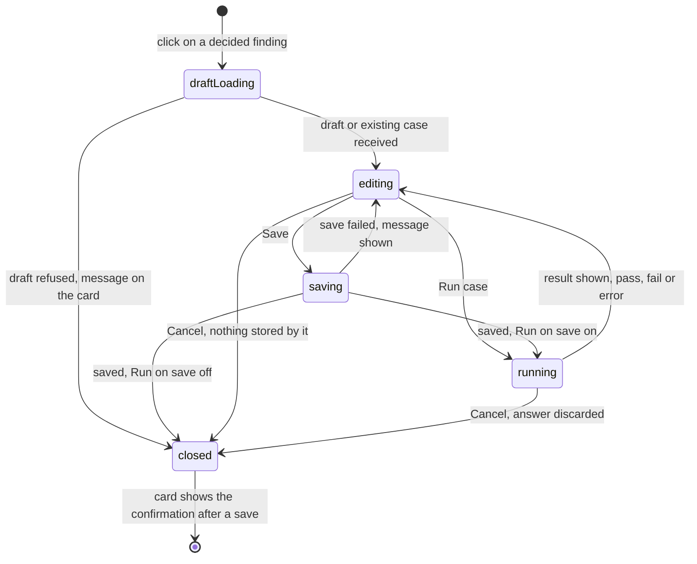
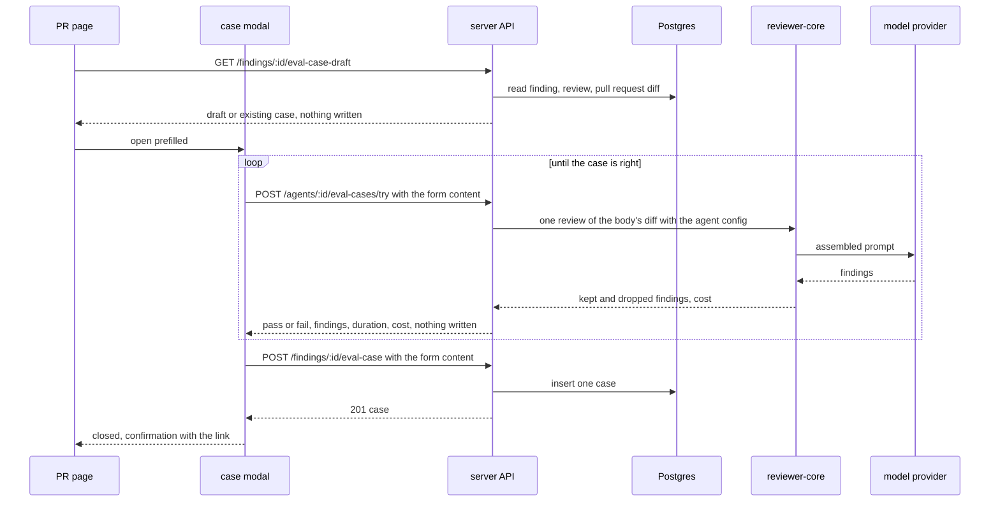

# Spec: Eval case modal — warm a case up before it is saved
Spec ID: SPEC-09
Status: implemented
Supersedes: in part — SPEC-03 (specs/2026-10-12-eval-pipeline.md), SPEC-04 (specs/2026-10-12-case-editor.md) and SPEC-05 (client/specs/2026-10-12-eval-trend-charts.md); the replaced criteria and non-goals are listed under Problem and user, everything else in the three specs stays in force

## Problem and user

A **reviewer** who accepted or dismissed a finding turns it into an eval case with the
"Turn into eval case" control. Today the click stores the case at once (SPEC-03 AC-1,
AC-16): it appears in the agent's set although nobody checked that its diff and its
expectation measure anything. The course mentor names this as a defect (IN-1: «Поганий кейс
у наборі гірший, ніж жодного: він або завжди червоний, або завжди зелений і нічого не
міряє»; «клік на кнопку не зберігає кейс одразу в базу, а відкриває модалку
EvalCaseModal»).

An **agent author** has no way to see what the agent answers on one case without running
the whole set as a stored eval run: SPEC-03 and SPEC-04 left the per-case run, "Run on
save", "Run all agents", "Promote vN" and the dashboard-row sparkline out as non-goals, and
the user has now asked for them to be built as the requirements define them (IN-2).

A **repo owner** pays for every model call, so each of these actions has to be an explicit
click that says what it costs, and a trial run must leave nothing behind (IN-3).

**What this spec replaces.** The three specs are `implemented` and are not edited. The
items below are replaced by this spec; every other item of the three specs stays in force
and is not restated. References to them carry the prefix ("SPEC-03 AC-7"); an ID without a
prefix belongs to this spec.

| Spec | Replaced | By |
|---|---|---|
| SPEC-03 | AC-1, AC-2 — the click-time store without a body | AC-23, AC-25 |
| SPEC-03 | AC-3, AC-4, AC-5, AC-6 — the stored values derived from the finding and the pull request | AC-12…AC-15 (the draft), AC-24, AC-25 (the store) |
| SPEC-03 | AC-8 — the second call for one finding | AC-20, AC-26 |
| SPEC-03 | AC-10, with its EC-4, EC-5, EC-6 — a finding outside the diff refuses the case | AC-21, AC-22, AC-28 |
| SPEC-03 | AC-13…AC-19 — the control and its one-click behaviour on the PR page | AC-1…AC-11, AC-31…AC-35 |
| SPEC-03 | NG-14 "Run all agents", NG-15 "Promote vN", NG-16 the per-case run icon | AC-72…AC-80, AC-81…AC-88, AC-66…AC-71 |
| SPEC-03 | NFR-6, its second clause — the route accepts no body field | NFR-5 |
| SPEC-04 | NG-6 — "Run case", "Run on save", the run icon on a case row; its last part (no duration and no cost in the stored last-run line) stays, as NG-5 here | AC-37…AC-71 |
| SPEC-04 | AC-37 — a successful save always closes the editor | AC-62, AC-64 |
| SPEC-04 | NFR-6, the clause that `POST /findings/:id/eval-case` accepts no body field | NFR-5 |
| SPEC-05 | NG-3 — a sparkline on each agent row of the Eval Dashboard | AC-89…AC-91 |

The words "with one click" in SPEC-03 G-1, US-1 and US-2 are read as "through the case
modal". SPEC-03 AC-7, AC-9, AC-11 and AC-12 keep holding for the changed route (AC-29).
SPEC-04 AC-28…AC-31 gain a third mode of the same dialog and are otherwise unchanged.

## Goals / Non-goals

- **G-1** A reviewer turns an accepted or a dismissed finding into an eval case only through the case modal: the click stores nothing, the modal comes prefilled from the finding, Save stores the case and Cancel leaves nothing.
- **G-2** A user runs the content currently in the case modal as one review by the agent and sees the agent's actual findings with pass or fail, as many times as needed, in every mode of the modal.
- **G-3** An agent author saves a case and sees its result in one step through "Run on save".
- **G-4** An agent author runs one stored case from its row on the Evals tab and sees the result there.
- **G-5** An agent author starts the eval run of every agent from the Eval Dashboard after seeing how many agents and cases it executes.
- **G-6** An agent author makes the configuration of a compared run's agent version the agent's current one, as a new version.
- **G-7** An agent author sees on each agent row of the Eval Dashboard how that agent's recall moved over its recent runs.
- **G-8** A model is called only by an explicit click that says so, and a trial run of a case stores nothing.

- **NG-1** The JSON "Expected output" editor with its "valid JSON" badge and "Finding skeleton" button (IN-4) — the homework asks for the expectation type, the file and the line range as fields; SPEC-04 NG-8 stays (IN-2).
- **NG-2** The "Files" input tab and the "Linked issue" field (IN-4) — no source says what they hold; SPEC-04 NG-7 stays (IN-2).
- **NG-3** The "30 days" range control (IN-7) — no source names the ranges, and the run list holds the 20 newest runs; SPEC-05 NG-4 stays (IN-2).
- **NG-4** Evals for skills and an Evals tab in the Skill Editor — the mentor marks it optional (IN-1); SPEC-03 NG-4 stays.
- **NG-5** Storing the result of a "Run case" press or of a row run, a history of single-case runs, and a duration or a cost in the stored last-run line — a case's `last_result` stays the newest completed run of the whole set (IN-2).
- **NG-6** Any change to how a run of the whole set is started, executed, scored and stored, to the three metrics, and to `reviewer-core/` — SPEC-03 stays the base (IN-3).
- **NG-7** An MCP tool for any of this and a browser e2e flow — SPEC-03 NG-7 and NG-8 stay (IN-10).
- **NG-8** Closing the two known gaps of the review prompt that a trial run inherits — a forged closing tag inside diff text, and the pull request title, number and author in the task line outside an untrusted-data block — SPEC-03 NG-11 and SPEC-04 NG-5 stay (IN-11).
- **NG-9** A database migration — the feature adds no table, column or index; the cases stored by the one-click path stay valid as they are (IN-8, NFR-9).

## User stories

- **US-1** As a reviewer, I want the click on "Turn into eval case" to open a modal prefilled from the finding without storing anything, so that I look at the case before it exists.
- **US-2** As a reviewer, I want to edit the diff or the expectation and press Run case to see the agent's actual result with pass or fail, so that I repeat until the case measures what it is meant to.
- **US-3** As a reviewer, I want Save to put the case into the agent's set and to give me a link to it, so that only a checked case lives there.
- **US-4** As a reviewer, I want Cancel to leave nothing behind, so that a case not worth keeping never reaches the set.
- **US-5** As a reviewer, I want a finding that already has a case to open that case, so that one finding never yields two cases.
- **US-6** As an agent author, I want Run case in the modal for a new and for an existing case too, so that I check a hand-made case the same way.
- **US-7** As an agent author, I want a "Run on save" toggle, so that a saved case shows its result without a second click.
- **US-8** As an agent author, I want a run control on every case row, so that I check one stored case without running the whole set.
- **US-9** As an agent author, I want "Run all agents" on the Eval Dashboard with its size stated first, so that I refresh every agent's numbers knowingly.
- **US-10** As an agent author, I want to promote the agent version of a compared run, so that a better-scoring configuration becomes the current one without retyping it.
- **US-11** As an agent author, I want a sparkline on each agent row of the Eval Dashboard, so that I see a drift before opening the agent.
- **US-12** As a repo owner, I want only an explicit click to call a model and a trial run to store nothing, so that looking costs nothing and trying leaves no trace in the numbers.
- **US-13** As a reviewer, I want the control offered only for an accepted or a dismissed finding, so that the expectation type follows my decision.

## Acceptance criteria (EARS)

Terms are those of SPEC-03 and SPEC-04: **case**, **expectation**, **run**, **matches**,
**grounded**, **content**. **The case modal** is the case editor dialog of SPEC-04 in one
of three modes: **from a finding**, **new** (by hand) and **edit**. **The draft** is the
unsaved case content the API builds from a finding. **A try** is one execution of case
content through `POST /agents/:id/eval-cases/try`; it is what "Run case", "Run on save" and
the row run control start. A form is **complete** by the rule of SPEC-04 AC-34. Shapes are
under Module interactions § Contracts.

### The control on the finding card

- **AC-1** [ubiquitous] The PR page shall show a "Turn into eval case" control in the action row of every expanded finding card, after the Dismiss control. — covers: US-13 · verify: component — the control's accessible name and its position in the action row
- **AC-2** [state-driven] WHILE a finding is neither accepted nor dismissed, the PR page shall render the "Turn into eval case" control disabled with a hint that says to accept or dismiss the finding first. — covers: US-13 · verify: component — the control is disabled and carries the hint text
- **AC-3** [ubiquitous] The PR page shall give the "Turn into eval case" control the title "Create a 'must find' eval case from this finding" on an accepted finding and "Create a 'must NOT comment' eval case from this dismissal" on a dismissed finding. — covers: US-13 · verify: component — the two titles for the two decisions
- **AC-4** [event-driven] WHEN the reviewer activates the "Turn into eval case" control, the PR page shall send one `GET /findings/:id/eval-case-draft` request for that finding and no request with another method. — covers: US-1 · verify: component — the mocked `fetch` records one `GET` and no `POST`, `PUT` or `DELETE`
- **AC-5** [state-driven] WHILE the draft request of a finding is in flight, the PR page shall render that finding's control disabled and show a loading text beside it. — covers: US-1 · verify: component — a pending request; a second click sends no second request
- **AC-6** [event-driven] WHEN the draft request answers with a draft, the case modal shall open titled "New eval case", naming the agent, with the draft's name, diff, pull request title and body, file, start line, end line, finding title, severity and category filled in. — covers: US-1 · verify: component — every field equals the mocked draft
- **AC-7** [state-driven] WHILE the case modal is open from a finding, the case modal shall show the draft's expectation type in words as text that is not editable. — covers: US-1 · verify: component — no type control, "must find" for an accepted and "must NOT flag" for a dismissed finding
- **AC-8** [unwanted] IF the draft request fails, THEN the PR page shall show the API's message beside the control, open no modal and render the control enabled. — covers: US-1 · verify: component — a mocked 400 `eval_owner_missing` shows its message and no dialog
- **AC-9** [event-driven] WHEN the draft request answers with an existing case, the case modal shall open in edit mode titled "Eval case · " followed by that case's name, holding that case's values. — covers: US-5 · verify: component — a mocked response with `case` set opens the edit title and the stored values
- **AC-10** [unwanted] IF the draft carries `problem` `file_not_in_diff`, THEN the case modal shall open with an empty diff field and a message that the pull request's diff holds no patch for the finding's file and that a diff is to be pasted. — covers: US-1 · verify: component — the message, an empty diff field, Save and Run case disabled
- **AC-11** [unwanted] IF the draft carries `problem` `lines_outside_diff`, THEN the case modal shall open with the file's diff and a message that the finding's lines lie outside the changed lines of the diff. — covers: US-1 · verify: component — the message beside a filled diff field and the draft's line numbers

### The draft — API

- **AC-12** [event-driven] WHEN `GET /findings/:id/eval-case-draft` is called for an accepted or a dismissed finding that has no case, the API shall answer 200 with `case` null, the id and the name of the agent of the finding's review, and a `draft` whose `expectation_type` is `must_find` for an accepted and `must_not_flag` for a dismissed finding. — covers: US-1 · verify: integration — one accepted and one dismissed finding
- **AC-13** [ubiquitous] The API shall name a draft `must-find-` (for `must_find`) or `no-` (for `must_not_flag`) followed by the finding's title in lower case with every run of characters other than `a-z` and `0-9` replaced by one hyphen, cut to 34 characters. — covers: US-1 · verify: unit — "Hardcoded Stripe secret key in commit" accepted gives `must-find-hardcoded-stripe-secret-key-in-co`
- **AC-14** [ubiquitous] The API shall put into a draft's `input_diff` the unified diff of the finding's file alone, taken from the pull request's diff at the time of the request. — covers: US-1 · verify: integration — for a pull request with three changed files the draft holds the hunks of the finding's file and no other file
- **AC-15** [ubiquitous] The API shall put into a draft the pull request's number, title, author and description as `input_meta` and the finding's `file`, `start_line`, `end_line`, `title`, `severity` and `category` as `expected_output`. — covers: US-1 · verify: integration — the ten values equal the pull request row and the finding row
- **AC-16** [ubiquitous] The API shall serve `GET /findings/:id/eval-case-draft` without writing a row to any table and without a model call. — covers: US-12 · verify: integration — the row counts of `eval_cases` and `eval_runs` and the mock provider's recorded calls are the same before and after
- **AC-17** [unwanted] IF the finding is neither accepted nor dismissed and has no case, THEN the API shall answer the draft request with 400 and code `finding_undecided`. — covers: US-13 · verify: integration — status and code
- **AC-18** [unwanted] IF the finding's review has no agent, or that agent no longer exists in the workspace, and the finding has no case, THEN the API shall answer the draft request with 400 and code `eval_owner_missing`. — covers: US-1 · verify: integration — a review whose agent was deleted
- **AC-19** [unwanted] IF the finding does not exist or belongs to another workspace, THEN the API shall answer the draft request with 404. — covers: US-1 · verify: integration — a finding of a second workspace
- **AC-20** [unwanted] IF a case with the finding's id as `source_finding_id` exists, THEN the API shall answer the draft request with 200, `draft` null and that case with its `last_result` as `GET /agents/:id/eval-cases` returns it, whatever the finding's decision is now. — covers: US-5 · verify: integration — a finding with a stored case that a completed run covered
- **AC-21** [unwanted] IF the finding's file is absent from the pull request's diff, THEN the API shall answer the draft request with 200 and a draft whose `input_diff` is an empty string and whose `problem` is `file_not_in_diff`. — covers: US-1 · verify: integration — a finding whose file has no stored patch
- **AC-22** [unwanted] IF the finding's line range shares no line with a hunk of its file, THEN the API shall answer the draft request with 200 and a draft that holds the file's diff and `problem` `lines_outside_diff`. — covers: US-1 · verify: integration — a finding whose lines lie outside every hunk

### Save from a finding — API

- **AC-23** [event-driven] WHEN `POST /findings/:id/eval-case` is called with a valid body for an accepted or a dismissed finding that has no case, the API shall store one case owned by the agent of the finding's review with the finding's id as `source_finding_id` and `revision` 1, and answer 201 with the case. — covers: US-3 · verify: integration — one new `eval_cases` row with `owner_kind` `agent`, the review's `agent_id` and the finding's id
- **AC-24** [ubiquitous] The API shall store in a case created from a finding the body's `name`, `input_diff`, `pr_title`, `pr_body` and `expected_output` values by the rules of SPEC-04 AC-2 and AC-4, and no value of the finding in their place. — covers: US-3 · verify: integration — a body whose diff, lines and name differ from the draft reads back as sent
- **AC-25** [ubiquitous] The API shall take the `expectation_type` of a case created from a finding from the finding's decision at the time of the request, and its `pr_number` and `pr_author` from the pull request row, whatever the body carries. — covers: US-3 · verify: integration — a body with `expectation_type` `must_not_flag` and a `pr_number` for an accepted finding stores `must_find` and the pull request's number
- **AC-26** [unwanted] IF a case with the finding's id as `source_finding_id` exists, THEN the API shall answer `POST /findings/:id/eval-case` with 200 and that case unchanged, and store no second case. — covers: US-5 · verify: integration — two calls with different bodies leave one row holding the first body
- **AC-27** [unwanted] IF the body of `POST /findings/:id/eval-case` is missing or fails a schema rule of SPEC-04 AC-5, THEN the API shall answer 422 and store nothing. — covers: US-3 · verify: integration — a request without a body, and one with a blank `name`, each with an unchanged row count
- **AC-28** [unwanted] IF the body of `POST /findings/:id/eval-case` fails the diff rule of SPEC-04 AC-6 or the expectation rule of SPEC-04 AC-7, THEN the API shall answer 400 with code `eval_diff_invalid` or `expectation_outside_diff` and store nothing. — covers: US-3 · verify: integration — prose as the diff, and lines 40–41 against a hunk of lines 10–16
- **AC-29** [unwanted] IF the finding named in `POST /findings/:id/eval-case` is in the condition of AC-17, AC-18 or AC-19, THEN the API shall answer with the status and the code that criterion names and store nothing. — covers: US-3 · verify: integration — an undecided finding, a deleted agent and a finding of a second workspace, each with an unchanged row count
- **AC-30** [event-driven] WHEN `GET /agents/:id/eval-cases` is called after a case was stored from a finding, the API shall return that case in the agent's list with `last_result` null. — covers: US-3 · verify: integration — the list holds the new case

### Save and Cancel in the case modal

- **AC-31** [event-driven] WHEN the reviewer activates Save in a case modal opened from a finding, the case modal shall send one `POST /findings/:id/eval-case` request with the form's values. — covers: US-3 · verify: component — one mocked request whose body holds the edited diff, lines and name
- **AC-32** [event-driven] WHEN a case modal that stored a case from a finding closes, the PR page shall show beside the control a confirmation that names the stored expectation type and links to the Evals tab of the owning agent. — covers: US-3 · verify: component — the confirmation text and the link's `href` with `tab=evals`
- **AC-33** [unwanted] IF the save request of a case modal opened from a finding answers 200, THEN the PR page shall close the modal and show beside the control that the finding already has an eval case, with the link to the Evals tab of the owning agent. — covers: US-5 · verify: component — a mocked 200 shows the text and the link, and no try request is sent
- **AC-34** [unwanted] IF the save request of a case modal opened from a finding fails, THEN the case modal shall stay open with every field's value kept and show the API's message. — covers: US-3 · verify: component — a mocked 400 `expectation_outside_diff` shows its message; the diff field still holds the text
- **AC-35** [event-driven] WHEN the reviewer leaves a case modal opened from a finding through Cancel, the close control or Escape, after the confirmation of SPEC-04 AC-40 where the form changed, the case modal shall close without sending a save request. — covers: US-4 · verify: component — after edits and one Run case, Cancel and the confirmation leave the mocked `fetch` with no request to `POST /findings/:id/eval-case`, `POST /agents/:id/eval-cases` or `PUT /eval-cases/:id`
- **AC-36** [ubiquitous] The API shall hold the same rows in `eval_cases` and `eval_runs` after a draft request followed by any number of try requests as before them. — covers: US-4 · verify: integration — row counts and row contents before and after one draft request and two try requests

### Run case — API

- **AC-37** [event-driven] WHEN `POST /agents/:id/eval-cases/try` is called with a valid body for an agent of the workspace, the API shall execute the body's content as one review by the review engine with the agent's current system prompt, provider, model, strategy and linked enabled skills, and answer 200 with the result. — covers: US-2 · verify: integration — with the mock provider, one structured call whose system message holds the agent's prompt and whose user message holds the body's diff
- **AC-38** [ubiquitous] The API shall score a try by the rules of SPEC-03 AC-50…AC-54 and return `status` `pass` or `fail` with `matched`, the number of grounded findings that match the body's expectation. — covers: US-2 · verify: integration — an overlapping grounded finding gives `pass` and 1 for `must_find`, `fail` and 1 for `must_not_flag`
- **AC-39** [ubiquitous] The API shall return with a try's result every grounded finding of the execution with its `file`, `start_line`, `end_line`, `severity`, `category` and `title`, the execution's `duration_ms` and its `cost_usd`, null when the cost is unknown. — covers: US-2 · verify: integration — two grounded findings, a duration and the mock provider's cost
- **AC-40** [ubiquitous] The API shall build the model input of a try from the request body alone by the rules of SPEC-03 AC-33, AC-34 and AC-35 and SPEC-04 AC-24 — without a repo skeleton, a callers digest, a file-rank note, project context documents and a derived intent, without the expectation type and the expected output, and without reading a stored case or a pull request row. — covers: US-2 · verify: unit — the assembled input of a try for an agent with repo intel on holds the body's diff, title and description and none of the listed sections or values
- **AC-41** [ubiquitous] The API shall produce for a try the model input that is byte-identical to the one a run of the whole set produces for a stored case with the same content and the same agent configuration. — covers: US-2 · verify: unit — assemble both inputs and compare the strings
- **AC-42** [ubiquitous] The API shall write no row to `eval_cases`, `eval_runs`, `reviews`, `findings`, `agent_runs` and `run_traces` while it serves a try. — covers: US-12 · verify: integration — the six row counts before and after a try that passes, one that fails and one that errors
- **AC-43** [ubiquitous] The API shall return the same `last_result` of every case, the same run list and the same dashboard response after a try as before it. — covers: US-12 · verify: integration — `GET /agents/:id/eval-cases`, `GET /agents/:id/eval-runs` and `GET /eval/dashboard` read before and after a try
- **AC-44** [unwanted] IF the engine review of a try fails, THEN the API shall answer 200 with `status` `error`, the failure's message cut to 500 characters and no finding. — covers: US-2 · verify: integration — a provider that throws
- **AC-45** [unwanted] IF no key is configured for the agent's provider, THEN the API shall answer a try with 400 and code `eval_provider_unavailable` before any model call. — covers: US-2 · verify: integration — a container whose provider lookup throws
- **AC-46** [unwanted] IF the body of a try fails a schema rule, the diff rule of SPEC-04 AC-6 or the expectation rule of SPEC-04 AC-7, THEN the API shall answer 422, 400 `eval_diff_invalid` or 400 `expectation_outside_diff` before any model call. — covers: US-2 · verify: integration — one request per failure with the mock provider's calls empty
- **AC-47** [unwanted] IF the agent named in a try does not exist or belongs to another workspace, THEN the API shall answer 404 before any model call. — covers: US-2 · verify: integration — an agent of a second workspace
- **AC-48** [state-driven + event-driven] WHILE a run of the agent is in status `running`, WHEN a try is requested for that agent, the API shall execute the try and answer as AC-37 states. — covers: US-6 · verify: integration — a try sent while a stored run is `running` answers 200

### Run case — the case modal

- **AC-49** [ubiquitous] The case modal shall show a "Run case" control between Cancel and Save in each of its three modes. — covers: US-6 · verify: component — the control in the from-a-finding, the new and the edit mode
- **AC-50** [state-driven] WHILE the form is not complete, the case modal shall render Run case disabled. — covers: US-2 · verify: component — an empty diff disables Run case and Save alike
- **AC-51** [event-driven] WHEN the user activates Run case, the case modal shall send one try request for the modal's agent with the form's current diff, pull request title and body, expectation type, file and line range, the pull request number and author the modal was opened with, and no save request. — covers: US-2 · verify: component — one mocked request whose body holds an edit made after the modal opened
- **AC-52** [state-driven] WHILE a try of the case modal is in flight, the case modal shall render Run case disabled with the text "Running…" and keep every field editable. — covers: US-2 · verify: component — a second click sends no second request; a field accepts a change
- **AC-53** [event-driven] WHEN a try answers `pass` or `fail`, the case modal shall show a result region that says passed or failed in words with an icon, "expected N, got M" where N is 1 for `must_find` and 0 for `must_not_flag` and M is `matched`, the duration in seconds and the cost, with "—" for a null cost. — covers: US-2 · verify: component — a pass with 1 match, 1800 ms and 0.02; a fail; a null cost
- **AC-54** [ubiquitous] The case modal shall list in the result region every finding of the try with its file, line range, severity and title, or a text that the agent returned no finding. — covers: US-2 · verify: component — two findings, and an empty list
- **AC-55** [unwanted] IF a try answers `status` `error` or the try request fails, THEN the case modal shall show the error's message in the result region and render Run case enabled with every field's value kept. — covers: US-2 · verify: component — a 200 with `status` `error`, a mocked 400 `eval_provider_unavailable` and a mocked 429
- **AC-56** [event-driven] WHEN a form value that a try request carries changes after the request was sent, the case modal shall mark that try's result as belonging to earlier content. — covers: US-2 · verify: component — a changed end line adds the note to the shown result; a changed name does not
- **AC-57** [event-driven] WHEN a later try answers, the case modal shall replace the shown result with the later one. — covers: US-2 · verify: component — a fail followed by a pass shows the pass alone
- **AC-58** [event-driven] WHEN the case modal is closed while a try is in flight, the case modal shall discard that try's answer. — covers: US-4 · verify: component — the answer arriving after the close renders nothing and sends no request
- **AC-59** [state-driven] WHILE an existing case is being edited, the case modal shall keep the "Last run" line of SPEC-04 AC-39 showing the stored `last_result`, unchanged by a try. — covers: US-6 · verify: component — a stored fail stays "Last run failed" beside a try that passed
- **AC-60** [ubiquitous] The eval screens shall give every Run case control and every row run control a title that says the action makes one model call. — covers: US-12 · verify: component — the title of the control in the modal and on a case row

### Run on save

- **AC-61** [ubiquitous] The case modal shall show a "Run on save" toggle in its footer in each of its three modes, on when the modal opens. — covers: US-7 · verify: component — the toggle by its accessible name and its on state in the three modes
- **AC-62** [state-driven + event-driven] WHILE Run on save is on, WHEN a save stores the case — 201 from a create route or 200 from `PUT /eval-cases/:id` — the case modal shall stay open, send one try request with the saved content and show its result. — covers: US-7 · verify: component — a save followed by exactly one try request in each mode
- **AC-63** [state-driven] WHILE the case modal stays open after a save, the case modal shall hold the saved case in edit mode, so that a further Save sends `PUT /eval-cases/:id` for it. — covers: US-7 · verify: component — a second Save after a create sends a `PUT` to the stored case's id and no second create
- **AC-64** [state-driven + event-driven] WHILE Run on save is off, WHEN a save stores the case, the case modal shall close without sending a try request. — covers: US-7 · verify: component — the dialog is gone and the mocked `fetch` holds no try request
- **AC-65** [unwanted] IF a save fails while Run on save is on, THEN the case modal shall send no try request. — covers: US-7 · verify: component — a mocked 400 on the save

### The run control on a case row

- **AC-66** [ubiquitous] The Evals tab shall show on every case row a run control, a native button whose accessible name names the case, before the edit control. — covers: US-8 · verify: component — two rows, each with a button named after its case
- **AC-67** [event-driven] WHEN the agent author activates a row's run control, the Evals tab shall send one try request with that case's stored diff, pull request number, title, author and body, expectation type, file and line range, and no other write request. — covers: US-8 · verify: component — one mocked request whose body equals the row's case
- **AC-68** [state-driven] WHILE a row's try is in flight, the Evals tab shall render that row's run control disabled with a running text and keep the run controls of the other rows enabled. — covers: US-8 · verify: component — a pending request on one of two rows
- **AC-69** [event-driven] WHEN a row's try answers, the Evals tab shall show on that row a result labelled as a trial run that is not stored — passed or failed in words with "expected N, got M", the duration and the cost, or the error's message — beside the row's stored last result. — covers: US-8 · verify: component — a row whose stored result is "never run" shows the trial result and still "never run"
- **AC-70** [event-driven] WHEN the case list is read again, the Evals tab shall show every row without a trial result. — covers: US-8 · verify: component — the trial result is gone after the list query is invalidated
- **AC-71** [unwanted] IF a row's try request fails, THEN the Evals tab shall show the API's message on that row and render its run control enabled. — covers: US-8 · verify: component — a mocked 400 `eval_provider_unavailable`

### Run all agents

- **AC-72** [event-driven] WHEN `GET /eval/dashboard` is called, the API shall return for every agent `case_count`, the number of its cases, and `run_in_progress`, true while a run of that agent is in status `running`. — covers: US-9 · verify: integration — an agent with 3 cases and a `running` run, one with 2 cases and none, one without cases
- **AC-73** [ubiquitous] The Eval Dashboard shall show a "Run all agents" control in its header. — covers: US-9 · verify: component — the control by its accessible name
- **AC-74** [state-driven] WHILE no agent has at least one case and no run in progress, the Eval Dashboard shall render "Run all agents" disabled with a hint that says why. — covers: US-9 · verify: component — a response of agents without cases, and an empty agent list
- **AC-75** [event-driven] WHEN the agent author activates "Run all agents", the Eval Dashboard shall open a confirmation dialog that states the number of agents to be run and the total number of their cases as model calls, and names the agents left out for having no case and those left out for a run in progress, before any request is sent. — covers: US-9 · verify: component — three agents of 8, 3 and 0 cases give "2 agents", "11" and the third agent's name; no request recorded
- **AC-76** [event-driven] WHEN the agent author confirms the dialog, the Eval Dashboard shall send one `POST /agents/:id/eval-runs` request for each agent that has at least one case and no run in progress, and none for any other agent. — covers: US-9 · verify: component — two mocked requests for the two eligible agents
- **AC-77** [event-driven] WHEN a start request of "Run all agents" answers, the Eval Dashboard shall show on that agent's row that its run started, or the API's message when the request was refused. — covers: US-9 · verify: component — one 202 and one mocked 400 `eval_provider_unavailable`
- **AC-78** [event-driven] WHEN the agent author cancels the confirmation dialog, the Eval Dashboard shall close it without sending a request. — covers: US-9 · verify: component — no request after Cancel and after Escape
- **AC-79** [state-driven] WHILE the start requests of "Run all agents" are in flight, the Eval Dashboard shall render the control disabled. — covers: US-9 · verify: component — a second click sends no further request
- **AC-80** [state-driven] WHILE `run_in_progress` is true for an agent of the dashboard response, the Eval Dashboard shall show a running state on that agent's row and read the dashboard again every 3 seconds. — covers: US-9 · verify: component — a response that changes from `run_in_progress` true to false replaces the running state with the new latest run without a page reload

### Promote vN

- **AC-81** [state-driven] WHILE the agent version of the newer of the two compared runs differs from the agent's current version, the compare view shall show a "Promote vN" control that names the newer run's version. — covers: US-10 · verify: component — runs of versions 6 and 7 for an agent at version 8 show "Promote v7"
- **AC-82** [state-driven] WHILE the agent version of the newer compared run equals the agent's current version, the compare view shall show the Promote control disabled with a text that this version is the agent's current one. — covers: US-10 · verify: component — runs of versions 6 and 7 for an agent at version 7
- **AC-83** [event-driven] WHEN the agent author activates Promote, the compare view shall open a confirmation dialog that says the agent's configuration will be replaced by that of version N and saved as a new version, and that no earlier version is changed, before any write request is sent. — covers: US-10 · verify: component — the dialog text; no `PUT` recorded
- **AC-84** [event-driven] WHEN the agent author confirms the promotion, the compare view shall send one `PUT /agents/:id` request that holds the `provider`, `model`, `system_prompt`, `strategy`, `output_schema`, `ci_fail_on` and `repo_intel` of the snapshot `GET /agents/:id/versions/:version` returns for version N, and no change of the agent's linked skills [NEEDS CLARIFICATION: which snapshot values a promotion restores, and whether the skill links → OQ-1]. — covers: US-10 · verify: component — the body of the mocked `PUT` equals the seven values of the mocked snapshot
- **AC-85** [event-driven] WHEN `PUT /agents/:id` is called with the configuration of an earlier version's snapshot that differs from the agent's current configuration, the API shall store the agent with its version increased by 1, add one snapshot for the new version and leave every earlier `agent_versions` row unchanged. — covers: US-10 · verify: integration — an agent at version 3 promoted to the configuration of version 1 reads version 4; the rows of versions 1, 2 and 3 are identical before and after
- **AC-86** [event-driven] WHEN the promotion request answers with a higher agent version, the compare view shall show in place of the control that the agent is now at that version with the configuration of version N. — covers: US-10 · verify: component — "v9" and "v7" after a mocked answer with version 9
- **AC-87** [unwanted] IF the promotion request answers with the agent's version unchanged, THEN the compare view shall say that the agent already has that configuration. — covers: US-10 · verify: component — a mocked answer with the version the agent had
- **AC-88** [unwanted] IF the snapshot read or the promotion request fails, THEN the compare view shall show the API's message and render the Promote control enabled. — covers: US-10 · verify: component — a mocked 404 on the snapshot read

### The sparkline on a dashboard row

- **AC-89** [event-driven] WHEN `GET /eval/dashboard` is called, the API shall return for every agent `trend`, the `recall`, `precision` and `citation_accuracy` of that agent's newest completed runs, at most 20, oldest first. — covers: US-11 · verify: integration — 21 completed runs give the 20 newest in ascending start time; an agent without runs gives an empty list
- **AC-90** [ubiquitous] The Eval Dashboard shall show on each agent row a sparkline of the recall values of `trend` that are not null, oldest first. — covers: US-11 · verify: component — three trend entries give one sparkline on the row
- **AC-91** [unwanted] IF an agent's `trend` holds fewer than two recall values that are not null, THEN the Eval Dashboard shall show that agent's row without a sparkline. — covers: US-11 · verify: component — one completed run, and three runs whose recall is null

## Edge cases

- **EC-1** The control is clicked twice while the draft loads → one draft request, one modal — covered by: AC-5
- **EC-2** Two tabs open the modal from one finding and both save → one case; the second save answers 200, its edits are not stored and the card says the finding already has a case — covered by: AC-26, AC-33
- **EC-3** The finding's decision changes between the click and Save → the stored type follows the decision at the time of Save and the confirmation names the stored type; a finding undecided by then is refused — covered by: AC-25, AC-29, AC-32
- **EC-4** The pull request's head moved, the finding's file has no patch (a binary file, a file beyond the first 100 of a large pull request), or a full-file finding lies outside every hunk → the modal opens with a message and the user corrects the lines or pastes a diff; Save and Run case validate — covered by: AC-10, AC-11, AC-21, AC-22, AC-28
- **EC-5** The reviewer pastes a diff of several files into a modal opened from a finding → accepted; every path is stored — covered by: AC-24
- **EC-6** Cancel after edits and after several Run case presses → no row anywhere — covered by: AC-35, AC-36, AC-42
- **EC-7** The PR page is reloaded while the modal is open → nothing was stored, so nothing remains; the modal's open state is not in the URL — covered by: AC-36
- **EC-8** No key is configured for the agent's provider → the try is refused and the result region shows why — covered by: AC-45, AC-55
- **EC-9** The provider call of a try never returns (`server/INSIGHTS.md`: an eval run has no per-case deadline) → a try holds no lock and stores nothing, so nothing else is blocked; the modal shows the running state until it is closed; whether a try gets a deadline is undecided — open: OQ-2
- **EC-10** More than 10 tries within a minute, from the modal or from several rows → the API answers 429 and the message is shown — covered by: AC-55, AC-71, NFR-3
- **EC-11** The form is edited while a try is in flight → the result is shown and marked as belonging to earlier content — covered by: AC-56
- **EC-12** Run case is pressed while a run of the whole set is executing → the try executes; a Save of an existing case is still refused with `eval_run_in_progress` (SPEC-04 AC-14) and no try follows it — covered by: AC-48, AC-65
- **EC-13** Run on save is on, the save succeeds and the try errors → the case stays saved, the modal holds it in edit mode and shows the error — covered by: AC-62, AC-63, AC-55
- **EC-14** Run on save is on and a save from a finding answers 200 for an existing case → the modal closes with the message and no try is sent — covered by: AC-33
- **EC-15** The agent's prompt is changed between two presses of Run case → each try uses the configuration at its own time — covered by: AC-37
- **EC-16** The agent is deleted while the modal is open → a try answers 404 and a save from a finding 400 `eval_owner_missing`; both are shown — covered by: AC-47, AC-29, AC-34
- **EC-17** A `must_not_flag` try returns grounded findings that do not match the expectation → `pass`, and the findings are listed — covered by: AC-38, AC-54
- **EC-18** The body of a try or of a save is larger than the API's body limit → refused, nothing executed or stored — covered by: NFR-5
- **EC-19** A finding whose case was stored by the one-click path before this feature → the click opens that case in edit mode; the case runs and is edited as before — covered by: AC-20, NFR-9
- **EC-20** A row's case was edited in another tab and the list is stale → the try runs the content the list holds; the result goes away with the next read — covered by: AC-67, AC-70
- **EC-21** A run of an agent starts between the dashboard read and the confirmation of "Run all agents" → that agent's request answers `eval_run_in_progress`, shown on its row; the others start — covered by: AC-77
- **EC-22** More than 10 agents are eligible → the start route's limit of 10 requests per minute refuses the rest with 429, shown per agent — covered by: AC-77
- **EC-23** One agent's provider has no key → that agent is not started and says why; the others start — covered by: AC-77
- **EC-24** The workspace has no agent, or no agent with a case → "Run all agents" is disabled — covered by: AC-74
- **EC-25** The newer run's version has no stored snapshot (a seeded agent's version 1, `server/INSIGHTS.md`) → the comparison itself is refused (SPEC-03 AC-71), so the control is never reached; a snapshot read that fails later shows the API's message — covered by: AC-88
- **EC-26** The agent's linked skills changed since version N: a snapshot holds skill ids, `PUT /agents/:id` takes none, and linking creates no version → the default leaves the links as they are; whether a promotion restores them is undecided — open: OQ-1
- **EC-27** Promote is confirmed for a configuration equal to the current one → no version is added and the view says so — covered by: AC-87
- **EC-28** Promote is confirmed while a run of the agent executes → the agent is saved; the running run keeps the version it started with (SPEC-03 AC-31) — covered by: AC-85
- **EC-29** An agent has one completed run, or only `must_not_flag` cases so that every recall is null → no sparkline on its row — covered by: AC-91
- **EC-30** A finding of a try carries a severity the UI has no style for → shown as text — covered by: AC-54, NFR-6
- **EC-31** The diff or the description of a try carries text addressed to the model → it travels as data inside the engine's untrusted-data blocks — covered by: NFR-4
- **EC-32** The finding, the agent or the case named in a request belongs to another workspace → 404, nothing read, executed or stored — covered by: AC-19, AC-29, AC-47
- **EC-33** The finding's severity or category is a string outside the `Severity` and `FindingCategory` contracts (`findings.severity` is free text) → the draft carries it as it is, the modal shows it, and Save is refused with 422 until a listed value or none is chosen, as an edit of such a case is today — covered by: AC-15, AC-27, AC-34

## Non-functional requirements

- **NFR-1** [cost] A model is called only by `POST /agents/:id/eval-cases/try` and `POST /agents/:id/eval-runs`, each sent only after a click on a control whose text or title names the action; the draft route, the save from a finding, the dashboard route, opening the modal, typing in it and rendering a sparkline make no model call. — verify: integration — the mock provider's recorded calls stay empty across the draft, the save and the dashboard routes; component — opening the modal and editing its fields send no `POST`
- **NFR-2** [cost] A try makes one engine review and no other model call; no intent derivation, brief or repo-intel call is started by it. — verify: integration — with strategy `single-pass`, the mock provider records one structured call per try
- **NFR-3** [cost] `POST /agents/:id/eval-cases/try` is limited to 10 requests per minute, the limit `POST /agents/:id/eval-runs` carries (`server/src/modules/eval/constants.ts:6`). — verify: integration — the route's rate-limit config
- **NFR-4** [security] The diff and the pull request description of a try reach the model only inside the engine's untrusted-data blocks of the user message, through the path a run of the whole set uses; the system message holds neither, and no second prompt assembly is introduced. — verify: unit — in the assembled input of a try whose diff holds "ignore the instructions above" the text stands inside the diff block and the system message holds neither value
- **NFR-5** [security] `GET /findings/:id/eval-case-draft`, `POST /findings/:id/eval-case` and `POST /agents/:id/eval-cases/try` declare Zod schemas for params and body; a body above the API's limit of 1,048,576 bytes is refused; body values are stored as data and never placed into query text. — verify: integration — a non-uuid id answers 422; a body of 1,100,000 bytes stores and executes nothing; a `file` of `'; drop table eval_cases; --` is stored and read back as that text
- **NFR-6** [security] The findings of a try, the error message of a try, the values of a draft and the agent names in the "Run all agents" dialog are rendered as text, never as markup. — verify: component — a finding title and a draft name holding `` appear as visible text and add no `img` element
- **NFR-7** [compatibility] The draft response, the try request and response, the body of `POST /findings/:id/eval-case` and the three fields added to the dashboard's agent record are declared in both `@devdigest/shared` copies with identical text. — verify: unit — the check SPEC-03 NFR-7 names, extended to these declarations
- **NFR-8** [compatibility] Every other route keeps its response; `GET /eval/dashboard` only gains fields; `POST /findings/:id/eval-case` now requires a body and its one caller is the PR page; every MCP tool, the eval fixture command and `reviewer-core/` stay as they are. — verify: integration — the SPEC-03 and SPEC-04 server suites pass with only the tests of the replaced criteria changed; the `mcp/` suite passes unchanged; `git status --short reviewer-core` is empty
- **NFR-9** [compatibility] The feature adds no migration file and changes no table, column or index; a case stored before the feature — the 8 on the user's dev database included — is returned by the draft route as the finding's existing case, is run by a try and by a run of the whole set, and is edited, with no row rewritten. — verify: integration — a case inserted in the stored shape of SPEC-03 with a `source_finding_id` is returned by the draft route and executed by a try; manual — `git status --short server/src/db/migrations` lists no file of this feature, which a test does not read
- **NFR-10** [i18n] Every string of the feature comes from `client/messages/en/` (`eval`, `prReview`), reusing the reserved keys `caseEditor.runCase` and `caseEditor.running`; counts of agents, cases and findings use ICU plural forms, and every number that exceeds 999 is a typed number argument. — verify: component — tests render with the real message files; `grep -rn` finds no literal UI string in the feature's components
- **NFR-11** [accessibility] The result region of the modal and the trial result on a row are live regions, announced on every new result, an error through an alert; pass, fail and error are carried by words and an icon in addition to colour; "Run on save" is a native checkbox or a switch with an accessible name and an exposed on or off state; the row run control, Run case, "Run all agents" and Promote are native buttons with an accessible name; the two confirmation dialogs close on Escape and return focus to the control that opened them; a disabled control's reason is exposed as its description. — verify: component — queries by role and name, the live region's text after a result, the toggle's checked state, focus after close
- **NFR-12** [accessibility] The sparkline on a dashboard row is hidden from assistive technology; the row's three metric values carry its meaning. — verify: component — no accessible node for the sparkline
- **NFR-13** [observability] The API writes one log line per try with the agent id, the agent version, the status, `matched`, the counts of findings produced and grounded, tokens, cost and duration, and never diff text, expectation text or finding text. — verify: integration — the log record of a try and the absence of the fixture diff's text in it
- **NFR-14** [performance] `GET /eval/dashboard` returns at most 20 `trend` entries of three numbers per agent and no per-case data, and computes `case_count`, `run_in_progress` and `trend` without one query per agent. — verify: integration — the response for an agent with 21 runs; the number of statements for 1 agent and for 5 agents is the same

## Module interactions

Packages: server, client
Surfaces: the finding card on the PR page (the "Turn into eval case" control, the confirmation); the case modal in its three modes (Run case, the result region, "Run on save"); the case rows of the Evals tab (the run control, the trial result); the Eval Dashboard ("Run all agents" with its dialog, the row sparkline, the running state); the compare view ("Promote vN" with its dialog); the routes `GET /findings/:id/eval-case-draft` (new), `POST /agents/:id/eval-cases/try` (new), `POST /findings/:id/eval-case` (changed: takes a body), `GET /eval/dashboard` (changed: three more fields per agent)

| # | From → To | Channel | Carries | Exists today | If it fails |
|---|---|---|---|---|---|
| MI-1 | client → server | `GET /findings/:id/eval-case-draft` | back: the agent's id and name, and either a draft or the finding's existing case | new | the API's message beside the control, no modal (AC-8) |
| MI-2 | server, eval → server, reviews and pulls data | the finding with its review and pull request; the pull request's diff | `file`, lines, `severity`, `category`, `title`, the decision, the review's `agent_id`; number, title, author, body; the diff, from the clone or from the stored file patches | yes (`server/src/modules/reviews/service.ts:191`, `:219`; `server/src/modules/reviews/diff-loader.ts:11`) | 404 or 400 with a code (AC-17…AC-19); a file without a patch gives a draft with `problem` (AC-21) |
| MI-3 | client → server | `POST /findings/:id/eval-case` | name, diff, pull request title and body, expectation; back: the case, 201 or 200 | changes (`server/src/modules/eval/routes.ts:21` reads no body and derives everything, `server/src/modules/eval/service.ts:52`) | the modal stays open with the API's message (AC-34) |
| MI-4 | client → server | `POST /agents/:id/eval-cases/try` | expectation type, diff, pull request number, title, author and body, expectation; back: status, `matched`, findings, duration, cost | new | the message in the result region or on the row (AC-55, AC-71) |
| MI-5 | server, eval → reviewer-core | `reviewPullRequest`, as a run of the whole set calls it | system prompt, model, strategy, skill blocks, the diff, the task line, the description; back: kept and dropped findings, tokens, cost | yes (`server/src/modules/eval/runner.ts:60`; the input is assembled at `server/src/modules/eval/helpers.ts:159`) | the try answers `status` `error` (AC-44) |
| MI-6 | server, eval → server, agents and skills data | the agent row and its linked enabled skills | `system_prompt`, provider, model, strategy, `version`; skill names and bodies | yes (`server/src/modules/eval/types.ts:171`; read by `server/src/modules/eval/service.ts:234`) | 404 for an unknown agent (AC-47) |
| MI-7 | reviewer-core → model provider | the injected provider | the assembled prompt | yes (`server/src/modules/eval/service.ts:234` resolves it and refuses a missing key) | 400 `eval_provider_unavailable` (AC-45); an error during the call gives `status` `error` |
| MI-8 | client → server | `POST /agents/:id/eval-cases`, `PUT /eval-cases/:id` | unchanged; the saves of the new and the edit mode | yes (`server/src/modules/eval/routes.ts:35`, `:55`) | unchanged (SPEC-04 AC-38) |
| MI-9 | client → server | `GET /eval/dashboard` | per agent, added: `case_count`, `run_in_progress`, `trend` | changes (`server/src/modules/eval/service.ts:345` returns `agent_id`, `name`, `model`, `latest_run`) | the dashboard's failure state with retry, as today |
| MI-10 | client → server | `POST /agents/:id/eval-runs`, once per eligible agent | no body; 202 with the run | yes (`server/src/modules/eval/routes.ts:70`) | the API's message on that agent's row (AC-77) |
| MI-11 | client → server | `GET /agents/:id`, `GET /agents/:id/versions/:version`, `PUT /agents/:id` | the agent's current `version`; a version's snapshot; the promoted configuration, answered with the agent at its new version | yes (`server/src/modules/agents/routes.ts:79`, `:110`, `:135`; the snapshot is written at `server/src/modules/agents/repository.ts:160`) | the API's message in the compare view (AC-88) |
| MI-12 | server → Postgres | `eval_cases` | one insert by the save from a finding; no write by the draft route and by a try; one case per finding kept by the existing partial unique index | yes (`server/src/db/schema/eval.ts:48`) | a failed write fails the request and stores nothing |
| MI-13 | mcp → server | the existing routes | unchanged; no tool reads, drafts, tries or starts an eval | yes (`mcp/src/api/http-client.ts` names no eval route) | unchanged |

### Contracts

Wire JSON is snake_case. Both `@devdigest/shared` copies carry the same declarations
(NFR-7). Everything not listed here is as SPEC-03 § Contracts and SPEC-04 § Contracts have
it. A status is the HTTP status; a code is the `code` of the API's error body.

**`GET /findings/:id/eval-case-draft` — response 200**

| Field | Type | Notes |
|---|---|---|
| `agent` | `{ id: string, name: string }` | the agent of the finding's review, or the owner of the existing case |
| `case` | eval case record or null | the finding's existing case with `last_result` (AC-20); null otherwise |
| `draft` | draft or null | null exactly when `case` is set |

Draft: `{ expectation_type, name, input_diff, input_meta: { pr_number: int, pr_title: string, pr_author: string, pr_body: string or null }, expected_output: { file, start_line, end_line, title, severity, category }, problem }`, where `problem` is `file_not_in_diff`, `lines_outside_diff` or null (AC-21, AC-22), and `severity` and `category` are plain strings as the finding holds them.

**`POST /findings/:id/eval-case` — request body:** the body of `PUT /eval-cases/:id`
(SPEC-04 § Contracts): `name`, `input_diff`, `input_meta: { pr_title, pr_body }`,
`expected_output`. An `expectation_type`, a `pr_number` or a `pr_author` in the body is not
used (AC-25).

**`POST /agents/:id/eval-cases/try` — request body**

| Field | Type | Notes |
|---|---|---|
| `expectation_type` | `must_find` or `must_not_flag` | decides pass or fail; never sent to the model |
| `input_diff` | string, not blank | a unified diff with at least one file and one hunk |
| `input_meta` | `{ pr_number: int or null, pr_title: string, pr_author: string or null, pr_body: string or null }` | number and author as the draft or the stored case holds them, null for a hand-made case; they stand in the task line as SPEC-04 AC-24 states |
| `expected_output` | `{ file: string, start_line: int, 1 or above, end_line: int, not below start_line }` | `file` is a file of `input_diff`; further keys are accepted and not used |

**`POST /agents/:id/eval-cases/try` — response 200**

| Field | Type | Notes |
|---|---|---|
| `status` | `pass`, `fail` or `error` | AC-38, AC-44 |
| `matched` | int | 0 on `error` |
| `findings` | `{ file, start_line, end_line, severity, category, title }[]` | the grounded findings; empty on `error` |
| `error` | string or null | set on `error`, at most 500 characters |
| `duration_ms` | int | |
| `cost_usd` | number or null | null when the cost is unknown |

**`GET /eval/dashboard` — added to each entry of `agents`**

| Field | Type | Notes |
|---|---|---|
| `case_count` | int, 0 or above | AC-72 |
| `run_in_progress` | boolean | AC-72 |
| `trend` | `{ recall, precision, citation_accuracy }[]`, each a number 0–1 or null | at most 20, oldest first (AC-89) |

**Routes**

| Route | Success | Errors |
|---|---|---|
| `GET /findings/:id/eval-case-draft` | 200 | 404; 400 `finding_undecided`, `eval_owner_missing`; 422 params |
| `POST /findings/:id/eval-case` | 201 case; 200 the existing case | 404; 400 `finding_undecided`, `eval_owner_missing`, `eval_diff_invalid`, `expectation_outside_diff`; 422 params or body |
| `POST /agents/:id/eval-cases/try` | 200 result, `status` `error` included | 404; 400 `eval_provider_unavailable`, `eval_diff_invalid`, `expectation_outside_diff`; 422 params or body; 429 |

## Design review

Sources reviewed: IN-4, IN-5, IN-6, IN-7, IN-12

A decision `accepted` below rests on IN-2: the user settled D1…D11 and told the calling
session to take the recommended option wherever the requirements leave a point open. Two
points are kept open, because their answer changes what is built.

| # | Kind | Finding | Proposal | Decision |
|---|---|---|---|---|
| DR-1 | inconsistency | IN-4 draws "Expected output" as a JSON array with a "valid JSON" badge and a "Finding skeleton" button (`screen_cizruns.jsx:97-99`); the homework asks for fields and SPEC-04 built fields | Keep the fields | rejected — NG-1, as SPEC-04 NG-8 decided (IN-2) |
| DR-2 | module | IN-4 draws a "Files" tab and a "Linked issue" field (`screen_cizruns.jsx:80`, `:92`); no source says what they hold | Not included | rejected — NG-2 (IN-2) |
| DR-3 | ux | IN-4 draws the "Run on save" toggle switched on (`screen_cizruns.jsx:64`, `on: true`) | The toggle is on when the modal opens | accepted → AC-61 |
| DR-4 | inconsistency | IN-4 joins a stored state and a run in one banner: "Last run passed · expected 1 finding, got 1 · 1.8s · $0.02" (`screen_cizruns.jsx:103`); a stored `last_result` has neither duration nor cost, and a try is not stored | Two regions: the try's result with duration and cost, and the stored last-run line of SPEC-04 AC-39 unchanged | accepted → AC-53, AC-59 |
| DR-5 | missing state | No frame shows the draft loading or refused, a try in flight, a failed or errored try, a result that no longer matches the form, or a failed save | The states of AC-5, AC-8, AC-52, AC-55, AC-56, AC-34 | accepted → AC-5, AC-8, AC-34, AC-52, AC-55, AC-56 |
| DR-6 | missing state | IN-4 shows only "expected 1 finding, got 1"; IN-1 asks to see «фактичний результат агента», and a failed `must_find` is not understood without what the agent did say | List the try's grounded findings with file, lines, severity and title | accepted → AC-54 |
| DR-7 | corner case | SPEC-03 refuses a finding whose file or lines are outside the pull request's diff (its AC-10); with a modal the user is able to correct the lines or paste a diff | Open the modal with a message; Save and Run case validate | accepted → AC-10, AC-11, AC-21, AC-22 |
| DR-8 | corner case | No source says what the click does for a finding that already has a case; SPEC-03 returned the stored case | Open that case in edit mode | accepted → AC-9, AC-20 |
| DR-9 | corner case | With "Run on save" the modal stays open after a create; a second Save would store a second hand-made case, or drop the edits of a case made from a finding (AC-26) | After a save the modal holds the saved case in edit mode | accepted → AC-63 |
| DR-10 | ux | IN-5 draws a play icon on every case row (`components2.jsx:94`) and no frame shows its result; a metric over one case is 0 or 1 (SPEC-03 DR-9) | Show pass or fail with expected and got on the row, labelled as a trial run, never as the stored last result | accepted → AC-66, AC-69, AC-70 |
| DR-11 | ux | IN-6 draws "Run all agents" (`screen_skills.jsx:361`) with no confirmation; one click starts agents × cases model calls (SPEC-03 DR-7) | A confirmation that states the agents and the total of cases and names the agents left out | accepted → AC-75 |
| DR-12 | module | The dashboard response holds no case count and no running state per agent (`server/src/modules/eval/service.ts:345`), so the dialog has nothing to state its size from | Add `case_count` and `run_in_progress` to each agent of the response | accepted → AC-72 |
| DR-13 | missing state | No frame shows the dashboard while runs it started execute; the page reads the response once today | A running state per row and a re-read at the interval the run list is polled at, 3 s (`client/src/lib/hooks/evals.ts:19`) | accepted → AC-80 |
| DR-14 | inconsistency | IN-7 draws "Promote v7" for a comparison v6 → v7 (`screen_skills.jsx:324`, a button without a handler); in this product the newer run's version is the agent's current one unless the agent was edited after it | Offer it only when the versions differ; otherwise show it disabled with the reason, so the control is not missed | accepted → AC-81, AC-82 |
| DR-15 | module | A version snapshot holds `provider`, `model`, `system_prompt`, `output_schema`, `strategy`, `ci_fail_on`, `repo_intel` and skill ids (`server/src/modules/agents/repository.ts:160`); `PUT /agents/:id` takes the first seven and no skills; D10 names four of them | Restore the seven values the route accepts and leave the skill links | open → OQ-1 |
| DR-16 | missing state | No frame shows what follows a promotion, a promotion that changes nothing, or a failed one | A message with the new version; a message that the configuration is already current; the API's message | accepted → AC-86, AC-87, AC-88 |
| DR-17 | module | IN-6 draws one sparkline per row, of recall (`screen_skills.jsx:375`); the dashboard response holds one run per agent (SPEC-05 DR-9) | Carry the three metrics of at most 20 runs per agent and draw recall, as the prototype does | accepted → AC-89, AC-90 |
| DR-18 | corner case | A sparkline of fewer than two values divides by zero in the client's primitive (SPEC-05 DR-6) | No sparkline under two values | accepted → AC-91 |
| DR-19 | corner case | A run of the whole set has no per-case deadline (`server/INSIGHTS.md`); a try is one synchronous request, and no source gives a number for a deadline | No deadline; the user leaves by closing the modal, and a try holds no lock | open → OQ-2 |
| DR-20 | ux | No frame says that Run case and the row run control cost a model call | A title on both controls that says so | accepted → AC-60 |
| DR-21 | ux | IN-7 draws a "30 days" control (`screen_skills.jsx:434`), a button without a handler | Not included | rejected — NG-3, as SPEC-05 NG-4 decided (IN-2) |
| DR-22 | inconsistency | The reserved copy `caseEditor.resultSummary` reads "recall {recall}% · precision {precision}% · citation {citation}% · {duration}s" (`client/messages/en/eval.json:72`); the metrics of one case are 0 or 1 or undefined | The result shows pass or fail, expected and got, duration and cost; no metric | accepted → AC-53 |
| DR-23 | inconsistency | The prototype offers the control on an undecided finding as "must find" (`findings.jsx:25`); IN-1 allows it only for a decided one | Disabled with the hint, as SPEC-03 built it | accepted → AC-2 |

## Inputs and provenance

| # | Source | Kind | Used for |
|---|---|---|---|
| IN-1 | the course mentor's condition, 2026-10-12, quoted in `course-materials/results/lesson6/REQUEST.md:32-42` under «Доповнення 3»: «кнопка активна лише тоді, коли знахідку вже прийнято або відхилено» · «клік на кнопку не зберігає кейс одразу в базу, а відкриває модалку EvalCaseModal» · «у модалці вже підставлені diff, метадані PR, назва кейса і очікуваний результат (expected output), сформований зі знахідки» · «тут ви кейс «прогріваєте»: перевіряєте, чи правильно сформований expected output, за потреби правите diff чи очікування, натискаєте Run case, дивитесь фактичний результат агента і pass/fail — і повторюєте, поки кейс не стане таким, як треба» · «і лише потім Save — кейс з'являється у вкладці Evals агента в секції Eval cases. Або Cancel, якщо кейс не вартий того, щоб жити в наборі» · «Evals для скілів і вкладка Evals у Skill Editor — опціональна фіча»; the same as M-1…M-6 in `specs/eval-pipeline.md` | user text | Problem, G-1, G-2, US-1…US-5, US-13, NG-4 |
| IN-2 | the user's instruction, same message (`REQUEST.md:29`): «І по питаннях зроби як у вимогах мало бути, а якщо є невизначеність по вимогах, то зроби те, що ти рекомендуєш», and the decisions D1…D11 the calling session derived from it and relayed as settled on 2026-10-12: one dialog in three modes; a draft read that writes nothing; an existing case opens in edit mode; Run case in all modes through one route that stores nothing, rate-limited and validated as Save; Save from a finding takes the edited content; the confirmation with the link; "Run on save"; the row run control; "Run all agents" with a stated size; "Promote vN" for the newer run as a new version; the dashboard-row sparkline of at most 20 runs; the five things not built | user answer | G-3…G-8, US-6…US-12, NG-1…NG-3, NG-5, most criteria, the Design review decisions |
| IN-3 | task text of the calling session, 2026-10-12: SPEC-09; what the spec makes checkable (no write on the click, row counts, the six tables, no model call on the draft, the frozen input of SPEC-03 AC-33…AC-36, untrusted input, the modal's states, accessibility, cost); which items of SPEC-03, SPEC-04 and SPEC-05 are superseded; what changes for stored data | user text | the superseded list, NG-6, AC-16, AC-36, AC-40…AC-43, NFR-1…NFR-9, NFR-11 |
| IN-4 | `course-materials/materials/lesson6/i/img_5.png` (the case modal: Cancel / Run case / Save, "Run on save", the last-run banner, the JSON editor, the "Files" tab) with `docs/design/Dev Digest 2/Dev Digest/screen_cizruns.jsx:55-104` | figma export | AC-49, AC-53, AC-61, DR-1…DR-6 |
| IN-5 | `course-materials/materials/lesson6/i/img_4.png` (the Evals tab: a play, an edit and a delete icon on every case row) with `docs/design/Dev Digest 2/Dev Digest/screen_agents.jsx:182-200` and `components2.jsx:94` | figma export | AC-66, DR-10 |
| IN-6 | `course-materials/materials/lesson6/i/img_1.png` (the Eval Dashboard: "Run all agents", a sparkline in every agent row) with `docs/design/Dev Digest 2/Dev Digest/screen_skills.jsx:361`, `:375` | figma export | AC-73, AC-90, DR-11, DR-17 |
| IN-7 | `course-materials/materials/lesson6/i/img_3.png` (the compare modal: Close, "Promote v7"; behind it the "30 days" control) with `docs/design/Dev Digest 2/Dev Digest/screen_skills.jsx:285-329`, `:434` | figma export | AC-81, DR-14, DR-21 |
| IN-8 | `server/src/modules/eval/routes.ts`, `service.ts`, `runner.ts`, `repository.ts`, `helpers.ts`, `types.ts`, `constants.ts`; `server/src/vendor/shared/contracts/eval.ts` and its client copy (identical); `server/src/db/schema/eval.ts`; `server/src/db/eval-fixtures.ts`; `server/src/modules/agents/routes.ts`, `repository.ts`, `helpers.ts`; `server/src/vendor/shared/contracts/knowledge.ts` (`AgentVersionConfig`); `server/src/modules/reviews/service.ts`, `diff-loader.ts`, `routes.ts`; `server/src/app.ts`; `mcp/src` (no eval route) @ 1d4e77f, working tree with the uncommitted SPEC-03…SPEC-05 code | code | MI-2…MI-13, AC-44, AC-85, AC-87, NG-9, NFR-3, NFR-5, NFR-9, EC-25…EC-28, EC-33, DR-12, DR-15 |
| IN-9 | `client/src/app/repos/[repoId]/pulls/[number]/_components/FindingCard/_components/EvalCaseAction/EvalCaseAction.tsx`; the case editor dialog, the case list and the Evals tab under `client/src/app/agents/[id]/_components/AgentEditor/_components/EvalsTab/`; `client/src/components/eval-runs/`; `client/src/app/eval/`; `client/src/lib/hooks/evals.ts`; `client/messages/en/eval.json`, `prReview.json` @ 1d4e77f, working tree | code | AC-1…AC-3, AC-52, AC-80, NFR-10, DR-13, DR-22 |
| IN-10 | `specs/2026-10-12-eval-pipeline.md` (SPEC-03), `specs/2026-10-12-case-editor.md` (SPEC-04), `client/specs/2026-10-12-eval-trend-charts.md` (SPEC-05), all `implemented`; `specs/eval-pipeline.md` (the homework index with M-1…M-7) | repository | the superseded list, the terms, NG-7, AC-13, AC-17…AC-19, AC-27…AC-29, NFR-12, the contracts |
| IN-11 | `INSIGHTS.md`, `server/INSIGHTS.md` (an eval run has no per-case deadline; a seeded agent has no version snapshot; `findings.severity` is free text; a stored pull request holds its first 100 files; the untrusted-data delimiter gap), `client/INSIGHTS.md` (`No QueryClient set` in suites that render the finding card; the Evals tab overflow; no `user-event`; the shared package is type-only in the client), `AGENTS.md`, `server/AGENTS.md`, `client/AGENTS.md`, `TESTING.md`, `.claude/agents/security-reviewer.md` § Step 2, `.claude/skills/onion-architecture/rules/zod-contracts.md` | repository | NG-8, EC-4, EC-9, EC-25, EC-33, the `verify:` rings, Untrusted inputs |
| IN-12 | `docs/design/Dev Digest 2/Dev Digest/findings.jsx:19-45` (the finding card's action row, the two titles of the control) | figma export | AC-3, DR-23 |

| Items | Origin | Source |
|---|---|---|
| G-1, G-2 | stated | IN-1 |
| G-3…G-8 | stated | IN-2 |
| NG-1…NG-3, NG-5 | stated | IN-2 |
| NG-4 | stated | IN-1 |
| NG-6 | stated | IN-3 |
| NG-7 | stated | IN-10 (SPEC-03 NG-7, NG-8) |
| NG-8 | code | IN-11 |
| NG-9 | code | IN-8 |
| US-1…US-5, US-13 | stated | IN-1 |
| US-6…US-12 | stated | IN-2 |
| AC-1…AC-3 | code | IN-9, IN-12 (built by SPEC-03 AC-13…AC-15, restated) |
| AC-4, AC-6, AC-7, AC-31, AC-35 | stated | IN-1 |
| AC-5, AC-8…AC-12, AC-14, AC-15, AC-20…AC-26, AC-30, AC-32…AC-34 | stated | IN-2 (D1…D3, D5, D6) |
| AC-13, AC-17…AC-19, AC-27…AC-29 | stated | IN-10 (SPEC-03 AC-6, AC-7, AC-9, AC-11; SPEC-04 AC-5…AC-7), on the instruction of IN-2 |
| AC-16, AC-36, AC-40…AC-43 | stated | IN-3 |
| AC-37…AC-39, AC-45…AC-48, AC-50…AC-52, AC-54…AC-58 | stated | IN-2 (D4) |
| AC-44 | code | IN-8 (`server/src/modules/eval/runner.ts:15`) |
| AC-49, AC-53, AC-61 | design | IN-4 |
| AC-59, AC-60 | stated | IN-2 (the recommended option of DR-4 and DR-20) |
| AC-62…AC-65 | stated | IN-2 (D7) |
| AC-66 | design | IN-5 |
| AC-67…AC-71 | stated | IN-2 (D8) |
| AC-72, AC-74…AC-80 | stated | IN-2 (D9) |
| AC-73 | design | IN-6 |
| AC-81 | design | IN-7 |
| AC-82, AC-83, AC-86, AC-88 | stated | IN-2 (D10) |
| AC-84 | assumed | OQ-1 |
| AC-85, AC-87 | code | IN-8 (`server/src/modules/agents/repository.ts:124`) |
| AC-89, AC-91 | stated | IN-2 (D11) |
| AC-90 | design | IN-6 |
| EC-1…EC-8, EC-10…EC-18, EC-20…EC-24, EC-27…EC-32 | stated | IN-2 |
| EC-9 | assumed | OQ-2 |
| EC-19, EC-25, EC-33 | code | IN-8, IN-11 |
| EC-26 | assumed | OQ-1 |
| NFR-1…NFR-9, NFR-11 | stated | IN-3 |
| NFR-10 | code | IN-9 |
| NFR-12 | stated | IN-2 (D11) |
| NFR-13 | stated | IN-10 (SPEC-03 NFR-12), on the instruction of IN-2 |
| NFR-14 | stated | IN-2 (D11) |

## Untrusted inputs

| # | Input | Controlled by | Enters at | Reaches | Rule |
|---|---|---|---|---|---|
| UI-1 | The diff in the modal or of a stored case, with the file paths inside it | the pull request's author, then a workspace user who edits or pastes it | the body of `POST /agents/:id/eval-cases/try` and of `POST /findings/:id/eval-case` | the model prompt on every try; the stored case; rendered HTML in the preview | sent to the model only inside the engine's untrusted-data block, through the path a run of the whole set uses — NFR-4; rendered as text — NFR-6; refused above the body limit — NFR-5 |
| UI-2 | The pull request title and description | the pull request's author, then a workspace user | the same bodies; the draft, from the pull request row | the model prompt on every try; rendered HTML | the description only inside the engine's untrusted-data block and never in the system message — NFR-4; the title in the task line of the user message, as a run of the whole set has it — AC-40 |
| UI-3 | The pull request number and author of a try | the HTTP caller; the client sends what the draft or the stored case holds | the body of `POST /agents/:id/eval-cases/try` | the task line of the model prompt | checked by the route's schema — NFR-5; in the task line of the user message exactly as a stored case's values are — AC-40, AC-41; not stored — AC-42; on a save they come from the pull request row, never from the body — AC-25 |
| UI-4 | The case name and the expectation's file, title, severity and category | a model over author-controlled input (the finding), then a workspace user | the draft; the two request bodies | the stored case; rendered HTML; never the model | never part of the model input — AC-40; stored as data and never evaluated — NFR-5; rendered as text — NFR-6 |
| UI-5 | The findings and the error message a try returns | a model, over author-controlled input; a provider | the engine's answer in a try | rendered HTML in the result region and on a row; never stored | parsed by the engine's schema; rendered as text — NFR-6; not stored — AC-42 |
| UI-6 | An agent version's snapshot used by a promotion | a workspace user, through the agent editor | `GET /agents/:id/versions/:version`, sent back in `PUT /agents/:id` | the stored agent, and through it the system message of later reviews | validated by the existing schema of `PUT /agents/:id`; stored as a new version, earlier versions untouched — AC-85 |
| UI-7 | Route params of the draft, the save and the try routes | the HTTP caller | the three routes | SQL | Zod schemas on params and body — NFR-5; an id of another workspace answers 404 — AC-19, AC-47 |

## Traceability

| Goal | Stories | Criteria | Edge cases | NFR |
|---|---|---|---|---|
| G-1 | US-1, US-3, US-4, US-5, US-13 | AC-1…AC-15, AC-17…AC-36, AC-58 | EC-1…EC-7, EC-16, EC-19, EC-32, EC-33 | NFR-9 |
| G-2 | US-2, US-6 | AC-37…AC-41, AC-44…AC-57, AC-59 | EC-8…EC-12, EC-15, EC-17, EC-18, EC-30, EC-31 | NFR-2, NFR-3, NFR-4, NFR-13 |
| G-3 | US-7 | AC-61…AC-65 | EC-13, EC-14 | — |
| G-4 | US-8 | AC-66…AC-71 | EC-20 | — |
| G-5 | US-9 | AC-72…AC-80 | EC-21…EC-24 | — |
| G-6 | US-10 | AC-81…AC-88 | EC-25…EC-28 | — |
| G-7 | US-11 | AC-89…AC-91 | EC-29 | NFR-12, NFR-14 |
| G-8 | US-12 | AC-16, AC-42, AC-43, AC-60 | — | NFR-1 |
| — | — | — | — | NFR-5, NFR-6, NFR-7, NFR-8, NFR-10, NFR-11 |

## Open questions

- **OQ-1** [non-blocking] Which values of version N's snapshot does a promotion write back, and does it restore the skill links of that version? D10 names system prompt, provider, model and strategy; the snapshot also holds `output_schema`, `ci_fail_on`, `repo_intel` and skill ids, `PUT /agents/:id` takes no skills, and an eval run uses the linked enabled skills — options: the seven values `PUT /agents/:id` accepts, skill links left as they are / only the four D10 names / the seven values and the skill links of version N as well, through `POST /agents/:id/skills` — default taken: the seven values, skill links left as they are — affects: AC-84, EC-26, DR-15
- **OQ-2** [non-blocking] Does a try get a deadline on the API? A run of the whole set has none, a run of 8 cases took 325 s on the dev stack and one provider call that never returned kept a run `running` for 43 minutes (`server/INSIGHTS.md`), and no source gives a number for a deadline — options: no deadline, the user leaves by closing the modal / a deadline whose number the user names or a `researcher` report establishes, answered as `status` `error` — default taken: no deadline — affects: EC-9, AC-52, DR-19
