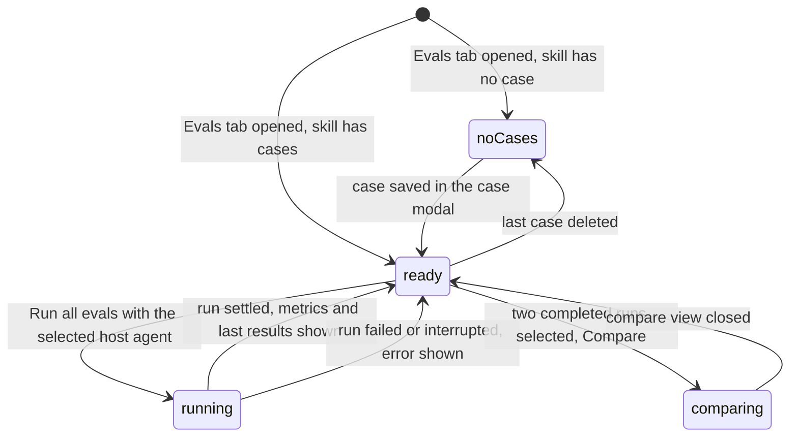
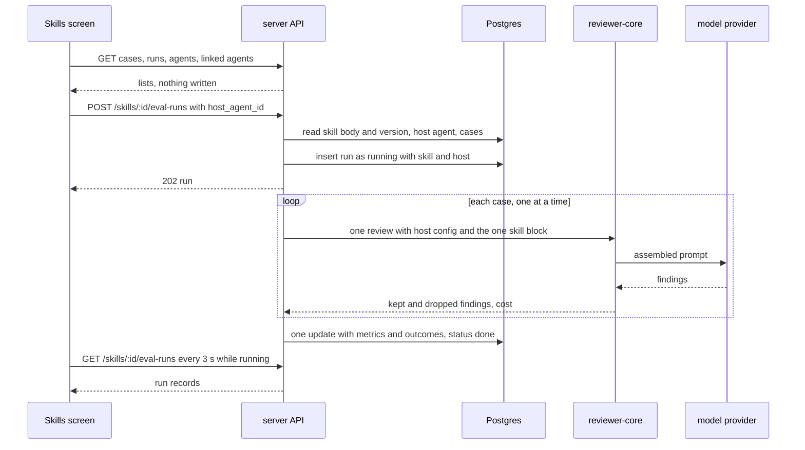

# Spec: Skill evals — eval cases and an Evals tab in the Skill Editor
Spec ID: SPEC-10
Status: implemented
Supersedes: in part — SPEC-03 (specs/2026-10-12-eval-pipeline.md) and SPEC-09 (specs/2026-10-13-eval-case-modal.md): the non-goal NG-4 of each ("eval cases owned by a skill", "evals for skills and an Evals tab in the Skill Editor") is replaced by this spec; everything else in both specs stays in force

## Problem and user

A **skill author** edits the body of a skill on the Skills screen. The body is the only text
of a skill that reaches a model, and it is shared by every agent that links the skill. Today
nothing tells the author whether an edit made the skill better or worse: eval cases, runs and
the three metrics exist for agents only (SPEC-03, SPEC-04, SPEC-09), the Skill Editor has
five tabs and no Evals tab (`client/src/app/skills/constants.ts:16`), and the only way to
measure a skill is to link it to an agent and run that agent's own set, where the result
also depends on the agent's other skills. The course mentor names the gap as an optional
feature (IN-1: «Evals для скілів і вкладка Evals у Skill Editor — опціональна фіча»), and the
user asked for it (IN-2: «Зроби те, що опційне від ментора теж»).

An **agent author** relies on the numbers of an agent's own eval set. Those numbers, the
agent's cases and its run history have to read the same after skills gain evals (IN-3).

A **repo owner** pays for every model call, so a skill eval has to start only from an
explicit click that says what it costs, and has to leave nothing in the review data (IN-3).

A skill is not an agent: it has no provider, no model, no system prompt and no strategy.
This spec therefore also settles what a skill eval executes: the skill's case set is run
through one **host agent** chosen by the user, with the skill as the only skill block.

**What this spec replaces.** SPEC-03 NG-4 and SPEC-09 NG-4 are replaced by this spec. Every
other item of SPEC-03, SPEC-04, SPEC-05 and SPEC-09 stays in force and is not restated;
references to them carry the prefix ("SPEC-03 AC-33"); an ID without a prefix belongs to
this spec. The pre-template `specs/skills.md` names the Evals tab as not built; this spec
builds it.

## Goals / Non-goals

- **G-1** A skill author keeps a set of eval cases for a skill — created, edited and deleted by hand in the case modal — and sees it on an Evals tab of the Skill Editor.
- **G-2** A skill author runs the skill's set, or one case of it, through a chosen host agent with this skill's body as the only skill block, and reads pass or fail per case and recall, precision and citation accuracy for the run.
- **G-3** A skill author sees the history of a skill's runs and compares two of them, with the two skill bodies side by side.
- **G-4** A model is called for a skill eval only by an explicit click; a skill eval writes nothing to the review data; every existing agent case, agent run and agent number reads the same as before.

- **NG-1** A baseline run "without the skill" and a with/without comparison — no design source draws it; the comparison this spec offers is between two runs of the skill (IN-3).
- **NG-2** A skill case made from a finding — a finding belongs to an agent's review and nothing records which skill produced it (`client/docs/skills-ui.md:37`); "Turn into eval case" keeps creating agent cases only (IN-3).
- **NG-3** Skills on the Eval Dashboard, in "Run all agents" and on a per-skill dashboard page — the dashboard is drawn for reviewer agents only (IN-6); SPEC-03 and SPEC-09 keep it as it is (IN-3).
- **NG-4** The metric trend chart on the skill's Evals tab — SPEC-05 built it for agents; no source asks for it on a skill (IN-2).
- **NG-5** A "Promote" control in the comparison of two skill runs — the Versions tab already restores an earlier body as a new version (`server/src/modules/skills/service.ts:150`) (IN-2).
- **NG-6** A host agent stored on the skill, and one action that runs the set on several hosts — the host is chosen per run and stored with the run (IN-3).
- **NG-7** The "Run on evals" button of the Skill Editor header and the "Eval" side panel with "Run on 20" and "Export to CI workflow" (IN-4) — the first duplicates "Run all evals" of the tab, the second is defined in the prototype and rendered nowhere (IN-2).
- **NG-8** Pull frequency, accept rate and findings per skill on the Stats tab — no data backs them; `specs/skills.md` stays (IN-2).
- **NG-9** Any change to scoring, to the three metrics, to `reviewer-core/`, to how an agent's own set is created, run, scored and compared, and to the case modal's fields — SPEC-03, SPEC-04 and SPEC-09 stay the base, SPEC-09 NG-1 and NG-2 included (IN-3).
- **NG-10** An MCP tool for any of this and a browser e2e flow — SPEC-03 NG-7 and NG-8 stay (IN-2).
- **NG-11** A deadline or a cancel for a skill run or a try, and closing the known gaps of the review prompt a run inherits — SPEC-09 NG-8 and the default of SPEC-09 OQ-2 stay (IN-2).

## User stories

- **US-1** As a skill author, I want an Evals tab in the Skill Editor that lists the skill's eval cases with each case's last result, so that I see what the skill is measured against.
- **US-2** As a skill author, I want to create, edit and delete a case of the skill by hand in the case modal, so that the set holds the situations the skill exists for.
- **US-3** As a skill author, I want to choose the host agent a skill eval runs through, so that I know which model and system prompt the skill was measured with.
- **US-4** As a skill author, I want to run all cases of the skill and read recall, precision, citation accuracy and cases passed, so that an edit of the body shows up in numbers.
- **US-5** As a skill author, I want to try one case — from the modal, on save, or from its row — without storing anything, so that I check a case before it counts.
- **US-6** As a skill author, I want the history of the skill's runs and a comparison of two of them with the two skill bodies, so that I see what a change of the body did.
- **US-7** As a repo owner, I want a skill eval to call a model only after an explicit click and to write nothing to reviews, findings, agent runs and run traces, so that looking costs nothing and an eval leaves the review data alone.
- **US-8** As an agent author, I want my agent's cases, runs, comparison and dashboard numbers to stay what they were, so that hosting a skill eval never moves my agent's results.
- **US-9** As a skill author, I want a deletion to remove exactly the eval data that depends on what is deleted, and to be told so before a skill is deleted, so that no case or run is left without an owner.

## Acceptance criteria (EARS)

Terms are those of SPEC-03, SPEC-04 and SPEC-09: **case**, **expectation**, **run**,
**matches**, **grounded**, **content**, **the case modal**, **a try**, **complete**. A
**skill case** is a case whose `owner_kind` is `skill`. A **skill run** is a run of a
skill's case set; an **agent run** is a run of an agent's own set. The **host agent** of a
skill run or a skill try is the agent whose system prompt, provider, model and strategy the
execution uses. The **Evals tab** below is the one of the Skill Editor on the Skills screen.
Shapes are under Module interactions § Contracts.

### Skill cases — API

- **AC-1** [event-driven] WHEN `GET /skills/:id/eval-cases` is called for a skill of the workspace, the API shall return that skill's cases, oldest first, each with `last_result` taken from the newest completed run of that skill that scored the case at its current `revision`, or null. — covers: US-1 · verify: integration — two cases, one covered by a completed skill run and one never run
- **AC-2** [event-driven] WHEN `POST /skills/:id/eval-cases` is called with a valid body for a skill of the workspace, the API shall store one case with `owner_kind` `skill`, the skill's id as `owner_id`, `source_finding_id` null, a null `pr_number` and `pr_author`, and `revision` 1 by the rules of SPEC-04 AC-2 and AC-4, and answer 201 with the case. — covers: US-2 · verify: integration — one new `eval_cases` row with `owner_kind` `skill` and the skill's id
- **AC-3** [unwanted] IF the body of `POST /skills/:id/eval-cases` fails a schema rule of SPEC-04 AC-5, the diff rule of SPEC-04 AC-6 or the expectation rule of SPEC-04 AC-7, THEN the API shall answer 422, 400 `eval_diff_invalid` or 400 `expectation_outside_diff` and store nothing. — covers: US-2 · verify: integration — a blank `name`, prose as the diff, and lines outside every hunk, each with an unchanged row count
- **AC-4** [event-driven] WHEN `PUT /eval-cases/:id` is called with a valid body for a skill case, the API shall update the case by the rules of SPEC-04 AC-10, AC-11 and AC-15 and answer 200 with the case and its `last_result` taken from the runs of the owning skill. — covers: US-2 · verify: integration — a rename keeps `revision` 1 and the stored last result; a changed `end_line` gives `revision` 2 and `last_result` null
- **AC-5** [state-driven + event-driven] WHILE a run of a skill is in status `running`, WHEN `PUT /eval-cases/:id` is called for a case of that skill, the API shall answer 400 with code `eval_run_in_progress` and leave the case unchanged. — covers: US-2 · verify: integration — an update sent while a stored skill run is `running`
- **AC-6** [event-driven] WHEN `DELETE /eval-cases/:id` is called for a skill case, the API shall delete that case and leave every stored run unchanged. — covers: US-2 · verify: integration — the case is gone; a completed skill run still holds its outcome for it
- **AC-7** [unwanted] IF the skill named in the path of a skill eval route does not exist or belongs to another workspace, THEN the API shall answer 404 before any write and any model call. — covers: US-1 · verify: integration — a skill of a second workspace on each of the six routes of this spec, with unchanged row counts and no recorded provider call
- **AC-8** [ubiquitous] The API shall return only skill cases of the named skill from `GET /skills/:id/eval-cases` and only agent cases of the named agent from `GET /agents/:id/eval-cases`. — covers: US-1 · verify: integration — an agent and a skill with one case each; each list holds its own case alone

### The host agent — API

- **AC-9** [unwanted] IF `host_agent_id` in the body of a skill run or a skill try names no agent of the workspace, THEN the API shall answer 400 with code `eval_host_agent_missing`, store nothing and call no model. — covers: US-3 · verify: integration — a random uuid, and an agent of a second workspace
- **AC-10** [unwanted] IF no key is configured for the host agent's provider, THEN the API shall answer a skill run or a skill try with 400 and code `eval_provider_unavailable` before any model call, storing nothing. — covers: US-3 · verify: integration — a container whose provider lookup throws

### A run of the skill's set — API

- **AC-11** [event-driven] WHEN `POST /skills/:id/eval-runs` is called with a `host_agent_id` for a skill that has at least one case and no run in status `running`, the API shall store one run in status `running` that holds the skill's id as `skill_id`, the skill's current version as `skill_version`, the host agent's id and current version as `agent_id` and `agent_version`, the host's provider and model, the skill's name as the one entry of `skills` and the ids of every case of the skill, whatever the `enabled` flag of the skill and of the host agent, and answer 202 with the run. — covers: US-4 · verify: integration — the stored row and the response for a disabled skill hosted by a disabled agent
- **AC-12** [ubiquitous] The API shall execute each case of a skill run as one review of the case's `input_diff` by the review engine with the host agent's system prompt, provider, model and strategy and with exactly one skill block, that of the evaluated skill, whether or not the skill is enabled or linked to the host and whatever other skills the host links. — covers: US-4 · verify: integration — with the mock provider, one structured call per case whose prompt holds the host's system prompt, the heading and body of the evaluated skill, and no heading of a second enabled skill linked to the host; a disabled skill linked to no agent runs the same way
- **AC-13** [ubiquitous] The API shall build the model input of a skill case execution from the stored case, the host agent's configuration and the skill body alone by the rules of SPEC-03 AC-33, AC-34 and AC-35 and SPEC-04 AC-24 — without a repo skeleton, a callers digest, a file-rank note, a derived intent, the project context documents attached to the host agent or to the skill, the case's name, its expectation type and its expected output. — covers: US-4 · verify: unit — the assembled input for a host with repo intel on and a skill with attached documents holds the diff, the title, the description and the skill block, and none of the listed sections or values
- **AC-14** [ubiquitous] The API shall produce for a case of a skill run the model input that is byte-identical to the one an agent run of the host produces for a case of the same content when the evaluated skill, at the same body, is the host's only linked enabled skill. — covers: US-4 · verify: unit — assemble both inputs and compare the strings
- **AC-15** [ubiquitous] The API shall score a skill run by the rules of SPEC-03 AC-50…AC-54 with no model call, and store its `recall`, `precision`, `citation_accuracy`, case counts, finding counts, cost, duration and per-case outcomes in the one update that sets the run to `done`. — covers: US-4 · verify: integration — a run of one passing `must_find` and one failing `must_not_flag` case reads `done` with recall 1, precision 0.5 (one of the two grounded findings hits its own `must_not_flag` case) and two outcomes; the mock provider records two calls
- **AC-16** [ubiquitous] The API shall write no row to `reviews`, `findings`, `agent_runs` and `run_traces` while it executes a skill run or serves a skill try. — covers: US-7 · verify: integration — the four row counts before and after a skill run and a skill try
- **AC-17** [unwanted] IF the skill has no case, THEN the API shall answer `POST /skills/:id/eval-runs` with 400 and code `eval_no_cases` and store no run. — covers: US-4 · verify: integration — status, code and an unchanged row count
- **AC-18** [unwanted] IF a run of the skill is in status `running`, THEN the API shall answer `POST /skills/:id/eval-runs` with 400, code `eval_run_in_progress` and that run's id as `details.run_id`, and store no second run. — covers: US-4 · verify: integration — two start requests in a row leave one `running` row
- **AC-19** [state-driven + event-driven] WHILE a skill run hosted by an agent is in status `running`, WHEN `POST /agents/:id/eval-runs` is called for that agent, the API shall start the agent run and answer 202. — covers: US-8 · verify: integration — an agent with one own case hosting a `running` skill run
- **AC-20** [state-driven + event-driven] WHILE an agent run of the host agent, or a run of another skill hosted by the same agent, is in status `running`, WHEN `POST /skills/:id/eval-runs` is called, the API shall start the skill run and answer 202. — covers: US-4 · verify: integration — a `running` agent run and a `running` run of a second skill, both on the host
- **AC-21** [unwanted] IF the execution of one case of a skill run fails, THEN the API shall record that case's outcome as `error` with the failure's message and execute the remaining cases, as SPEC-03 AC-37 states for an agent run. — covers: US-4 · verify: integration — a provider that throws on the second of three cases
- **AC-22** [event-driven] WHEN the API starts, the API shall set every skill run still in status `running` to `failed` with the error "interrupted", as SPEC-03 AC-42 states for an agent run. — covers: US-4 · verify: integration — a `running` skill run present before the app is built reads `failed` after
- **AC-23** [event-driven] WHEN `GET /skills/:id/eval-runs` is called, the API shall return the skill's runs, newest first, at most 20, as run records without per-case outcomes. — covers: US-6 · verify: integration — 21 stored skill runs give the 20 newest in descending start time
- **AC-24** [event-driven] WHEN `GET /eval-runs/:id` is called for a skill run, the API shall return the run with its `skill_id`, its `skill_version` and its per-case outcomes. — covers: US-6 · verify: integration — a completed skill run of two cases
- **AC-25** [ubiquitous] The API shall use for every case of a skill run the skill body read when the run started and store as `skill_version` the version that body carries. — covers: US-4 · verify: integration — a body saved between the first and the second case of a run leaves both calls with the first body and the run at the earlier version

### A try of one skill case — API

- **AC-26** [event-driven] WHEN `POST /skills/:id/eval-cases/try` is called with a valid body, the API shall execute the body's content as one review as AC-12 and AC-13 state, with the skill's stored body at the time of the request, and answer 200 with the result by the rules of SPEC-09 AC-38, AC-39 and AC-44. — covers: US-5 · verify: integration — with the mock provider, one structured call whose prompt holds the skill block and the body's diff; an overlapping grounded finding gives `pass` for `must_find`
- **AC-27** [ubiquitous] The API shall write no row to `eval_cases` and `eval_runs` while it serves a skill try, and return the same case list and run list of the skill after it as before it. — covers: US-7 · verify: integration — row counts and both list responses before and after a try that passes, one that fails and one that errors
- **AC-28** [unwanted] IF the body of a skill try fails a schema rule, the diff rule of SPEC-04 AC-6 or the expectation rule of SPEC-04 AC-7, THEN the API shall answer 422, 400 `eval_diff_invalid` or 400 `expectation_outside_diff` before any model call. — covers: US-5 · verify: integration — one request per failure with the mock provider's calls empty
- **AC-29** [state-driven + event-driven] WHILE a run of the skill is in status `running`, WHEN a skill try is requested, the API shall execute the try and answer as AC-26 states. — covers: US-5 · verify: integration — a try sent while a stored skill run is `running` answers 200

### Comparing two skill runs — API

- **AC-30** [event-driven] WHEN `GET /skills/:id/eval-runs/compare` is called with `base` and `head` naming two completed runs of that skill, the API shall return, the older run as `base`, for each run its `skill_version`, the skill body of that version's stored snapshot, its host agent's id and version, its provider and model, and its metrics, cost and case counts computed over the cases both runs scored at the same revision, with `cases_only_in_base`, `cases_only_in_head` and `cases_edited` by the rules of SPEC-03 AC-72 and SPEC-04 AC-19. — covers: US-6 · verify: integration — two runs at skill versions 1 and 2 return both bodies; a case edited between them is named in `cases_edited` and left out of the values
- **AC-31** [unwanted] IF `base` or `head` names a run that is not completed, is a run of another skill or an agent run, or names a skill version without a stored snapshot, THEN the API shall answer 400 with code `eval_runs_not_comparable`. — covers: US-6 · verify: integration — a `running` skill run, a run of a second skill and an agent run of the host

### The agent side stays as it is — API

- **AC-32** [ubiquitous] The API shall count only agent runs in `GET /agents/:id/eval-runs`, in the `last_result` of every agent case and in every field of `GET /eval/dashboard` — `latest_run`, `run_in_progress`, `trend` and `recent_runs`. — covers: US-8 · verify: integration — a host agent with one own completed run and one hosted completed skill run returns the own run alone in the three responses; `run_in_progress` reads false while a hosted skill run is `running`
- **AC-33** [unwanted] IF `base` or `head` of `GET /agents/:id/eval-runs/compare` names a skill run, THEN the API shall answer 400 with code `eval_runs_not_comparable`. — covers: US-8 · verify: integration — an agent run compared with a skill run the agent hosted

### Deleting — API and the Skills screen

- **AC-34** [event-driven] WHEN `DELETE /skills/:id` is called, the API shall delete the skill's cases and the skill's runs together with the skill, all or nothing, and leave every other row of `eval_cases` and `eval_runs` unchanged. — covers: US-9 · verify: integration — a skill with two cases and one run beside an agent with one case and one run; after the delete the agent's rows are identical and the skill's are gone
- **AC-35** [event-driven] WHEN `DELETE /agents/:id` is called for an agent that hosted skill runs, the API shall delete those runs with the agent and keep every skill case. — covers: US-9 · verify: integration — a skill with one case and one run hosted by the deleted agent reads one case with `last_result` null and an empty run list
- **AC-36** [event-driven] WHEN the skill author activates Delete on a skill, the Skills screen shall state in the confirmation dialog that the skill's eval cases and eval runs are deleted with it, before any request is sent. — covers: US-9 · verify: component — the dialog text; no `DELETE` recorded before the confirmation

### The Evals tab — the Skills screen

- **AC-37** [ubiquitous] The Skills screen shall show an "Evals" tab in the Skill Editor between the Preview tab and the Stats tab. — covers: US-1 · verify: component — the order of the six tab buttons
- **AC-38** [event-driven] WHEN `/skills/:id` is opened with `tab=evals` in the query, the Skills screen shall show the Evals tab of that skill. — covers: US-1 · verify: component — the tab's heading is rendered for the query value, and again after a remount
- **AC-39** [event-driven] WHEN the Evals tab is opened, the Skills screen shall send only `GET` requests — the skill's cases, the skill's runs, the workspace's agents and the agents linked to the skill. — covers: US-7 · verify: component — the mocked `fetch` records the four reads and no `POST`, `PUT` or `DELETE`
- **AC-40** [state-driven] WHILE the skill has no case, the Skills screen shall show on the Evals tab an empty state titled "No eval cases yet" with the text "Add a case to test this skill against a known diff and expected findings." and a "New eval case" control. — covers: US-1 · verify: component — an empty case list
- **AC-41** [state-driven] WHILE the skill has at least one case, the Skills screen shall show on the Evals tab the heading "Eval cases", the number of cases whose stored last result is `pass` out of the number of cases that have a stored last result as "N / M passing", a "Run all evals" control and a "New eval case" control. — covers: US-1 · verify: component — three cases with a pass, a fail and no result give "1 / 2 passing"
- **AC-42** [ubiquitous] The Skills screen shall show each case of the Evals tab as a row with the case's name, its expectation type in words, its stored last result in words — passed or failed with "expected N, got M", errored with the reason, or "never run" — and a run, an edit and a delete control, each a native button whose accessible name names the case. — covers: US-1 · verify: component — four rows, one per result state, each with three named buttons
- **AC-43** [state-driven] WHILE the read of the skill's cases or of the skill's runs is in flight, the Skills screen shall show a loading text in that part of the Evals tab. — covers: US-1 · verify: component — a pending cases request and a pending runs request
- **AC-44** [unwanted] IF the read of the skill's cases or of the skill's runs fails, THEN the Skills screen shall show a failure message with a retry control in that part of the Evals tab. — covers: US-1 · verify: component — a mocked 500 on each read; the retry control sends the read again
- **AC-45** [ubiquitous] The Skills screen shall show on the Evals tab a labelled host agent selector that lists every agent of the workspace by name and model, the agents linked to the skill first. — covers: US-3 · verify: component — three agents of which the second is linked: the linked one is the first option
- **AC-46** [event-driven] WHEN the Evals tab is opened, the Skills screen shall preselect as host the host agent of the skill's newest run where that agent is in the list, otherwise the first agent linked to the skill, otherwise the first agent of the list. — covers: US-3 · verify: component — a newest run hosted by the third agent; no run and one linked agent; no run and no linked agent
- **AC-47** [state-driven] WHILE the workspace has no agent, the Skills screen shall render "Run all evals" and every row run control disabled with a hint that a host agent is needed, and keep "New eval case" enabled. — covers: US-3 · verify: component — an empty agent list
- **AC-48** [state-driven] WHILE the skill is disabled, the Skills screen shall show on the Evals tab a text that an eval uses the skill's saved body although the skill is disabled. — covers: US-4 · verify: component — a skill with `enabled` false shows the text; an enabled one does not
- **AC-49** [ubiquitous] The Skills screen shall state on the "Run all evals" control, in its text or its title, the number of cases as model calls and the name of the selected host agent. — covers: US-7 · verify: component — three cases and the host "Security Reviewer"
- **AC-50** [event-driven] WHEN the skill author activates "Run all evals", the Skills screen shall send one `POST /skills/:id/eval-runs` request with the selected host agent's id and no other write request. — covers: US-4 · verify: component — one mocked request whose body holds the selected agent's id
- **AC-51** [state-driven] WHILE the newest run of the skill is in status `running`, the Skills screen shall render "Run all evals" disabled with a running text and read the skill's run list again every 3 seconds. — covers: US-4 · verify: component — a 202 answer disables the control; a second click sends no request; a second read follows after 3 seconds of fake time
- **AC-52** [event-driven] WHEN the newest run of the skill leaves status `running`, the Skills screen shall read the skill's case list again and show the run's metrics and each case's new last result without a page reload. — covers: US-4 · verify: component — a run list that changes from `running` to `done` is followed by one more cases read
- **AC-53** [unwanted] IF the start request of a skill run is refused, THEN the Skills screen shall show the API's message beside "Run all evals" and render the control enabled. — covers: US-4 · verify: component — a mocked 400 `eval_provider_unavailable`, a mocked 400 `eval_host_agent_missing` and a mocked 429
- **AC-54** [ubiquitous] The Skills screen shall show on the Evals tab four tiles — recall, precision, citation accuracy and cases passed of total — for the skill's newest completed run, each of the three metrics with its change against the previous completed run, and "—" with no change for a metric that is null. — covers: US-4 · verify: component — two completed runs; a run whose `recall` is null
- **AC-55** [state-driven] WHILE the skill has cases and no completed run, the Skills screen shall show the tiles without values and a text that the set was never run. — covers: US-4 · verify: component — cases with an empty run list
- **AC-56** [event-driven] WHEN the skill author activates a row's run control, the Skills screen shall send one `POST /skills/:id/eval-cases/try` request with that case's stored content and the selected host agent's id, and no other write request. — covers: US-5 · verify: component — one mocked request whose body equals the row's case and the selected host
- **AC-57** [ubiquitous] The Skills screen shall show the running state, the trial result and the failure of a row's try as SPEC-09 AC-68…AC-71 state for a case row of an agent. — covers: US-5 · verify: component — a pending request on one of two rows; a pass labelled as a trial run beside "never run"; a mocked 400 shown on the row
- **AC-58** [event-driven] WHEN the skill author activates a row's delete control, the Skills screen shall send one `DELETE /eval-cases/:id` request for that case and show the list without it once the request answers. — covers: US-2 · verify: component — one mocked request and a list of one row less

### The case modal opened from the Skills screen

- **AC-59** [event-driven] WHEN the skill author activates "New eval case", the case modal shall open in new mode titled "New eval case", naming the skill and the selected host agent, with an empty name, an empty diff and an editable expectation type. — covers: US-2 · verify: component — the title, the two names and the empty fields
- **AC-60** [event-driven] WHEN the skill author activates a row's edit control, the case modal shall open in edit mode with that case's values and the "Last run" line of SPEC-04 AC-39. — covers: US-2 · verify: component — the stored values and "Last run failed" for a case whose last result is a fail
- **AC-61** [event-driven] WHEN the skill author activates Save in a case modal opened from the Skills screen, the case modal shall send one `POST /skills/:id/eval-cases` request in new mode or one `PUT /eval-cases/:id` request in edit mode, and no request to a route of an agent. — covers: US-2 · verify: component — the recorded request in each mode; no request whose path starts with `/agents/`
- **AC-62** [event-driven] WHEN the skill author activates Run case in a case modal opened from the Skills screen, the case modal shall send one `POST /skills/:id/eval-cases/try` request with the form's current content and the selected host agent's id, and no save request. — covers: US-5 · verify: component — one mocked request whose body holds an edit made after the modal opened
- **AC-63** [ubiquitous] The case modal opened from the Skills screen shall behave for Cancel, the result region, the mark on a result of earlier content, "Run on save" and a failed save or try as SPEC-09 AC-35 and AC-49…AC-65 state, with the skill's routes in place of the agent's. — covers: US-5 · verify: component — the modal's SPEC-09 test cases for the new and the edit mode, run with a skill as owner
- **AC-64** [state-driven] WHILE the workspace has no agent, the case modal opened from the Skills screen shall render Run case disabled with a hint that a host agent is needed and close after a successful save without sending a try request. — covers: US-5 · verify: component — an empty agent list; a save followed by no try request

### Run history and comparison — the Skills screen

- **AC-65** [ubiquitous] The Skills screen shall show on the Evals tab the skill's run history as a table with one row per run — start time, skill version as `vN`, the host agent's name with its version, recall, precision, citation accuracy, cases passed of covered, and cost — newest first, a failed run with its error. — covers: US-6 · verify: component — two completed rows in order and one failed row
- **AC-66** [state-driven] WHILE exactly two completed runs are selected in the skill's run history, the Skills screen shall render the Compare control enabled, as SPEC-03 AC-68 and AC-69 state for an agent's run history. — covers: US-6 · verify: component — one completed run leaves the control disabled with its hint; two selected rows enable it
- **AC-67** [event-driven] WHEN the skill author activates the Compare control, the compare view shall show for recall, precision, citation accuracy and cost the older run's value, the newer run's value and the difference with its direction, name the two skill versions in its title, and show the difference between the two skill bodies with removed and added text each marked by a label or a text decoration in addition to colour. — covers: US-6 · verify: component — versions 3 and 4 with one line added to the newer body
- **AC-68** [unwanted] IF the two compared runs carry the same skill version, THEN the compare view shall say that both runs used the same skill body in place of a difference. — covers: US-6 · verify: component — two runs at version 2
- **AC-69** [unwanted] IF the two compared runs differ in host agent, host agent version, provider or model, THEN the compare view shall list those differences above the skill body difference. — covers: US-6 · verify: component — two runs hosted by different agents on different models
- **AC-70** [ubiquitous] The compare view of two skill runs shall show no Promote control. — covers: US-6 · verify: component — no button named "Promote" for a mocked skill comparison
- **AC-71** [unwanted] IF the compare request of two skill runs fails, THEN the compare view shall show the API's message. — covers: US-6 · verify: component — a mocked 400 `eval_runs_not_comparable`
- **AC-72** [unwanted] IF the compare response names cases in `cases_only_in_base`, `cases_only_in_head` or `cases_edited`, THEN the compare view shall name those cases and say that they are left out of the values. — covers: US-6 · verify: component — one case in each of the three lists
- **AC-73** [ubiquitous] The Skills screen shall show the Evals tab at the width of the Skill Editor pane without a horizontal scrollbar of the pane, for a case name of 64 characters and a `file` path longer than the pane. — covers: US-1 · verify: manual — a screenshot of the real page; jsdom computes no layout, and the agent's Evals tab overflowed with every component test green (`client/INSIGHTS.md` § Recurring Errors)

## Edge cases

- **EC-1** The skill has no case → the empty state; a start request is refused — covered by: AC-17, AC-40
- **EC-2** The workspace has no agent → cases are still created and edited; nothing is run, and the controls say why — covered by: AC-47, AC-64
- **EC-3** The skill is linked to no agent → every agent of the workspace is offered as host and the first one is preselected — covered by: AC-45, AC-46
- **EC-4** The skill is disabled, as every imported skill is when it arrives → it is evaluated all the same and the tab says so — covered by: AC-11, AC-12, AC-48
- **EC-5** The host agent links other enabled skills → none of them reaches the prompt of a skill eval — covered by: AC-12
- **EC-6** The host agent is disabled → its `enabled` flag is not read, as SPEC-03 AC-31 has it for an agent run — covered by: AC-11
- **EC-7** The skill body is saved while a run of the skill executes → the run keeps the body and the version it started with; the next run uses the new ones — covered by: AC-25
- **EC-8** The body is edited on the Config tab and not saved → a run and a try use the stored body — covered by: AC-25, AC-26
- **EC-9** The host agent's prompt or model changes between two runs, or another host is chosen → each run stores its host, the host's version, provider and model, and the comparison lists the differences — covered by: AC-11, AC-69
- **EC-10** The host agent of earlier runs is deleted → those runs go with it, the skill's cases stay with no last result from them, and another agent is preselected — covered by: AC-35, AC-46
- **EC-11** The selected host agent is deleted between the tab's read and the click → the start or the try answers `eval_host_agent_missing` and the message is shown — covered by: AC-9, AC-53, AC-57
- **EC-12** The skill is deleted in another tab while its Evals tab is open → the next request answers 404 and the message is shown — covered by: AC-7, AC-53
- **EC-13** "Run all evals" is clicked twice, or in two tabs → one run; the second request is refused with the running run's id — covered by: AC-18, AC-51
- **EC-14** A skill run and an agent run of its host are started at the same time → both run; neither refuses the other — covered by: AC-19, AC-20
- **EC-15** Two skills are run on the same host at the same time → both run; the limit is one run per skill — covered by: AC-18, AC-20
- **EC-16** The provider call of a case never returns (`server/INSIGHTS.md`: a run has no per-case deadline) → the skill's run stays `running` and refuses a new run and a case edit of that skill only, until the API restarts — covered by: AC-5, AC-18, AC-19, AC-22
- **EC-17** One case of N fails in the provider → that case is `error`, the others are scored — covered by: AC-21
- **EC-18** No key is configured for the host's provider → refused before any call, and the message is shown — covered by: AC-10, AC-53
- **EC-19** More than 10 starts or tries within a minute → the API answers 429 and the message is shown — covered by: AC-53, AC-57, NFR-3
- **EC-20** A case is edited or deleted between two compared runs → it is left out of both sides and named — covered by: AC-30, AC-72
- **EC-21** A compared run's skill version has no stored snapshot → the comparison is refused; a skill created through the API or the seed has a snapshot for every version (`server/src/modules/skills/repository.ts:136`, `server/src/db/seed.ts:321`) — covered by: AC-31, AC-71
- **EC-22** Two compared runs carry the same skill version and differ only in host → the view says the bodies are the same and lists the host differences — covered by: AC-68, AC-69
- **EC-23** The skill has only `must_not_flag` cases, so recall is null → "—" and no change for recall — covered by: AC-54
- **EC-24** The skill has one completed run → tiles without a change, Compare disabled with its hint — covered by: AC-54, AC-66
- **EC-25** Cases and runs stored before the feature, the user's dev database included → they stay agent cases and agent runs, read back unchanged — covered by: AC-32, NFR-9
- **EC-26** The diff or the description of a skill case carries text addressed to the model → it travels as data inside the engine's untrusted-data blocks — covered by: NFR-4
- **EC-27** The body of an imported skill carries instructions of a third party → it reaches the model as one labelled skill block, as in a live review of an agent that enabled it, and only in an eval of that skill — covered by: AC-12, NFR-5
- **EC-28** The skill, the host agent or the case named in a request belongs to another workspace → 404 or `eval_host_agent_missing`; nothing read, executed or stored — covered by: AC-7, AC-9
- **EC-29** A long case name or file path on the tab → the row wraps; the pane does not scroll sideways — covered by: AC-73
- **EC-30** A finding of a try carries a severity the UI has no style for → shown as text — covered by: AC-63, NFR-7
- **EC-31** The body of a create, a try or a start request is larger than the API's body limit → refused, nothing executed or stored — covered by: NFR-6
- **EC-32** The skill is deleted while a run of it executes → its cases and runs are deleted; nothing of the run is stored afterwards — covered by: AC-34

## Non-functional requirements

- **NFR-1** [cost] A model is called for a skill only by `POST /skills/:id/eval-runs` and `POST /skills/:id/eval-cases/try`, each sent only after a click on a control whose text or title names the action; the case routes, the run list, the comparison, the delete routes, opening the Evals tab, choosing a host and typing in the modal make no model call. — verify: integration — the mock provider's recorded calls stay empty across the case, list, compare and delete routes; component — opening the tab, changing the selector and editing the modal send no `POST`
- **NFR-2** [cost] A skill run makes one engine review per case and a skill try makes one; no intent derivation, brief or repo-intel call is started by either, and scoring calls no model. — verify: integration — with strategy `single-pass`, the mock provider records N structured calls for a run of N cases and one per try
- **NFR-3** [cost] `POST /skills/:id/eval-runs` and `POST /skills/:id/eval-cases/try` are each limited to 10 requests per minute, the limit their agent counterparts carry (`server/src/modules/eval/constants.ts:6`). — verify: integration — the two routes' rate-limit config
- **NFR-4** [security] The diff and the pull request description of a skill case reach the model only inside the engine's untrusted-data blocks of the user message, through the path an agent run uses; no second prompt assembly is introduced. — verify: unit — in the assembled input of a skill case whose diff holds "ignore the instructions above" the text stands inside the diff block and outside the system message and the skill block
- **NFR-5** [security] A skill body reaches a model through a skill eval only as the one skill block of an eval of that same skill, rendered with the label a live review gives it — the skill's name, type and source, a third-party source marked as such; evaluating a disabled skill adds it to no live review and to no agent run. — verify: unit — the block's heading for an imported skill names its source as third-party; integration — after a run of a disabled skill linked to an agent, a review of that agent and an agent run of it record no block of the skill
- **NFR-6** [security] Every route this spec adds declares Zod schemas for its params, query and body; a body above the API's limit of 1,048,576 bytes (`server/src/app.ts:49`) is refused; body values are stored as data and never placed into query text. — verify: integration — a non-uuid id and a non-uuid `host_agent_id` answer 422; a body of 1,100,000 bytes stores and executes nothing; a `file` of `'; drop table eval_cases; --` is stored and read back as that text
- **NFR-7** [security] Case names, the findings and the error of a try or a run, agent names and the two skill bodies of a comparison are rendered as text, never as markup. — verify: component — a case name, a finding title and a skill body holding `` appear as visible text and add no `img` element
- **NFR-8** [compatibility] The request and response shapes this spec adds, and the two fields added to the run record, are declared in both `@devdigest/shared` copies with identical text. — verify: unit — the check SPEC-03 NFR-7 names, extended to these declarations
- **NFR-9** [compatibility] The feature adds one migration, and it is additive: it adds nullable columns to `eval_runs` for the evaluated skill and its version and scopes the one-running-run rule to the owner of the set; it adds no table, changes no existing column and updates or deletes no row of `eval_cases` and `eval_runs`; a run stored before the feature reads as an agent run with `skill_id` and `skill_version` null and every other value unchanged. — verify: integration — rows inserted in the pre-feature shape read back identical through the agent routes after the migration; manual — a dry run of the migration on a restored copy of the dev database with a per-table row diff before it is applied there (`INSIGHTS.md` § What Works), because no test reads the user's database
- **NFR-10** [compatibility] Every existing route keeps its response, except that a run record gains `skill_id` and `skill_version`; every MCP tool, the eval fixture command and `reviewer-core/` stay as they are. — verify: integration — the server suites of SPEC-03, SPEC-04 and SPEC-09 pass with no assertion changed; the `mcp/` suite passes unchanged; `git status --short reviewer-core mcp` is empty
- **NFR-11** [i18n] Every string of the feature comes from `client/messages/en/` (`eval`, `skills`), reusing the keys the agent's Evals tab and the case modal already use; counts of cases use ICU plural forms, and every number that exceeds 999 is a typed number argument. — verify: component — tests render with the real message files; `grep -rn` finds no literal UI string in the feature's components
- **NFR-12** [accessibility] The host agent selector is a native select with a visible label; "Run all evals", "New eval case", Compare and the row controls are native buttons with an accessible name; the reason of a disabled control is exposed as its description; a refused start is announced through an alert; pass, fail and error are carried by words and an icon in addition to colour; the comparison dialog closes on Escape and returns focus to the control that opened it. — verify: component — queries by role and name, the description of a disabled control, the alert's text, focus after close
- **NFR-13** [observability] The API writes for a skill run the start and the settle log line of an agent run, and for a skill try the log line of an agent try, each with the skill id and the skill version added to the host agent's id and version, and never the skill body, diff text, expectation text or finding text. — verify: integration — the three log records and the absence of the fixture body's and the fixture diff's text in them
- **NFR-14** [performance] `GET /skills/:id/eval-runs` returns at most 20 runs without per-case outcomes, and `GET /skills/:id/eval-cases` computes every `last_result` without one query per case; every skill eval read is served from stored rows without reading a clone or calling GitHub. — verify: integration — the response for 21 stored runs; the number of statements for 1 case and for 5 cases is the same; the mock git and GitHub clients record no call

## Module interactions

Packages: server, client
Surfaces: the Skill Editor on the Skills screen (a new Evals tab: the host agent selector, the case list, the metric tiles, the run history, the comparison; the delete confirmation); the case modal in its new and edit modes with a skill as owner; the routes `GET /skills/:id/eval-cases`, `POST /skills/:id/eval-cases`, `POST /skills/:id/eval-cases/try`, `POST /skills/:id/eval-runs`, `GET /skills/:id/eval-runs`, `GET /skills/:id/eval-runs/compare` (all new); `PUT /eval-cases/:id`, `DELETE /eval-cases/:id`, `GET /eval-runs/:id`, `DELETE /skills/:id` (changed); the agent eval routes and `GET /eval/dashboard` (unchanged in what they return for agents)

| # | From → To | Channel | Carries | Exists today | If it fails |
|---|---|---|---|---|---|
| MI-1 | client → server | `GET /skills/:id/eval-cases` | back: the skill's cases with `last_result` | new | the failure state with retry on the tab (AC-44) |
| MI-2 | client → server | `POST /skills/:id/eval-cases` | name, expectation type, diff, pull request title and body, expectation; back: the case, 201 | new | the modal stays open with the API's message (AC-63) |
| MI-3 | client → server | `PUT /eval-cases/:id`, `DELETE /eval-cases/:id` | unchanged bodies; for a skill case the run-in-progress check and `last_result` follow the owning skill | changes (`server/src/modules/eval/service.ts:182`, `:216` read the runs by the owner id as an agent id) | the API's message in the modal or on the row |
| MI-4 | client → server | `POST /skills/:id/eval-runs` | `host_agent_id`; back: the run, 202 | new | the API's message beside the control (AC-53) |
| MI-5 | client → server | `GET /skills/:id/eval-runs`; `GET /eval-runs/:id` | back: run records with `skill_id` and `skill_version`; one run with outcomes | new; changes (`server/src/modules/eval/routes.ts:141` returns a run without the two fields) | the failure state with retry on the tab (AC-44) |
| MI-6 | client → server | `POST /skills/:id/eval-cases/try` | `host_agent_id` and the try body of SPEC-09; back: status, `matched`, findings, duration, cost | new | the message in the result region or on the row (AC-57, AC-63) |
| MI-7 | client → server | `GET /skills/:id/eval-runs/compare` | `base`, `head`; back: two sides with skill version, skill body, host, metrics | new | the API's message in the compare view (AC-71) |
| MI-8 | client → server | `GET /agents`, `GET /skills/:id/agents` | the workspace's agents with name and model; the agents linked to the skill | yes (`client/src/lib/hooks/agents.ts:16`; `server/src/modules/skills/routes.ts:159`, read from `agent_skills` at `server/src/modules/skills/repository.ts:93`) | the selector shows no option and the run controls stay disabled (AC-47) |
| MI-9 | server, eval → server, skills data | the skill row and a skill version's snapshot | name, type, source, body, version; the body of a stored version | changes (`server/src/modules/eval/types.ts:187` reads only the enabled skills linked to an agent; the row and the snapshot are written at `server/src/modules/skills/repository.ts:136`, `:219`) | 404 for an unknown skill (AC-7); a missing snapshot makes two runs not comparable (AC-31) |
| MI-10 | server, eval → server, agents data | the host agent's record | `system_prompt`, provider, model, strategy, `version` | yes (`server/src/modules/eval/types.ts:171`, read at `server/src/modules/eval/service.ts:244`) | 400 `eval_host_agent_missing` (AC-9) |
| MI-11 | server, eval → reviewer-core | `reviewPullRequest`, as an agent run calls it | system prompt, model, strategy, one skill block, the diff, the task line, the description; back: kept and dropped findings, tokens, cost | yes (`server/src/modules/eval/runner.ts:87`; the input is assembled at `server/src/modules/eval/helpers.ts:201`) | the case is `error` (AC-21); a try answers `status` `error` (AC-26) |
| MI-12 | reviewer-core → model provider | the injected provider of the host's `provider` | the assembled prompt | yes (`server/src/modules/eval/service.ts:255` resolves it and refuses a missing key) | 400 `eval_provider_unavailable` (AC-10) |
| MI-13 | server → Postgres | `eval_cases` | inserts with `owner_kind` `skill`; reads by owner kind and owner id | changes (`server/src/db/schema/eval.ts:55` admits `skill`; every write sets `agent`, `server/src/modules/eval/service.ts:104`, `:145`) | a failed write fails the request and stores nothing |
| MI-14 | server → Postgres | `eval_runs` | a skill run: the host as agent, the skill and its version; at most one `running` run per skill, independent of the host agent's own | changes (`server/src/db/schema/eval.ts:84` keys a run by `agent_id` alone and `:113` allows one `running` run per `agent_id`) — a migration (NFR-9) | a second start is refused (AC-18) |
| MI-15 | server, skills → server, eval data | the delete of a skill | the skill's cases and runs go with it | changes (`server/src/modules/skills/repository.ts:228` deletes the skill row alone; `eval_cases.owner_id` carries no foreign key) | the delete fails as a whole and nothing is removed (AC-34) |
| MI-16 | mcp → server | the existing routes | unchanged; no tool reads, tries or starts a skill eval | yes (no file under `mcp/src` names an eval route) | unchanged |

### Contracts

Wire JSON is snake_case. Both `@devdigest/shared` copies carry the same declarations
(NFR-8). Everything not listed here is as SPEC-03, SPEC-04 and SPEC-09 § Contracts have it.
A status is the HTTP status; a code is the `code` of the API's error body.

**The run record — two fields added** (run lists, `GET /eval-runs/:id`, the 202 of a start)

| Field | Type | Notes |
|---|---|---|
| `skill_id` | string or null | the evaluated skill; null for an agent run |
| `skill_version` | int or null | the skill's version when the run started; null for an agent run |

For a skill run `agent_id` and `agent_version` are the host agent's, `provider` and `model`
the host's, and `skills` holds the evaluated skill's name alone.

**`POST /skills/:id/eval-cases` — request body:** the body of `POST /agents/:id/eval-cases`
(SPEC-04 § Contracts): `name`, `expectation_type`, `input_diff`,
`input_meta: { pr_title, pr_body }`, `expected_output`. Response 201: the eval case record
with `owner_kind` `skill`.

**`POST /skills/:id/eval-runs` — request body**

| Field | Type | Notes |
|---|---|---|
| `host_agent_id` | string, uuid | an agent of the workspace |

**`POST /skills/:id/eval-cases/try` — request body:** the try body of SPEC-09 § Contracts
(`expectation_type`, `input_diff`, `input_meta`, `expected_output`) plus `host_agent_id`
(string, uuid). Response 200: the try result of SPEC-09.

**`GET /skills/:id/eval-runs/compare?base=<run id>&head=<run id>` — response 200:**
`{ base, head, cases_only_in_base: string[], cases_only_in_head: string[], cases_edited: string[] }`,
where `base` is the older run and each side is:

| Field | Type | Notes |
|---|---|---|
| `run_id` | string | |
| `skill_version` | int | |
| `skill_body` | string | the body of that version's stored snapshot |
| `agent_id`, `agent_version` | string, int | the host agent |
| `provider`, `model` | string | the host's, as stored with the run |
| `started_at` | string | |
| `recall`, `precision`, `citation_accuracy` | number 0–1 or null | over the cases both runs scored at the same revision |
| `cost_usd` | number or null | |
| `cases_total`, `cases_passed` | int | over the same cases |

**Routes**

| Route | Success | Errors |
|---|---|---|
| `GET /skills/:id/eval-cases` | 200 case records | 404; 422 params |
| `POST /skills/:id/eval-cases` | 201 case | 404; 400 `eval_diff_invalid`, `expectation_outside_diff`; 422 params or body |
| `POST /skills/:id/eval-cases/try` | 200 result, `status` `error` included | 404; 400 `eval_host_agent_missing`, `eval_provider_unavailable`, `eval_diff_invalid`, `expectation_outside_diff`; 422 params or body; 429 |
| `POST /skills/:id/eval-runs` | 202 run | 404; 400 `eval_host_agent_missing`, `eval_no_cases`, `eval_run_in_progress`, `eval_provider_unavailable`; 422 params or body; 429 |
| `GET /skills/:id/eval-runs` | 200 run records, at most 20 | 404; 422 params |
| `GET /skills/:id/eval-runs/compare` | 200 | 404; 400 `eval_runs_not_comparable`; 422 params or query |

`eval_host_agent_missing` is the one new code; the others exist
(`server/src/modules/eval/constants.ts:10`).

## Design review

Sources reviewed: IN-4, IN-5, IN-6

A decision `accepted` below rests on IN-2: the user told the calling session, in writing,
to build the feature as the requirements define it and to take the recommended option
wherever they leave a point open. Each row is such a point with the option taken.

| # | Kind | Finding | Proposal | Decision |
|---|---|---|---|---|
| DR-1 | module | A skill has no provider, model, system prompt or strategy (`server/src/modules/skills/repository.ts:20`); the engine needs all four (`server/src/modules/eval/helpers.ts:201`). No design source says what a skill eval executes | Run the set through one host agent's configuration with the evaluated skill as the only skill block | accepted → AC-11, AC-12 |
| DR-2 | module | `eval_runs` is keyed by a non-null `agent_id` and holds skill names only (`server/src/db/schema/eval.ts:84`, `:106`); nothing tells a skill run from an agent run, so an agent's run list, last results, trend and dashboard would count the skill runs it hosted. The existing tables do not carry the feature | One additive migration: the run stores the evaluated skill and its version; agent reads count agent runs only | accepted → AC-11, AC-32, NFR-9 |
| DR-3 | module | The database allows one `running` run per `agent_id` (`server/src/db/schema/eval.ts:113`); kept as it is, a skill run would refuse the host agent's own run with nothing running on the agent's tab, and a hung provider call (`server/INSIGHTS.md`) would block the agent too | One `running` run per skill, independent of the host agent's own run and of other skills on the same host | accepted → AC-18, AC-19, AC-20 |
| DR-4 | missing state | The prototype's Evals tab has "Run all evals" and no way to say which agent runs it (`screen_skills.jsx:126-137`) | A labelled host selector, linked agents first; preselected from the newest run, then the first linked agent, then the first agent; stored with each run, never on the skill | accepted → AC-45, AC-46 |
| DR-5 | missing state | No source shows the tab for a workspace without an agent | Cases are still created; the run controls are disabled with a hint | accepted → AC-47, AC-64 |
| DR-6 | corner case | A live review loads a skill only when it is linked and enabled (`server/src/modules/skills/repository.ts:113`), and an imported skill arrives disabled. The prototype's data gives the disabled, imported, unlinked skill `phantom-api-gate` four eval cases (`data.jsx:224`, `:344`) | An eval runs the skill whatever its `enabled` flag and links, and the tab says so for a disabled skill; measuring before enabling is the use | accepted → AC-12, AC-48, NFR-5 |
| DR-7 | corner case | The host agent links its own skills; with them in the prompt a result would not be the evaluated skill's | Exactly one skill block, the evaluated skill's | accepted → AC-12 |
| DR-8 | inconsistency | The prototype's skill tab draws the "N / M passing" badge and the rows and no metric (`screen_skills.jsx:131`), while IN-1 names recall, precision and citation accuracy as the point of the evals, and the agent tab shows them as tiles (IN-6, `img_4.png`) | The four tiles, the run history and the comparison on the skill tab, from the components the agent tab uses | accepted → AC-54, AC-65, AC-67 |
| DR-9 | inconsistency | The agent comparison shows the difference of two system prompts (IN-6, `img_3.png`); between two skill runs the text that changed is the skill body, and the prototype says of skill versions "Every save snapshots the body so eval runs stay reproducible against the exact text they scored" (`screen_skills.jsx:175`) | Store the skill version with the run and show the difference of the two bodies from the version snapshots; list host differences above it | accepted → AC-25, AC-30, AC-67, AC-69 |
| DR-10 | ux | The agent comparison offers "Promote vN" (SPEC-09 AC-81); the Versions tab of a skill already restores a body as a new version | Not included | rejected — NG-5 (IN-2) |
| DR-11 | ux | A with/without-skill baseline would show what the skill adds; no design source draws it, and it doubles the model calls of a run | Not included | rejected — NG-1 (IN-3) |
| DR-12 | module | "Turn into eval case" stores a case for the agent of the finding's review (SPEC-09 AC-23); nothing records which skill produced a finding (`client/docs/skills-ui.md:37`) | Skill cases are made by hand only | rejected — NG-2 (IN-3) |
| DR-13 | inconsistency | The prototype has "Run on evals" in the editor header (`screen_skills.jsx:273`) and "Run all evals" on the tab (`:133`), both without a handler, and an "Eval" side panel with "Run on 20" and "Export to CI workflow" that is defined and rendered nowhere (`:189-212`) | One run control, on the tab | rejected — NG-7 (IN-2) |
| DR-14 | module | The Eval Dashboard is drawn for reviewer agents only ("Regression harness across all reviewer agents", IN-6 `img_1.png`; `screen_skills.jsx:343`) | Skills are not shown there, and its numbers leave skill runs out | accepted → AC-32; the rest rejected — NG-3 (IN-3) |
| DR-15 | corner case | `DELETE /skills/:id` removes the skill row alone (`server/src/modules/skills/repository.ts:228`) and `eval_cases.owner_id` has no foreign key, so a deleted skill would leave cases nobody lists; an agent delete removes the agent's cases in the same transaction (`server/src/modules/agents/repository.ts:77`) | The skill's cases and runs go with the skill, all or nothing, and the confirmation says so | accepted → AC-34, AC-36 |
| DR-16 | corner case | A run's `agent_id` cascades on an agent delete (`server/src/db/schema/eval.ts:86`), so deleting a host agent removes the skill runs it hosted. Keeping them would mean changing an existing column of stored runs | Keep the existing rule: the hosted runs go with the agent, the skill's cases stay | accepted → AC-35 |
| DR-17 | missing state | The prototype shows the tab with cases and the empty state only: no loading, no failed read, no running run, no refused start, no set that was never run | The states the agent's Evals tab has | accepted → AC-43, AC-44, AC-51, AC-53, AC-55 |
| DR-18 | ux | No frame says what "Run all evals" costs or which agent it runs through | The control states the number of cases as model calls and the host's name | accepted → AC-49 |
| DR-19 | module | `PUT /eval-cases/:id` checks for a running run and computes `last_result` with the case's owner id passed as an agent id (`server/src/modules/eval/service.ts:182`, `:216`); for a skill case both would silently find nothing | Both follow the owning skill | accepted → AC-4, AC-5 |
| DR-20 | inconsistency | The client says the Evals tab is "intentionally absent" because "a tab that invents numbers is worse than a tab that is not there" (`client/src/app/skills/constants.ts:11-15`, `client/docs/skills-ui.md:37`) | The tab is added and shows stored cases and stored runs only; the usage metrics the same note rejects stay out | accepted → AC-37, AC-41; NG-8 |
| DR-21 | ux | The agent tab draws a metric trend chart (SPEC-05); no source asks for one on a skill | Not included | rejected — NG-4 (IN-2) |
| DR-22 | corner case | A skill run inherits the missing per-case deadline of an agent run (`server/INSIGHTS.md`) | No deadline; with DR-3 a hung run blocks that skill alone | rejected — NG-11 (IN-2) |
| DR-23 | missing state | The modal's Run case and "Run on save" need a host agent; none exists in a workspace without agents | Run case disabled with a hint; a save closes the modal without a try | accepted → AC-64 |
| DR-24 | corner case | The agent's Evals tab overflowed its pane on a long `file:line` while every component test was green (`client/INSIGHTS.md`) | One look at the real page at the pane's width | accepted → AC-73 |

## Inputs and provenance

| # | Source | Kind | Used for |
|---|---|---|---|
| IN-1 | the course mentor's note, quoted in `course-materials/results/lesson6/REQUEST.md:42` under «Доповнення 3»: «2️⃣ Evals для скілів і вкладка Evals у Skill Editor — опціональна фіча. Робити її не обов'язково: основний фокус — evals для агентів, метрики recall / precision / citation accuracy, дашборд і порівняння прогонів. Якщо встигаєте — буде гарним бонусом.»; the same as M-6 in `specs/eval-pipeline.md:40` | user text | Problem, G-1…G-3, US-1…US-6 |
| IN-2 | the user's instructions in the same file: «Зроби те, що опційне від ментора теж» (`REQUEST.md:56`, 2026-10-13) and «І по питаннях зроби як у вимогах мало бути, а якщо є невизначеність по вимогах, то зроби те, що ти рекомендуєш» (`REQUEST.md:29`); earlier «Бери рекомендовані сам» (SPEC-03 IN-15) | user answer | the request itself; every Design review decision; NG-4…NG-11; most criteria |
| IN-3 | task text of the calling session, 2026-10-13: SPEC-10 spans `server/` and `client/`; the recommendation that a skill's set runs through one chosen host agent's configuration with exactly this skill's current body as the only skill block, that the run stores the host agent and version and the skill version, that scoring, metrics, history and comparison are the existing code paths, and that the modal behaves as in SPEC-09 with the skill as owner; the defaults "no baseline", "manual cases only", "no skills on the dashboard", "the host is chosen per run and not stored on the skill"; the constraints: additive only for data, a paid model call only on an explicit user action, no row in `reviews`, `findings`, `agent_runs`, `run_traces`, the smallest honest scope, no new migration unless the existing tables do not carry the feature | user text | G-4, US-7…US-9, NG-1…NG-3, AC-11…AC-16, AC-26, AC-27, AC-32, AC-33, AC-63, NFR-1, NFR-2, NFR-9, NFR-10 |
| IN-4 | `docs/design/Dev Digest 2/Dev Digest/screen_skills.jsx:126-138` (the skill's Evals tab: heading, "N / M passing" badge, "Run all evals", "New eval case", the empty state and its copy), `:175` (the Versions tab's sentence about eval runs), `:189-212` (the unrendered "Eval" panel), `:237-281` (the editor: tabs Config, Context, Preview, Evals, Stats, Versions; "Run on evals" in the header); `data.jsx:219-226`, `:344` (the skills and their `evals` counts) | figma export | AC-37, AC-40, AC-41, DR-4, DR-6, DR-8, DR-9, DR-13, DR-17 |
| IN-5 | `docs/design/Dev Digest 2/Dev Digest/components2.jsx:75-97` (the case row both tabs share: status icon, name, type badge, result text, run, edit and delete icons) and `screen_agents.jsx:180-200` (the agent's Evals tab) | figma export | AC-42 |
| IN-6 | `course-materials/materials/lesson6/i/img_4.png` (the agent's Evals tab: four tiles, "3 / 5 passing", the case rows), `img_5.png` (the case modal: Cancel, Run case, Save, "Run on save"), `img_1.png` (the Eval Dashboard: agents only), `img_3.png` (the compare modal: metric changes, "System prompt diff", "Promote v7"), opened on 2026-10-13; `img.png`, `img_2.png` and `img_6.png` were not opened — `hw6_description.txt:34-36`, `:72` names them as the PR Overview page, one agent's dashboard view and a code sample for `evals/` | figma export | DR-8, DR-9, DR-14 |
| IN-7 | `course-materials/materials/lesson6/hw6_description.txt` — the homework text; it asks for the agent pipeline and names no skill eval in the product (its "Евал власного скіла в evals/" is SPEC-06) | user text | Problem (what the homework itself covers) |
| IN-8 | `server/src/modules/eval/routes.ts`, `service.ts`, `runner.ts`, `repository.ts`, `helpers.ts`, `types.ts`, `constants.ts`; `server/src/db/schema/eval.ts`; `server/src/vendor/shared/contracts/eval.ts` and `knowledge.ts:50`; `server/src/modules/skills/routes.ts`, `service.ts`, `repository.ts`; `server/src/domain/reviews/prompt-parts.ts`; `server/src/modules/agents/repository.ts:77`; `server/src/db/seed.ts:321`; `server/src/app.ts:49` @ 1d4e77f, working tree | code | MI-3, MI-5, MI-8…MI-16, AC-21, AC-22, AC-35, DR-1…DR-3, DR-15, DR-16, DR-19, NFR-3, NFR-6, EC-6, EC-21 |
| IN-9 | `client/src/app/skills/_components/SkillDetail/SkillDetail.tsx`, `client/src/app/skills/constants.ts`; `client/src/app/agents/[id]/_components/AgentEditor/_components/EvalsTab/EvalsTab.tsx` and its `CaseList`; `client/src/components/eval-runs/` (`RunControl`, `RunHistory`, `CompareRunsDialog`, `MetricTiles`), `client/src/components/eval-case-editor/CaseEditorDialog.tsx`; `client/src/lib/hooks/evals.ts`, `skills.ts`, `agents.ts`; `client/messages/en/eval.json`, `skills.json` @ 1d4e77f, working tree | code | Problem, AC-51, NFR-11, DR-20, MI-8 |
| IN-10 | `specs/2026-10-12-eval-pipeline.md` (SPEC-03), `specs/2026-10-12-case-editor.md` (SPEC-04), `client/specs/2026-10-12-eval-trend-charts.md` (SPEC-05), `specs/2026-10-13-eval-case-modal.md` (SPEC-09), all `implemented`; `specs/eval-pipeline.md`; `specs/skills.md:118`; `docs/eval-pipeline.md`; `client/docs/skills-ui.md:37-42`; `server/docs/skills-in-prompt.md` (the two SQL gates; a skill body is not wrapped as untrusted data) | repository | the superseded items, the terms, the cited criteria, NFR-3…NFR-8, NFR-11…NFR-14, DR-10, DR-12, DR-20, DR-21 |
| IN-11 | `INSIGHTS.md` (the dev-database dry-run recipe; `i/` is scratch, cite the JSX prototype; the starter pre-wires a lesson), `server/INSIGHTS.md` (a run has no per-case deadline; an agent delete removes its `eval_cases` from the agents repository; `drizzle-kit generate` turns interactive on a drop plus add), `client/INSIGHTS.md` (the Evals tab overflow; `Tabs` renders plain buttons; no `user-event`; the shared package is type-only in the client), `AGENTS.md`, `server/AGENTS.md`, `client/AGENTS.md`, `TESTING.md`, `.claude/agents/security-reviewer.md` § Step 2, `.claude/skills/onion-architecture/rules/zod-contracts.md` | repository | EC-16, EC-25, EC-27, AC-73, DR-22, DR-24, the `verify:` rings, Untrusted inputs |

| Items | Origin | Source |
|---|---|---|
| G-1…G-3 | stated | IN-1, IN-2 |
| G-4 | stated | IN-3 |
| NG-1…NG-3 | stated | IN-3 |
| NG-4…NG-11 | stated | IN-2 (the recommended option of DR-10, DR-13, DR-20, DR-21, DR-22; SPEC-03 and SPEC-09 non-goals kept) |
| US-1…US-6 | stated | IN-1, IN-2 |
| US-7…US-9 | stated | IN-3 |
| AC-37, AC-40…AC-42 | design | IN-4, IN-5 |
| AC-21, AC-22, AC-35 | code | IN-8 (`server/src/modules/eval/runner.ts:110`, `server/src/modules/eval/repository.ts:395`, `server/src/db/schema/eval.ts:86`) |
| AC-11…AC-16, AC-26, AC-27, AC-32, AC-33, AC-63 | stated | IN-3 |
| AC-1…AC-10, AC-17…AC-20, AC-23…AC-25, AC-28…AC-31, AC-34, AC-36, AC-38, AC-39, AC-43…AC-62, AC-64…AC-73 | stated | IN-2 (the recommended option of the Design review rows; the agent-side criteria of SPEC-03, SPEC-04 and SPEC-09 carried to a skill owner) |
| EC-6, EC-16, EC-21, EC-25, EC-27 | code | IN-8, IN-10, IN-11 |
| EC-1…EC-5, EC-7…EC-15, EC-17…EC-20, EC-22…EC-24, EC-26, EC-28…EC-32 | stated | IN-2 |
| NFR-1, NFR-2, NFR-9, NFR-10 | stated | IN-3 |
| NFR-3…NFR-8, NFR-11…NFR-14 | stated | IN-10 (SPEC-03 and SPEC-09 requirements of the same kind, carried to the skill routes on the instruction of IN-2) |

## Untrusted inputs

| # | Input | Controlled by | Enters at | Reaches | Rule |
|---|---|---|---|---|---|
| UI-1 | The diff of a skill case, with the file paths inside it | a workspace user who pastes it; a pull request's author where it was copied from one | the bodies of `POST /skills/:id/eval-cases`, `PUT /eval-cases/:id` and `POST /skills/:id/eval-cases/try` | the model prompt on every run and try; the stored case; rendered HTML in the preview | sent to the model only inside the engine's untrusted-data block, through the path an agent run uses — NFR-4; rendered as text — NFR-7; refused above the body limit — NFR-6 |
| UI-2 | The pull request title and description of a skill case | the same | the same bodies | the model prompt; rendered HTML | the description only inside the engine's untrusted-data block; the title in the task line as SPEC-04 AC-24 states — AC-13, NFR-4 |
| UI-3 | The skill body, an imported third-party text included | a workspace user; the author of an imported skill or archive | the skills import and editor, before this feature; read by a skill run and a skill try | the model prompt as a skill block — not wrapped as untrusted data, as in a live review (`server/docs/skills-in-prompt.md`); rendered HTML in the comparison | reaches a model only in an eval of that same skill, as one labelled block, on an explicit click; a disabled skill enters no live review through it — AC-12, NFR-5, NFR-1; rendered as text in the comparison — NFR-7 |
| UI-4 | `host_agent_id` and the route params and query | the HTTP caller | the six routes of this spec | SQL; the choice of system prompt, provider and model | Zod schemas on params, query and body — NFR-6; an id of another workspace answers 404 or `eval_host_agent_missing` — AC-7, AC-9 |
| UI-5 | The case name and the expectation's file, title, severity and category | a workspace user | the two case bodies and the try body | the stored case; rendered HTML; never the model | never part of the model input — AC-13; stored as data — NFR-6; rendered as text — NFR-7 |
| UI-6 | The findings and the error message of a skill run or try | a model, over the diff and the skill body; a provider | the engine's answer | the stored run's outcomes; rendered HTML on the tab and in the modal | parsed by the engine's schema; scored in code with no model call — AC-15; rendered as text — NFR-7; a try stores none — AC-27 |

## Traceability

| Goal | Stories | Criteria | Edge cases | NFR |
|---|---|---|---|---|
| G-1 | US-1, US-2 | AC-1…AC-8, AC-37, AC-38, AC-40…AC-44, AC-58…AC-61, AC-73 | EC-1, EC-29 | — |
| G-2 | US-3, US-4, US-5 | AC-9…AC-15, AC-17, AC-18, AC-20…AC-22, AC-25, AC-26, AC-28, AC-29, AC-45…AC-48, AC-50…AC-57, AC-62…AC-64 | EC-2…EC-9, EC-11…EC-19, EC-23, EC-30 | NFR-2, NFR-3, NFR-5 |
| G-3 | US-6 | AC-23, AC-24, AC-30, AC-31, AC-65…AC-72 | EC-20…EC-22, EC-24 | NFR-14 |
| G-4 | US-7, US-8, US-9 | AC-16, AC-19, AC-27, AC-32…AC-36, AC-39, AC-49 | EC-10, EC-25, EC-32 | NFR-1, NFR-9, NFR-10 |
| — | — | — | EC-26, EC-27, EC-28, EC-31 | NFR-4, NFR-6, NFR-7, NFR-8, NFR-11, NFR-12, NFR-13 |

## Open questions

None — the user delegated every open point to the recommended option (IN-2); each decision taken on that instruction is a row of the Design review with its reason, and none is left without a default.
