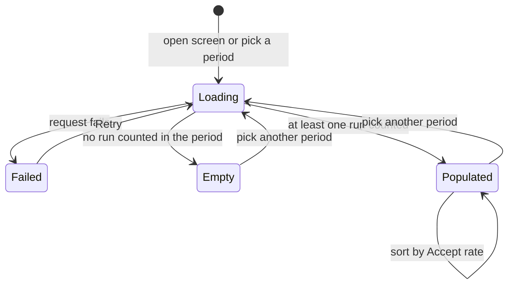
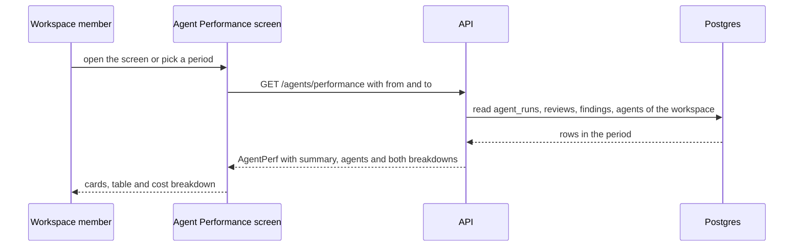
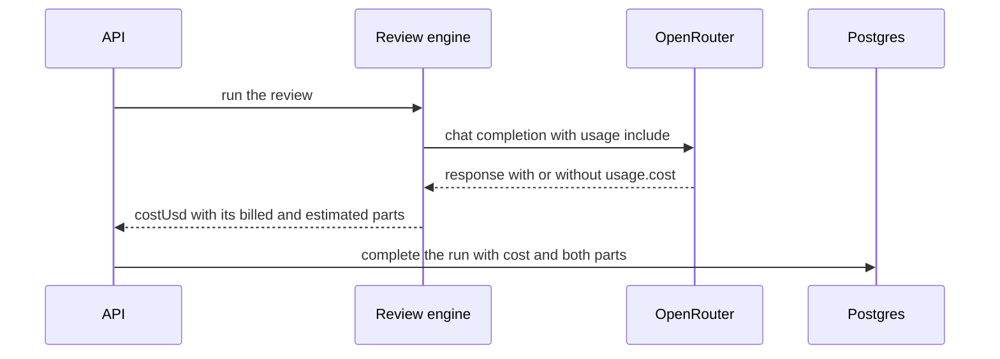

# Spec: Agent Performance dashboard
Spec ID: SPEC-11
Status: approved
Supersedes: none

## Problem and user

A workspace member who runs several reviewer agents on pull requests — and the agent author
who tunes them — cannot see today which agents earn their keep. Every run is stored with its
agent, model, status, duration and cost (`agent_runs`), and every accept or dismiss of a
finding is stored on the finding (`findings.accepted_at` / `dismissed_at`), but no screen
and no route aggregates them: the sidebar has no Global section (`client/src/vendor/ui/nav.ts:21-48`),
the agent editor has no Stats tab ("Stats / CI arrive with their own lessons",
`client/src/app/agents/[id]/_components/AgentEditor/constants.ts:10`), and
`GET /agents/performance` and `GET /agents/:id/stats` exist only as contracts
(`server/src/vendor/shared/contracts/productionize.ts:135-186`,
`server/src/vendor/shared/contracts/observability.ts:88-118`) with no route behind them.
The course homework (IN-1) asks for one global screen that aggregates the stored runs and
findings of all agents for a chosen period, with an accept rate whose sample size is visible
and a cost that is not mistaken for billing.

A stored run's cost is itself of two kinds that nobody can tell apart today: for an OpenRouter
call the engine asks for the provider's own figure (`usage: { include: true }`,
`reviewer-core/src/llm/openrouter.ts:83`) and stores it when the response carries it, and
DevDigest's price-table estimate when it does not (`:107`); `agent_runs` records only the sum
(`server/src/db/schema/runs.ts:21-22`). Every stored run in the dev database is an OpenRouter
run (IN-11), so the user wants each cost figure to say which part the provider billed. The
user also wants to see the period against the one before it (IN-11).

## Goals / Non-goals

- **G-1** A workspace member opens Agent Performance from the Global section of the sidebar and sees, for a chosen period, the runs, cost, duration, accept rate and last run of every agent, four KPI cards and a cost breakdown by agent and by model.
- **G-2** Every figure follows one written set of aggregation rules, shared with the per-agent stats, so that an agent's figures are equal in both places for the same period and every total equals the sum of its parts.
- **G-3** The screen tells apart loading, failure, a period with no run, an agent with no run, an accept rate from a small sample, and the part of a cost the provider billed from the part DevDigest estimated and the part whose source is unknown — and never shows a made-up figure.
- **G-4** Opening and using the dashboard starts no review and no model call; it reads stored runs and findings only.
- **G-5** Every review run written from now on records which part of its cost the model provider reported and which part DevDigest estimated; runs stored earlier keep an unknown source.
- **G-6** The dashboard compares the selected period with the one of the same length just before it: runs over time on the Total runs card, the change in total cost, and the direction of each agent's accept rate.
- **NG-1** The agent Stats tab in the agent editor is not built; the per-agent figures are served by `GET /agents/:id/stats` only — the editor's tab list defers it to its own lesson.
- **NG-2** No reconciliation with the provider's account: the dashboard calls no OpenRouter API, and no run stored before the cost source is recorded is backfilled — the user ruled out both (IN-11).
- **NG-3** `GET /agents/:id/stats` returns no runs series and no previous-period figures — a caller that wants the previous period asks for its range.
- **NG-8** The other surfaces that show a run's cost (the PR list, the run timeline, the trace drawer) keep showing one amount — the user asked for the split on the dashboard only (IN-11).
- **NG-4** The other Global items of the design — Memory, Multi-Agent Review, CI Runs — are not added — none of those screens exists, and the user chose Agent Performance alone in the new section (IN-10).
- **NG-5** Eval runs (`eval_runs`) are not counted — they are not reviews of pull requests.
- **NG-6** No filter by repository — the screen sits under GLOBAL and covers the whole workspace.
- **NG-7** A table row does not expand; View opens the agent — the design draws no expanded row.

## User stories

- **US-1** As a workspace member, I want an Agent Performance item in the Global section of the sidebar, so that I reach the cross-agent view from any screen.
- **US-2** As a workspace member, I want to choose the period — 1 day, 30 days or a custom range — so that every figure on the screen covers the same window.
- **US-3** As a workspace member, I want four KPI cards — Total runs, Total cost, Avg accept rate, Most-active agent — so that I see the state of all agents at a glance.
- **US-4** As a workspace member, I want a table of agents with runs, average cost, average duration, accept rate with its denominator, last run and a View link, sortable by accept rate, so that I compare agents.
- **US-5** As a workspace member, I want the cost broken down by agent and by model, so that I see where the money goes.
- **US-6** As an agent author, I want every figure computed by one set of rules shared with the per-agent stats, so that totals add up and the two views never contradict each other.
- **US-7** As a workspace member, I want loading, failure, an empty period and an agent without runs shown as such, so that I never read missing data as zero.
- **US-8** As a workspace member, I want every cost figure to show which part the provider billed, which part is a DevDigest estimate and which part has an unknown source, so that I do not take an estimate for billing.
- **US-9** As a workspace member, I want the dashboard to read stored runs and findings only, so that opening, reloading and sorting it never starts a review or costs a model call.
- **US-10** As an agent author, I want every review run to record which part of its cost the provider reported, so that billed cost is told apart from estimates without asking the provider again.
- **US-11** As a workspace member, I want to see runs over time, the change in total cost against the previous period and whether each agent's accept rate went up or down, so that I see a trend and not only a snapshot.

States of the screen:

## Acceptance criteria (EARS)

- **AC-1** [ubiquitous] The sidebar shall show an "Agent Performance" item, linking to `/agent-performance`, in a section titled "GLOBAL" placed after the Skills Lab section. — covers: US-1 · verify: component — the rendered sidebar holds a GLOBAL group whose item named "Agent Performance" links to `/agent-performance`
- **AC-2** [state-driven] WHILE the current path is `/agent-performance`, the sidebar shall mark the Agent Performance item as the active item. — covers: US-1 · verify: component — with the path mocked to `/agent-performance`, that item carries the active state and no other does
- **AC-3** [ubiquitous] The Agent Performance screen shall offer three period choices: 1 day, 30 days and a custom date range. — covers: US-2 · verify: component — the period picker lists the three choices by their labels
- **AC-4** [event-driven] WHEN the Agent Performance screen opens with no period in its URL, the Agent Performance screen shall select the 30 days period. — covers: US-2 · verify: component — the first request carries a 30-day range and the picker reads "30 days"
- **AC-5** [event-driven] WHEN a period is selected, the Agent Performance screen shall request `GET /agents/performance` once with `from` and `to` of that period — 1 day is the 24 hours before now, 30 days the 30 × 24 hours before now, a custom range runs from the start of its first local date to the start of the local date after its last. — covers: US-2 · verify: component — with the clock fixed, the mocked `fetch` receives one call per selection with the expected `from` and `to`
- **AC-6** [unwanted] IF a custom range ends before it starts, or ends after today, THEN the Agent Performance screen shall show a validation message at the range picker and send no request. — covers: US-2 · verify: component — an inverted range shows the message and `fetch` is not called
- **AC-7** [unwanted] IF `GET /agents/performance` or `GET /agents/:id/stats` is called without `from` or `to`, with a value that is not an ISO 8601 date-time, or with `from` not before `to`, THEN the API shall answer 422. — covers: US-2 · verify: unit — the route schema rejects each malformed query with 422 before the handler runs
- **AC-8** [event-driven] WHEN the response arrives, the Agent Performance screen shall show four cards — Total runs, Total cost, Avg accept rate, Most-active agent — filled from `summary`, each label naming the selected period. — covers: US-3 · verify: component — the four cards show the mocked `summary` values and a label such as "Total runs (30d)"
- **AC-9** [ubiquitous] The Avg accept rate card shall show, beside the rate, the number of decisions it is computed from and the number of runs counted in the period. — covers: US-3 · verify: component — with `decisions` 41 and `runs` 253 mocked, the card shows both numbers
- **AC-10** [ubiquitous] The Most-active agent card shall show that agent's name, its counted runs and its accept rate. — covers: US-3 · verify: component — the card shows the mocked name, run count and rate
- **AC-11** [ubiquitous] The Agent Performance screen shall show a table with the columns Agent, Runs, Avg cost, Avg duration, Accept rate, Last run and View, with one row per entry of `agents`. — covers: US-4 · verify: component — the header cells read in that order and the row count equals the mocked `agents` length
- **AC-12** [ubiquitous] The Accept rate cell of the Agent Performance screen shall show the rate together with its denominator as a number of decisions. — covers: US-4 · verify: component — a row with 9 accepted of 12 decisions shows "75%" and "12 decisions"
- **AC-13** [state-driven] WHILE an agent has fewer than 10 decisions in the period, the Agent Performance screen shall show a "small sample" text mark in that agent's Accept rate cell. — covers: US-4 · verify: component — a row with `small_sample: true` shows the text mark, a row with `false` does not
- **AC-14** [event-driven] WHEN the table is sorted by Accept rate, the Agent Performance screen shall order the rows that are not a small sample by their rate and place every small-sample row and every row without a rate after them. — covers: US-4 · verify: component — a small-sample row at 100% sorts below a 60% row with enough decisions, in both directions
- **AC-15** [event-driven] WHEN the table first renders, the Agent Performance screen shall sort it by Accept rate, highest first. — covers: US-4 · verify: component — the first row is the highest rate that is not a small sample and the header shows the descending state
- **AC-16** [event-driven] WHEN the user activates View on a row, the Agent Performance screen shall navigate to `/agents/<agent_id>` of that row. — covers: US-4 · verify: component — the router mock receives the agent's path
- **AC-17** [state-driven] WHILE a row stands for the runs of deleted agents (`agent_id` null), the Agent Performance screen shall show "Deleted agent" as its name and no View control. — covers: US-4 · verify: component — that row has the label and no View button
- **AC-18** [ubiquitous] The Agent Performance screen shall show a Cost breakdown section with two charts, By agent and By model, each with a legend naming every segment and its amount. — covers: US-5 · verify: component — both legends list the mocked segments with their formatted amounts
- **AC-19** [state-driven] WHILE no run counted in the period has a cost, the Agent Performance screen shall show "No cost recorded for this period" in place of both charts. — covers: US-5 · verify: component — with `total_cost_usd` null the text replaces the charts
- **AC-20** [ubiquitous] The API shall count a review run (`agent_runs`; eval runs are not review runs) when it belongs to the caller's workspace, its `ran_at` lies in the half-open range [`from`, `to`) and its status is `done`, `failed` or `cancelled`. — covers: US-6 · verify: integration — seeded runs on both edges of the range and in each status give the expected `runs`
- **AC-21** [ubiquitous] The API shall report as an agent's `total_cost_usd` the sum of `cost_usd` over its counted runs that have a cost, and as `avg_cost_usd` that sum divided by the number of those runs. — covers: US-6 · verify: integration — seeded costs, one of them null, give the expected sum and average
- **AC-22** [ubiquitous] The API shall report as an agent's `avg_latency_ms` the mean `duration_ms` of its counted runs whose status is `done`. — covers: US-6 · verify: integration — a failed run stored with 0 ms leaves the mean of the done runs unchanged
- **AC-23** [ubiquitous] The API shall report as an agent's `accepted` and `dismissed` the findings (of every kind) of the reviews produced by its counted runs that carry `accepted_at` or `dismissed_at`, whenever the decision was made, as `decisions` their sum, and as `accept_rate` accepted divided by decisions (null when decisions is 0). — covers: US-6 · verify: integration — seeded accepted, dismissed and undecided findings of each kind, one decided after `to`, give the expected counts and rate
- **AC-24** [ubiquitous] The API shall return a `summary.total_cost_usd` equal to the sum of `total_cost_usd` over `agents`, to the sum of `cost_by_agent` and to the sum of `cost_by_model`. — covers: US-6 · verify: integration — the four sums are equal on a seed with two agents, two models and one deleted agent
- **AC-25** [ubiquitous] The API shall group `cost_by_model` by the `model` stored on each run, not by the agent's current model. — covers: US-6 · verify: integration — an agent whose model changed mid-period contributes to two model segments
- **AC-26** [ubiquitous] The API shall report `summary.runs` as the number of counted runs and `summary.most_active_agent` as the agent with the most counted runs, ties going to the agent with the newer last run, and null when no run is counted. — covers: US-6 · verify: integration — a seeded tie resolves to the agent with the later run; an empty range gives null
- **AC-27** [ubiquitous] The API shall report `summary.avg_accept_rate` as the sum of `accepted` over all rows divided by the sum of `decisions`, null when that sum is 0. — covers: US-6 · verify: integration — two agents with 9/10 and 1/2 decisions give 10/12
- **AC-28** [ubiquitous] The API shall list in `agents` every agent of the workspace, enabled or not, an agent with no counted run having `runs` 0 and null `accept_rate`, `avg_cost_usd`, `avg_latency_ms` and `last_run_at`. — covers: US-6 · verify: integration — a seeded agent with no run is listed with those values
- **AC-29** [ubiquitous] The API shall gather the counted runs whose agent was deleted into one `agents` row and one `cost_by_agent` segment with `agent_id` null, included in every total. — covers: US-6 · verify: integration — after deleting a seeded agent its runs appear in that row and in `summary.runs`
- **AC-30** [ubiquitous] The API shall report, per agent and in `summary`, `unpriced_runs` as the number of counted runs that have no cost. — covers: US-6 · verify: integration — a seeded run with null `cost_usd` is counted in `runs` and in `unpriced_runs`
- **AC-31** [ubiquitous] The API shall count the runs of every repository of the caller's workspace and no run, review or finding of another workspace. — covers: US-6 · verify: integration — rows seeded in a second workspace leave every figure unchanged
- **AC-32** [event-driven] WHEN `GET /agents/:id/stats` is called with `from` and `to`, the API shall return `runs`, `total_cost_usd`, `avg_cost_usd`, `avg_latency_ms`, `accepted`, `dismissed` and `accept_rate` equal to that agent's row of `GET /agents/performance` for the same `from` and `to`. — covers: US-6 · verify: integration — both routes are called over the same seeded rows and the fields are compared for every agent
- **AC-33** [unwanted] IF `GET /agents/:id/stats` names an agent that is not in the caller's workspace, THEN the API shall answer 404. — covers: US-6 · verify: integration — an unknown id and an id of another workspace both give 404
- **AC-34** [state-driven] WHILE the response for the selected period has not arrived, the Agent Performance screen shall show placeholders without any number in place of the cards, the table and the breakdown. — covers: US-7 · verify: component — with `fetch` pending no digit is rendered inside the cards, table or breakdown
- **AC-35** [unwanted] IF the request fails, THEN the Agent Performance screen shall show an error message and a Retry control, without any number, in place of the cards, the table and the breakdown. — covers: US-7 · verify: component — a mocked 500 renders the message and Retry, no digit, and Retry issues the same GET again
- **AC-36** [state-driven] WHILE the response counts no run in the period (`summary.runs` 0), the Agent Performance screen shall show one empty state naming the period in place of the cards, the table and the breakdown. — covers: US-7 · verify: component — with `runs` 0 the empty state text appears and no table renders
- **AC-37** [state-driven] WHILE at least one run is counted and an agent has none, the Agent Performance screen shall show "No runs in this period" across that agent's figure cells, keeping its name and View. — covers: US-7 · verify: component — the row of a zero-run agent shows the text, no "0%" and no "$0"
- **AC-38** [ubiquitous] The Total cost card shall show under the total, each named in text, the amount billed by the provider, the DevDigest estimate and the amount of unknown source, leaving out a part that is zero. — covers: US-8 · verify: component — a mocked split of 4.10 / 0.60 / 0 shows two named lines and no "unknown" line
- **AC-39** [state-driven] WHILE `summary.unpriced_runs` is above 0, the Agent Performance screen shall state on the Total cost card how many counted runs the total leaves out. — covers: US-8 · verify: component — with `unpriced_runs` 3 the card shows the count
- **AC-40** [ubiquitous] The API shall answer `GET /agents/performance` and `GET /agents/:id/stats` without calling a model provider and without writing a row to any table. — covers: US-9 · verify: integration — after both calls the mock LLM provider has 0 calls and the `agent_runs` and `run_traces` counts are unchanged
- **AC-41** [ubiquitous] The Agent Performance screen shall send only GET requests while it loads, reloads, changes period, sorts or opens an agent. — covers: US-9 · verify: component — every call recorded by the `fetch` mock across those actions uses method GET
- **AC-42** [ubiquitous] The API shall report as an agent's `last_run_at` the newest `ran_at` among its counted runs. — covers: US-6 · verify: integration — a run outside the range does not move `last_run_at`
- **AC-43** [ubiquitous] The Agent Performance screen shall cut a long agent name or model name with an ellipsis inside its cell or legend, show it in full on hover and focus, and keep the page from scrolling sideways. — covers: US-4 · verify: component — a 200-character name renders with the full text in its `title` attribute
- **AC-44** [event-driven] WHEN a period is selected, the Agent Performance screen shall write that period into the URL query of `/agent-performance`. — covers: US-2 · verify: component — after picking 1 day, then a custom range, the router mock receives a URL carrying each period
- **AC-45** [event-driven] WHEN the Agent Performance screen opens with a valid period in its URL, the Agent Performance screen shall select that period and request it. — covers: US-2 · verify: component — opening with a custom range in the URL selects it in the picker and the first request carries its `from` and `to`
- **AC-46** [ubiquitous] The API shall put the cost of counted runs that have no stored `model` into one `cost_by_model` segment with `label` null, which the Agent Performance screen names "Unknown model". — covers: US-6 · verify: integration — a seeded priced run with null `model` forms that segment and the four sums of AC-24 still agree
- **AC-47** [ubiquitous] The Agent Performance screen shall show the subtitle "Which agents earn their keep — accept rate is the quality signal" under its title. — covers: US-3 · verify: component — the subtitle text from the messages file is rendered below the heading
- **AC-48** [event-driven] WHEN a model response of a review run carries a provider-reported `usage.cost`, the review engine shall count that response's cost as billed, and otherwise count the DevDigest estimate for that response's tokens as estimated, the rule applying to every response, re-asks included. — covers: US-10 · verify: unit — in `reviewer-core`, a stubbed OpenRouter client answering one attempt with `usage.cost` and one without gives a billed and an estimated part that add up to `costUsd`
- **AC-49** [ubiquitous] The API shall count the whole cost of a model response from the OpenAI or Anthropic adapters as estimated. — covers: US-10 · verify: unit — each adapter's structured result reports its cost as estimated and nothing as billed
- **AC-50** [event-driven] WHEN a review run completes, the API shall store with the run its billed part and its estimated part, which add up to the run's stored `cost_usd`, both empty when `cost_usd` is null. — covers: US-10 · verify: integration — a run through the mock provider stores both parts and their sum equals `cost_usd`; a failed run stores neither
- **AC-51** [ubiquitous] The API shall report the cost of a run stored before its parts were recorded as of unknown source, never as billed and never as estimated. — covers: US-10 · verify: integration — a seeded run with `cost_usd` and no recorded parts adds to `unknown_usd` only
- **AC-52** [ubiquitous] The API shall return for `summary`, for every `agents` row and for every `cost_by_agent` and `cost_by_model` segment a `cost_split` of `billed_usd`, `estimated_usd` and `unknown_usd` whose sum equals that figure's cost. — covers: US-8 · verify: integration — on a seed of new and older runs, every split sums to its figure and the summary split equals the sum of the row splits
- **AC-53** [ubiquitous] The Avg cost cell shall name the basis of the agent's cost as "Billed", "Estimate" or "Unknown source" when one part holds all of it, and "Mixed" when more than one part is above zero. — covers: US-8 · verify: component — four rows with the four kinds of split show the four words
- **AC-54** [ubiquitous] Each legend entry of the Cost breakdown shall name the basis of its segment in the words of AC-53 beside its amount. — covers: US-8 · verify: component — a fully billed segment reads "Billed" and a mixed one "Mixed"
- **AC-55** [ubiquitous] The Agent Performance screen shall state that a billed amount is the cost the provider reported in its responses to DevDigest, not a figure read from the provider's account. — covers: US-8 · verify: component — the note text is rendered on the Total cost card
- **AC-56** [ubiquitous] The API shall compute the previous period as [`from` − (`to` − `from`), `from`) and its figures by the counting rules of the selected period. — covers: US-11 · verify: integration — the `previous` figures equal those of a `GET /agents/performance` call with the previous range over the same seed
- **AC-57** [ubiquitous] The API shall return `runs_series` as consecutive buckets from `from` to `to`, one hour long when the period is at most 48 hours and one day (24 hours) long otherwise, the last one ending at `to`, whose run counts add up to `summary.runs`. — covers: US-11 · verify: integration — a 24-hour range gives 24 buckets, a 30-day range 30, a 3-day custom range 3, each summing to `runs`
- **AC-58** [ubiquitous] The Total runs card shall show a sparkline of `runs_series` beside the total, with a text alternative naming the bucket size and the highest bucket. — covers: US-11 · verify: component — the sparkline renders one point per mocked bucket and its accessible name holds the peak
- **AC-59** [ubiquitous] The API shall report `summary.cost_delta_usd` as `total_cost_usd` minus the previous period's `total_cost_usd`, null when either of the two is null. — covers: US-11 · verify: integration — seeded costs in both periods give the difference; an empty previous period gives null
- **AC-60** [state-driven] WHILE `summary.cost_delta_usd` is not null, the Total cost card shall show it with its sign beside the total and name the comparison in text. — covers: US-11 · verify: component — a delta of −1.20 renders "−$1.20 vs previous 30d"
- **AC-61** [state-driven] WHILE `summary.cost_delta_usd` is null, the Total cost card shall show "No earlier period to compare" in place of the delta. — covers: US-11 · verify: component — with a null delta the text renders and no signed amount does
- **AC-62** [ubiquitous] The API shall report for each `agents` row an `accept_trend` of `up` when its accept rate rounded to a whole percent is above the previous period's, `down` when below, `flat` when equal, and null when either period has no rate or is a small sample. — covers: US-11 · verify: integration — rows seeded for each case give `up`, `down`, `flat` and null
- **AC-63** [state-driven] WHILE a row's `accept_trend` is `up` or `down`, the Accept rate cell shall show an up or down arrow whose text names the previous rate. — covers: US-11 · verify: component — an `up` row shows the arrow with "up from 64%"; `flat` and null rows show no arrow
- **AC-64** [unwanted] IF a response's `usage.cost` is not a finite number of at least 0, THEN the review engine shall treat it as absent and estimate that response's cost. — covers: US-10 · verify: unit — `NaN`, a negative number and a string each give an estimated part and no billed part
- **AC-65** [event-driven] WHEN `GET /agents/:id/stats` is called with `from` and `to`, the API shall return a `cost_split` equal to that agent's `cost_split` in `GET /agents/performance` for the same range. — covers: US-6 · verify: integration — both routes over the same seed give equal splits for every agent

## Edge cases

- **EC-1** No run in the period at all → one empty state, no zero figures — covered by: AC-36
- **EC-2** Runs in the period, but one agent has none → that row says so; the totals still render — covered by: AC-28, AC-37
- **EC-3** An agent has runs but no decided finding → `accept_rate` null, shown with "0 decisions" and sorted after the rated rows — covered by: AC-23, AC-14
- **EC-4** An agent has a few decisions → the small-sample mark and the sort placement — covered by: AC-13, AC-14
- **EC-5** A run has no cost — failed or cancelled (`server/src/modules/reviews/run-executor.ts:92`, `:509`) or a model with no price (`server/src/db/schema/runs.ts:21`) → counted in runs, left out of cost sums and averages, and stated — covered by: AC-21, AC-30, AC-39
- **EC-6** No counted run has a cost → a text in place of both charts — covered by: AC-19
- **EC-7** The agent of a run was deleted (`agent_id` set null, `server/src/db/schema/runs.ts:13`) → one "Deleted agent" row and segment — covered by: AC-17, AC-29
- **EC-8** A run is still `running` when the screen loads → not counted until it ends — covered by: AC-20
- **EC-9** A run that failed before any work stores `duration_ms` 0 (`server/src/modules/reviews/run-executor.ts:89`) → left out of the average duration — covered by: AC-22
- **EC-10** An agent's model changed inside the period → its cost splits over both models — covered by: AC-25
- **EC-11** A run with no stored `model` → its cost forms one "Unknown model" segment — covered by: AC-46
- **EC-12** A finding of a run inside the period is decided after it ends, or a finding of an earlier run is decided inside it → the decision belongs to the period of its run — covered by: AC-23
- **EC-13** The same problem is stored again on every re-run (findings are never deduplicated, `server/INSIGHTS.md`) → each stored finding counts as its own decision — covered by: AC-23
- **EC-14** Two agents have the same number of runs → the tie rule for Most-active agent — covered by: AC-26
- **EC-15** A run exactly at `from` or at `to` → counted at `from`, not at `to` — covered by: AC-20
- **EC-16** A custom range that is inverted or ends in the future → rejected on the screen — covered by: AC-6
- **EC-17** A malformed or missing `from` / `to` reaching the API → 422 — covered by: AC-7
- **EC-18** A workspace with many agents → every agent is listed, enabled or not, with no cap and no paging — covered by: AC-28
- **EC-19** Eval runs of an agent (`eval_runs`) → not counted — covered by: AC-20
- **EC-20** The period is changed while a request is in flight → the placeholders of the new period, never the old period's numbers under the new label — covered by: AC-34
- **EC-21** A very long agent or model name → cut, full text on hover and focus — covered by: AC-43
- **EC-22** The previous period holds no run or no cost (the first weeks of a workspace) → no delta, a text saying there is nothing to compare, and no trend arrows — covered by: AC-59, AC-61, AC-62
- **EC-23** An agent's rate is a small sample in either period, or the agent had no rate before (new agent) → no trend arrow — covered by: AC-62, AC-63
- **EC-24** A period of 48 hours or less against a longer one → hourly against daily buckets — covered by: AC-57
- **EC-25** A custom range that spans a daylight-saving change → buckets are fixed 24-hour spans counted from `from`, so one bucket edge does not fall on local midnight — covered by: AC-57
- **EC-26** One run mixes responses with and without a reported cost (map-reduce chunks, a schema re-ask) → a billed part and an estimated part, shown as "Mixed" — covered by: AC-48, AC-53
- **EC-27** An OpenRouter response arrives without `usage.cost` → that response is estimated — covered by: AC-48
- **EC-28** A run stored before the parts were recorded → its whole cost is of unknown source, unchanged — covered by: AC-51, NFR-6
- **EC-29** One response has neither a reported cost nor a price → the run's cost is null as today (`reviewer-core/src/review/run.ts:213`), the run counts as unpriced and stores no parts — covered by: AC-50, AC-30
- **EC-30** The SDK re-sent a timed-out request (`reviewer-core/src/llm/openrouter.ts:55`, `maxRetries: 2`) → only responses that reached DevDigest are billed in its figures, which the note on the card says — covered by: AC-55

## Non-functional requirements

- **NFR-1** [cost] Neither route nor the screen starts a review, calls a model provider or calls any OpenRouter API; the number of `agent_runs` and `run_traces` rows is the same before and after any use of the dashboard. — verify: integration (AC-40) and component (AC-41); the recipe of root `INSIGHTS.md` § What Works (diff the two counts) for a manual check on the dev stack
- **NFR-2** [compatibility] The changes to `AgentPerf`, `AgentPerfRow`, `PerfCostSegment` and `AgentStats` land identically in `server/src/vendor/shared/contracts/` and `client/src/vendor/shared/contracts/`; lines in which the two copies already differ (`productionize.ts:36`, the provider enum) stay as they are; the client imports these contracts as types only. — verify: a diff of the changed schemas between the two copies shows no difference; `pnpm build` in `client/`
- **NFR-3** [i18n] Every visible string of the screen comes from `client/messages/en/`; every count and amount above 999 is rendered with digit grouping and costs in USD. — verify: component — 1234 runs render as "1,234"; no string literal in the screen's JSX
- **NFR-4** [accessibility] The period picker, the Accept rate sort control, Retry and every View are native buttons or links reachable by keyboard with an accessible name; the sorted header exposes `aria-sort`; the small-sample mark, every chart segment, the cost basis, the delta's sign and every trend arrow are carried by text, not by colour alone. — verify: component — queries by role and name, the `aria-sort` value, legend text per segment, the arrow's text
- **NFR-5** [security] Agent names and model names are rendered as text, never as HTML and never as a link target; the only link of a row is built from `agent_id`. — verify: component — an agent named `` renders as that literal text
- **NFR-6** [compatibility] The stored `cost_usd` of every run written before the parts are recorded stays as it is, and no migration, job or request writes a billed or estimated part for such a run. — verify: integration — a seeded earlier run reads back with the same `cost_usd` and no parts after migrating and after a dashboard call
- **NFR-7** [cost] Recording the parts of a run's cost adds no model call and no request to OpenRouter beyond the review's own calls. — verify: unit — in `reviewer-core`, the stubbed provider receives the same number of requests with and without the change

## Module interactions

Packages: server, client, reviewer-core
Surfaces: the sidebar (a GLOBAL section with Agent Performance); the screen `/agent-performance`; the routes `GET /agents/performance` and `GET /agents/:id/stats`; the review run's cost recording (the review engine's structured result, the run's stored row); the contracts `AgentPerf`, `AgentPerfRow`, `PerfCostSegment`, `AgentStats` and the LLM port's `StructuredResult` in both `@devdigest/shared` copies

| # | From → To | Channel | Carries | Exists today | If it fails |
|---|---|---|---|---|---|
| MI-1 | client → server | `GET /agents/performance?from=&to=` | the period; back: `AgentPerf` with `cost_split`, `previous`, `runs_series`, `accept_trend` | changes (`server/src/modules/agent-performance/routes.ts:24`) | the error state with Retry (AC-35); 422 on a bad period (AC-7) |
| MI-2 | any API caller → server | `GET /agents/:id/stats?from=&to=` | the agent and the period; back: `AgentStats` with `cost_split` | changes (`server/src/modules/agent-performance/routes.ts:33`) | 404 (AC-33); 422 (AC-7) |
| MI-3 | server → Postgres | `agent_runs` | `workspace_id`, `agent_id`, `ran_at`, `status`, `model`, `cost_usd`, `duration_ms`, and from now on the billed and estimated parts of the cost | changes (`cost_usd` written at `server/src/modules/reviews/repository/run.repo.ts:163` from `server/src/modules/reviews/run-executor.ts:446`; nothing stores its parts, `server/src/db/schema/runs.ts:21-22`) | the route answers 500 and the screen shows its error state |
| MI-8 | reviewer-core → OpenRouter | the chat completion with `usage: { include: true }` | back: `usage.cost` in USD when OpenRouter sends it | yes (`reviewer-core/src/llm/openrouter.ts:83`, read at `:97`) | a response without it is estimated (AC-48) |
| MI-9 | reviewer-core → server | `StructuredResult` of the LLM port and the review run's result | the billed and estimated parts beside `costUsd` | changes (`server/src/vendor/shared/adapters.ts:72-80` and `reviewer-core/src/review/run.ts:131` carry `costUsd` only; `reviewer-core/src/llm/openrouter.ts:107` returns the reported cost or the estimate, never both) | a run whose cost is null stores no parts (AC-50) |
| MI-10 | server, reviews → Postgres | the completion of a review run | the run's billed and estimated parts | new (`completeAgentRun`, `server/src/modules/reviews/repository/run.repo.ts:142-177`, writes `costUsd` only) | the run completes as today; its parts stay empty and its cost reads as unknown (AC-51) |
| MI-4 | server → Postgres | `reviews.run_id` → `findings.accepted_at` / `dismissed_at` | the decisions on the findings of each run | yes (`run_id` written at `server/src/modules/reviews/run-executor.ts:420`; decisions at `server/src/modules/reviews/repository/review.repo.ts:126`, `:139`, mutually exclusive) | as MI-3 |
| MI-5 | server → Postgres | `agents` | id and name of every agent of the workspace | yes (`server/src/modules/agents/routes.ts:74`) | as MI-3 |
| MI-6 | client sidebar → client screen | the nav registry | a GLOBAL group with the item `agent-performance` → `/agent-performance` | yes (`client/src/vendor/ui/nav.ts`, landed in e72bb9f) | — |
| MI-7 | mcp → server | the existing routes | unchanged; no MCP tool reads these routes | yes (no file under `mcp/src` names either route) | unchanged |

Neither route calls a model provider (AC-40).

How a review run records the parts of its cost (the dashboard takes no part in it):

Contract — `GET /agents/performance` (wire JSON, snake_case):

| Part | Field | Type | Status |
|---|---|---|---|
| query | `from`, `to` | ISO 8601 date-time with offset, required, `from` < `to` | new — 422 otherwise |
| response | `period` | `{ from: string, to: string }` — the range applied | new |
| response | `cost_basis` | — | removed (was `'estimate'`); every cost carries its `cost_split` instead |
| response | `runs_series` | `{ start: string, runs: int }[]` — AC-57 | new |
| response | `previous` | `{ from: string, to: string, runs: int, total_cost_usd: number \| null }` — AC-56 | new |
| `summary`, `agents[]`, `cost_by_agent[]`, `cost_by_model[]` | `cost_split` | `{ billed_usd: number, estimated_usd: number, unknown_usd: number }`, summing to the figure's cost; all 0 when it is null — AC-52 | new |
| `summary` | `cost_delta_usd` | number \| null — AC-59 | new |
| `agents[]` | `previous_accept_rate` | number \| null | new |
| `agents[]` | `accept_trend` | `'up' \| 'down' \| 'flat' \| null` — AC-62 | new |
| response | `min_decisions` | int — the small-sample threshold of AC-13 | new |
| `summary` | `runs` | int | declared |
| `summary` | `total_cost_usd` | number \| null — null when no counted run has a cost | declared |
| `summary` | `unpriced_runs`, `accepted`, `decisions` | int | new |
| `summary` | `avg_accept_rate` | number 0..1 \| null | declared |
| `summary` | `most_active_agent` | string \| null | declared |
| `summary` | `most_active_agent_id` | string \| null | new |
| `summary` | `most_active_runs` | int | new |
| `summary` | `most_active_accept_rate` | number \| null | new |
| `agents[]` | `agent_id` | string \| null — null for the deleted-agents row | changes (was string) |
| `agents[]` | `agent_name` | string \| null — null for the deleted-agents row | changes (was string) |
| `agents[]` | `runs`, `accepted`, `dismissed` | int | declared |
| `agents[]` | `decisions`, `unpriced_runs` | int | new |
| `agents[]` | `small_sample` | boolean — `decisions` < `min_decisions` | new |
| `agents[]` | `accept_rate`, `total_cost_usd`, `avg_cost_usd`, `avg_latency_ms` | number \| null | declared |
| `agents[]` | `last_run_at` | ISO string \| null | declared |
| `cost_by_agent[]` | `agent_id` | string \| null | new |
| `cost_by_agent[]`, `cost_by_model[]` | `label` | string \| null — agent name or stored model; null for deleted agents and for runs without a model | changes (was string) |
| `cost_by_agent[]`, `cost_by_model[]` | `value` | number, USD, > 0 | declared |

The fields `AgentPerfRow` declares and no criterion names (`provider`, `model`,
`findings_total`, `dismiss_rate`, `avg_findings_per_run`, `findings_by_severity`, `trend`)
are not required by this spec.

Contract — `GET /agents/:id/stats`: the same query as above; back `AgentStats` with the
same meaning for `runs`, `total_cost_usd`, `avg_cost_usd`, `avg_latency_ms`, `accepted`,
`dismissed`, `accept_rate`, plus `period`, `decisions`, `unpriced_runs` and `cost_split`
(new). 404 when the agent is not in the caller's workspace; 422 on a bad query.

Contract — the LLM port (`StructuredResult` in `adapters.ts`, both copies) and the review
run's result in `reviewer-core`: beside `costUsd`, the billed part and the estimated part,
each a number or null, adding up to `costUsd`, both null when `costUsd` is null.

## Design review

Sources reviewed: IN-2, IN-3, IN-4, IN-5, IN-6, IN-7, IN-12

| # | Kind | Finding | Proposal | Decision |
|---|---|---|---|---|
| DR-1 | module | The requirements compare against "the Stats tab of a specific agent", but the agent editor has Config, Skills, Context and Evals only (`client/src/app/agents/[id]/_components/AgentEditor/constants.ts:10-16`); the `StatsTab.tsx` named as a starting point is the skill's tab and holds no run metric on purpose (`client/src/app/skills/_components/SkillDetail/_components/StatsTab/StatsTab.tsx:1-5`); `GET /agents/:id/stats` is a contract with no route | Build `GET /agents/:id/stats` over the same rules and prove equality at the API; leave the tab to its lesson | accepted → AC-32, AC-33, NG-1 (IN-10) |
| DR-2 | module | No billing data from any provider is stored anywhere; `agent_runs.cost_usd` holds either OpenRouter's reported `usage.cost` or a PriceBook estimate, and which one is not recorded (`reviewer-core/src/llm/openrouter.ts:107`, `server/src/platform/price-book.ts:33`) | Record the billed and the estimated part of each run's cost when it is written; show billed, estimate and unknown on every cost figure (IN-11 replaces the IN-10 "label everything as an estimate") | accepted → AC-48, AC-50, AC-51, AC-52, AC-38, AC-55, NG-2 (IN-11) |
| DR-3 | inconsistency | The design's GLOBAL section holds Memory, Multi-Agent Review, Agent Performance and CI Runs (IN-2); the sidebar has no GLOBAL group (`client/src/vendor/ui/nav.ts:21-48`) and none of the other three screens exists | Add the GLOBAL group with Agent Performance only | accepted → AC-1, NG-4 (IN-10) |
| DR-4 | missing state | The design shows a populated screen only: no loading, failure, empty period, agent with no run, or period without cost | The states the requirements list | accepted → AC-34, AC-35, AC-36, AC-37, AC-19 |
| DR-5 | missing state | The design's Accept column shows a bare percentage: no denominator, no small-sample mark (IN-2) | Denominator and mark, as the requirements ask | accepted → AC-12, AC-13 |
| DR-6 | ux | The design's View has no target, and the requirements mention expanding a row while the design draws none | View opens the agent editor; rows do not expand | accepted → AC-16, NG-7 (IN-10) |
| DR-7 | ux | The design shows a runs sparkline, a cost delta ("-$1.20") and up/down arrows by the accept rate (IN-2); none says what it compares against, and the requirements do not list them | Build them, each compared with the previous period of the same length | accepted → AC-56, AC-57, AC-58, AC-59, AC-60, AC-62, AC-63 (IN-11 reverses IN-10) |
| DR-8 | corner case | The custom range picker is not drawn (IN-2 shows "30 days" only) | Two local dates, inclusive, not inverted, not in the future | accepted → AC-5, AC-6 (IN-10) |
| DR-9 | corner case | The header carries a repository switcher (IN-2) while the screen sits under GLOBAL | The screen ignores the active repository | accepted → AC-31, NG-6 (IN-10) |
| DR-10 | ux | A reload resets the period to 30 days: the requirements do not ask to keep it | Write the period into the URL so a reload or a shared link restores it | accepted → AC-44, AC-45 (IN-10) |
| DR-11 | ux | Only Accept rate is sortable in the design and in the requirements | Make Runs, Avg cost, Avg duration and Last run sortable too | rejected — the user kept sorting to Accept rate only, as the requirements and the design have it (IN-10) |
| DR-12 | inconsistency | The two copies of `productionize.ts` already differ (`provider` enum, line 36) | Add the new fields identically and leave the existing difference | accepted → NFR-2 |
| DR-13 | corner case | Findings are stored again on every re-run (`server/INSIGHTS.md`, "Findings are never deduplicated"), so decisions are counted per stored finding | Count stored findings as they are | accepted → AC-23 |
| DR-14 | inconsistency | A JSX prototype of this screen exists (`docs/design/Dev Digest 2/Dev Digest/screen_agentperf.jsx`) but was not named as a source; it was not opened | Add the prototype as a design source and revise against it | rejected — the user kept the exported frame (IN-2) as the only design source (IN-10) |
| DR-15 | missing state | The design's subtitle "Which agents earn their keep — accept rate is the quality signal" (IN-2) was left out without a decision | Show it under the title | accepted → AC-47 (IN-11) |
| DR-16 | corner case | Inside one call, a reported `usage.cost` on any attempt hides the estimate of the attempts without one: `costFromApi` is returned alone (`reviewer-core/src/llm/openrouter.ts:97-107`), so a re-asked call can under-count | Decide billed or estimated per response, so a call's parts add up over all its attempts | accepted → AC-48 (IN-13) |
| DR-17 | ux | The sparkline's bucket size is not drawn for 1 day, 30 days or a custom range (IN-2 shows one 30-day line) | Hourly buckets up to 48 hours, daily (24-hour) buckets beyond, counted from `from` | accepted → AC-57 (IN-13) |
| DR-18 | missing state | The design's delta and arrows assume a previous period with data; nothing is drawn for a first period, a new agent or a small sample | No delta and a text when the previous cost is missing; no arrow when either rate is missing or a small sample | accepted → AC-59, AC-61, AC-62 (IN-13) |
| DR-19 | ux | No source draws where billed, estimate and unknown appear while Total = sum of runs and breakdown = total must keep holding | Amounts stay whole; the Total cost card lists the non-zero parts; the Avg cost cell and each legend entry name the basis ("Billed", "Estimate", "Unknown source", "Mixed") | accepted → AC-38, AC-53, AC-54 (IN-13) |
| DR-20 | module | AC-32 keeps the per-agent route equal to the dashboard row; the new split, series and previous figures change the row | `GET /agents/:id/stats` gains `cost_split` only; series and previous figures stay on the dashboard | accepted → AC-65, NG-3 (IN-13) |
| DR-21 | corner case | `usage.cost` comes from a third party and is accepted when `typeof` says number (`reviewer-core/src/llm/openrouter.ts:98`), so `NaN` or a negative value would be stored as billed | Accept a finite number of at least 0, estimate otherwise | accepted → AC-64 (IN-13) |

## Inputs and provenance

| # | Source | Kind | Used for |
|---|---|---|---|
| IN-1 | task text, 2026-10-17 — the calling session's faithful paraphrase of a Ukrainian homework text, the original not supplied: «Add a global Agent Performance screen … add "Agent Performance" to the Global sidebar section; support periods: 1 day, 30 days and a custom range; show KPI cards: Total runs, Total cost, Avg accept rate, Most-active agent; a table with columns Agent, Runs, Avg cost, Avg duration, Accept rate, Last run, View; a cost breakdown by agents and by models; use the same API and the same aggregation rules as the per-agent Stats tab; loading, empty and error states; no model calls …; show the accept-rate denominator and the number of runs in the selected period; allow sorting by accept rate only for agents with enough decisions, or clearly mark a small sample.» Acceptance: «runs, cost, duration and accept rate match the Stats tab of the same agent for the same period; Total cost equals the sum of the counted runs, and the breakdown by agents and by models adds up to the total; Most-active agent is decided by number of runs in the selected period; an agent with no runs and a completely empty dashboard have different, correct states; loading and error never show made-up zeros; reload, sorting and expanding a row never start a review or a model call; the cost metrics make clear which figure is a DevDigest estimate and which is reconciled billing data.» | user text | Problem, G-1…G-4, US-1…US-9 |
| IN-2 | `course-materials/materials/lesson8/i/img.png` (untracked; mock numbers are illustrative) | figma export | AC-1, AC-4, AC-8, AC-10, AC-15, DR-3…DR-9 |
| IN-3 | `client/src/app/agents/[id]/_components/AgentEditor/constants.ts`, `client/src/app/skills/_components/SkillDetail/_components/StatsTab/StatsTab.tsx` @ 79a6886 | code | DR-1, NG-1 |
| IN-4 | `server/src/vendor/shared/contracts/productionize.ts:135-186`, `server/src/vendor/shared/contracts/observability.ts:88-118`, the client copies @ 79a6886 | code | Module interactions, NFR-2, DR-12 |
| IN-5 | `server/src/db/schema/runs.ts`, `server/src/db/schema/reviews.ts`, `server/src/modules/reviews/repository/run.repo.ts`, `server/src/modules/reviews/repository/review.repo.ts`, `server/src/modules/reviews/run-executor.ts`, `server/src/modules/agents/routes.ts` @ 79a6886 | code | MI-3…MI-5, AC-25, AC-33, EC-5, EC-7, EC-9 |
| IN-6 | `reviewer-core/src/llm/openrouter.ts:65-107`, `server/src/platform/price-book.ts` @ 79a6886 | code | DR-2 |
| IN-7 | `client/src/vendor/ui/nav.ts`, `client/src/components/app-shell/helpers.ts:37`, `client/messages/en/shell.json:27` @ 79a6886 | code | MI-6, AC-2 |
| IN-8 | `INSIGHTS.md` (proving no model call by diffing `agent_runs` / `run_traces`; `i/`-style scratch exports are overwritten; the starter pre-wires a lesson), `server/INSIGHTS.md` (findings never deduplicated; one review per run), `client/INSIGHTS.md` (ICU `{x, number}` grouping; grid overflow with long names; `@devdigest/shared` is type-only in the client) | repository | NFR-1, NFR-3, EC-13, DR-13 |
| IN-9 | `AGENTS.md` § Conventions (two contract copies), `server/AGENTS.md` § Conventions (schema-first validation, 422), `client/AGENTS.md` § Conventions (strings in `messages/`) | repository | AC-7, NFR-2, NFR-3 |
| IN-10 | answers, 2026-10-17, relayed by the calling session: «take all recommended» — per-agent stats route only, equality proven at the API (no agent Stats tab exists on main or in any upstream lesson branch); default counting rules; small sample below 10 decisions; Most-active tie to the newer last run; decisions on findings of runs in the period, all kinds; rolling 1 / 30 days and inclusive local dates; one "Deleted agent" row and segment counted in totals; every cost labelled "DevDigest estimate", no reconciled figure; no sparkline, delta or trend arrows; View opens `/agents/:id`, no row expansion; whole workspace; Agent Performance only in GLOBAL; runs without cost counted in Runs, left out of cost, count stated on the Total cost card; pooled average accept rate; all agents, enabled or not; presentation as written; the exported frame stays the only design source; DR-10 (period in the URL) accepted; DR-11 (more sortable columns) rejected. The answers on OQ-8 (everything an estimate) and OQ-9 (no sparkline, delta or arrows) are replaced by IN-11 | user answer | NG-1, NG-4…NG-7, AC-5, AC-6, AC-16, AC-17, AC-19…AC-23, AC-27…AC-31, AC-39, AC-42…AC-46, NFR-4, DR-1, DR-3, DR-6, DR-8…DR-11, DR-14 |
| IN-11 | answers, 2026-10-17, relayed by the calling session, revision 3: stay within the homework (IN-1) — no model call, no review started, stored runs and findings only, the aggregation rules of `/agents/:id/stats`, no made-up figure in loading or error; «BUILD the design's runs sparkline (Total runs card), the cost delta against the previous period (Total cost card), and up/down trend arrows by each agent's accept rate. The comparison base is the previous period of the same length, immediately before `from`: [from − (to − from), from), computed with the same counting rules. Also add the design's subtitle "Which agents earn their keep — accept rate is the quality signal"»; to the user's «shouldn't OpenRouter be used here?»: «record the cost source per run (provider-reported vs DevDigest estimate) when a run is written, and have the dashboard show which part of each cost figure is billed by the provider and which is a DevDigest estimate; runs stored before this change have an unknown source and must be shown as such, never guessed. No call to any OpenRouter API from the dashboard; no backfill.» Facts the calling session checked: every stored run in the dev DB has provider `openrouter`; `openrouter.ts:83` and `:107` as cited | user answer | Problem, G-5, G-6, US-8, US-10, US-11, NG-2, NG-8, AC-38, AC-47…AC-65, EC-22…EC-30, NFR-6, NFR-7, DR-2, DR-7, DR-15…DR-21 |
| IN-12 | `reviewer-core/src/llm/openrouter.ts:30-115`, `reviewer-core/src/review/run.ts:125-250`, `server/src/vendor/shared/adapters.ts:40-80`, `server/src/adapters/llm/openai.ts:84`, `server/src/adapters/llm/anthropic.ts:85`, `server/src/modules/reviews/repository/run.repo.ts:142-177`, `server/src/modules/agent-performance/` (routes, helpers, repository), `client/src/app/agent-performance/` @ e72bb9f; `reviewer-core/INSIGHTS.md` (the SDK re-sends a timed-out request; whether OpenRouter bills it is unverified) | code | MI-1…MI-3, MI-8…MI-10, AC-49, EC-29, EC-30, DR-16, DR-21 |
| IN-13 | answers, 2026-10-17, relayed by the calling session: proceed with the full revision — trends, subtitle and the cost source — so that the cost information is clear; take every recommendation: sparkline hourly up to 48 h, otherwise one point per 24 h from `from`; no delta and "No earlier period to compare" when either total is missing, no arrow on a missing rate or a small sample, the same whole percent is flat with no arrow; amounts stay whole, the card lists the non-zero parts, the Avg cost cell and legend entries name the basis; `GET /agents/:id/stats` gains `cost_split` only, equal to the dashboard row; billed or estimated per model response; a finite number ≥ 0 counts as billed; the revision stays in SPEC-11 (the branch is unmerged) | user answer | NG-3, AC-38, AC-48, AC-53, AC-54, AC-57, AC-59, AC-61, AC-62, AC-64, AC-65, EC-22…EC-26, DR-16…DR-21 |

| Items | Origin | Source |
|---|---|---|
| G-1…G-4, US-1…US-7, US-9, AC-1, AC-3, AC-8, AC-9, AC-11, AC-12, AC-13, AC-14, AC-18, AC-24, AC-26, AC-32, AC-34, AC-35, AC-36, AC-37, AC-40, AC-41, EC-1, EC-2, EC-4, EC-14, NFR-1 | stated | IN-1 |
| AC-4, AC-10, AC-15 | design | IN-2 |
| AC-2, AC-7, AC-25, AC-33, AC-49, EC-5, EC-7, EC-8, EC-9, EC-10, EC-13, EC-15, EC-17, EC-20, EC-29, EC-30, NFR-2, NFR-3, NFR-5 | code | IN-3…IN-9, IN-12 |
| NG-1, NG-4, NG-5, NG-6, NG-7, AC-5, AC-6, AC-16, AC-17, AC-19, AC-20, AC-21, AC-22, AC-23, AC-27, AC-28, AC-29, AC-30, AC-31, AC-39, AC-42, AC-43, AC-44, AC-45, AC-46, EC-3, EC-6, EC-11, EC-12, EC-16, EC-18, EC-19, EC-21, NFR-4 | stated | IN-10 |
| G-5, G-6, US-8, US-10, US-11, NG-2, NG-8, AC-47, AC-50, AC-51, AC-52, AC-55, AC-56, AC-58, AC-60, AC-63, EC-27, EC-28, NFR-6, NFR-7 | stated | IN-11 |
| NG-3, AC-38, AC-48, AC-53, AC-54, AC-57, AC-59, AC-61, AC-62, AC-64, AC-65, EC-22, EC-23, EC-24, EC-25, EC-26 | stated | IN-13 |

## Untrusted inputs

| # | Input | Controlled by | Enters at | Reaches | Rule |
|---|---|---|---|---|---|
| UI-1 | `from` and `to` query values | any caller of the API | `GET /agents/performance`, `GET /agents/:id/stats` | SQL | parsed by the route schema as ISO date-times before the handler, bound as parameters; anything else is 422 — AC-7 |
| UI-2 | the `:id` path value | any caller of the API | `GET /agents/:id/stats` | SQL | validated by the route schema and scoped to the caller's workspace; unknown → 404 — AC-33 |
| UI-3 | agent names and stored model names | a workspace member who names an agent, an imported plugin bundle (`PluginAgent.name`, `.model`), a provider's model id | `agents.name`, `agent_runs.model` | rendered HTML | rendered as text, never as markup or a link target — NFR-5 |
| UI-4 | `usage.cost` in an OpenRouter response | OpenRouter, a third party | `reviewer-core/src/llm/openrouter.ts:97` | SQL (the run's stored billed part) and the rendered dashboard | accepted only as a finite number of at least 0, otherwise the response is estimated — AC-64 |

## Traceability

| Goal | Stories | Criteria | Edge cases | NFR |
|---|---|---|---|---|
| G-1 | US-1, US-2, US-3, US-4, US-5 | AC-1…AC-19, AC-43, AC-44, AC-45, AC-47 | EC-14, EC-16, EC-17, EC-21 | NFR-3, NFR-4, NFR-5 |
| G-2 | US-6 | AC-20…AC-33, AC-42, AC-46, AC-65 | EC-5, EC-7…EC-13, EC-15, EC-18, EC-19 | NFR-2 |
| G-3 | US-7, US-8 | AC-34…AC-39, AC-52, AC-53, AC-54, AC-55 | EC-1…EC-4, EC-6, EC-20, EC-28, EC-30 | — |
| G-4 | US-9 | AC-40, AC-41 | — | NFR-1 |
| G-5 | US-10 | AC-48, AC-49, AC-50, AC-51, AC-64 | EC-26, EC-27, EC-29 | NFR-6, NFR-7 |
| G-6 | US-11 | AC-56…AC-63 | EC-22…EC-25 | — |

## Open questions

None — every question was answered on 2026-10-17 (IN-10, IN-11, IN-13).
