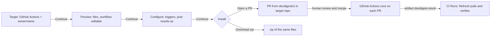
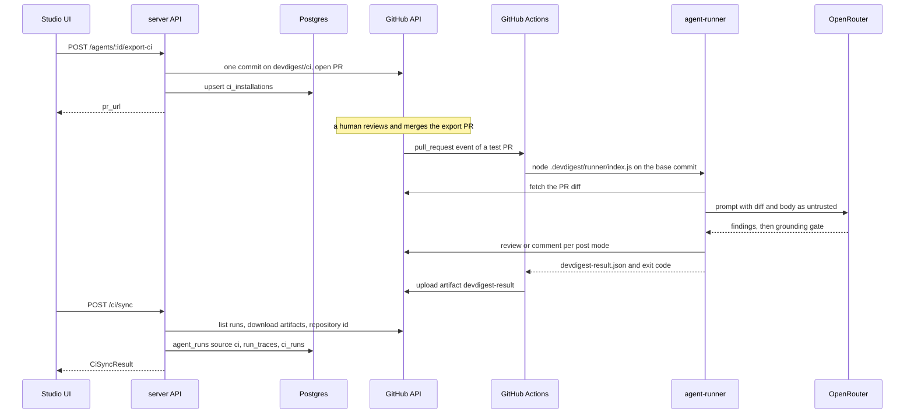

# Spec: Export to CI
Spec ID: SPEC-12
Status: approved
Supersedes: none

## Problem and user

An agent author tunes a review agent in the local studio, but the agent runs only on
their machine: the team cannot rely on it for every pull request (IN-1, «Поки агент
працює лише на вашій машині, команда не може покладатися на нього в кожному PR»). A
repository maintainer wants the same agent — same model, system prompt, skills and gate —
to review every PR inside the repository's own GitHub Actions, to block a merge on a
CRITICAL finding, and the author wants to see those CI runs back in the studio.

What exists today on `feature/lab-07` (read @ 37642ab, working tree):

- `agent-runner/` — the bundled CI runner: loads and validates `.devdigest/agents/<slug>.yaml`,
  fetches the PR diff, runs `reviewer-core` with the grounding gate, writes
  `devdigest-result.json`, posts the result and exits non-zero when the gate trips
  (`agent-runner/src/run.ts:95-172`).
- Tables `ci_installations`, `ci_runs` (`server/src/db/schema/ci.ts:4-26`) and
  `agent_runs.source` `local` or `ci` (`server/src/db/schema/runs.ts:26`) — no code writes
  any of them for CI.
- Contracts `AgentManifest`, `CiExportInput`, `CiInstallation`, `CiRun`, `CiResultArtifact`
  (`server/src/vendor/shared/contracts/eval-ci.ts:76-166`; the client copy lacks
  `AgentManifest`).
- UI scaffolds `ExportWizardSteps`, `LiveLogStream`, `AutoTriggerStatus`
  (`client/src/vendor/ui/`), the `ci` message namespace (`client/messages/en/ci.json`)
  and the `ci-runs` sidebar key (`client/src/components/app-shell/helpers.ts:38`).
- GitHub adapter calls `commitFiles`, `openPullRequest`, `findOpenPr`
  (`server/src/adapters/github/octokit.ts:253-357`), declared but called by nothing.

Missing, although the lab text calls it ready: the server `ci` module (manifest
serialization, workflow generation, result ingest) and its routes, the agent page CI tab,
the Export Wizard, the CI Runs page and its hooks — none exists on this branch
(`server/src/modules/` has no `ci/`; DR-10). This spec therefore specifies their behaviour.

## Goals / Non-goals

- **G-1** An agent author exports an agent to a GitHub repository through a four-step wizard, as a pull request on branch `devdigest/ci` or as a zip, after seeing every file.
- **G-2** In the target repository every pull request event runs the exported agent in GitHub Actions with the bundled runner, posts the result in the chosen mode, and fails the check by the agent's Fail CI on policy.
- **G-3** The studio pulls each CI result from GitHub over the user's authenticated GitHub API access, verifies it, and shows it on the CI Runs page and on the agent's CI tab.
- **G-4** Worktree B delivers G-1…G-3 without touching worktree A's areas and merges after A with every check green.
- **NG-1** CircleCI, Jenkins and Generic CLI targets — no generator exists for them; they are omitted from the wizard, not shown as disabled.
- **NG-2** A push channel — no public ingest endpoint, no tunnel, no webhook: GitHub Actions cannot reach a studio on localhost.
- **NG-3** A published marketplace action — `uses: devdigest/review-action@v1` stays a placeholder of the mockups only.
- **NG-4** Storing CI findings as `reviews` / `findings` rows, linking a CI run to a studio PR (`agent_runs.pr_id` stays null), or showing CI runs on the PR page — `reviews.pr_id` requires a PR imported into the studio, and stored rows would enter the PR findings feed; the attribution contract of SPEC-11 binds every review B inserts, and in this iteration B inserts none.
- **NG-5** Background polling and an "auto-refresh" indicator — results arrive on page open and on Refresh.
- **NG-6** More than one exported agent per repository — the runner reads exactly one manifest (`agent-runner/src/manifest.ts:41-46`).
- **NG-7** Any change to the multi-run service, the Multi-Agent Review page, the PR findings feed, `reviewer-core/`, `mcp/` or the finding-attribution contract owned by worktree A — those belong to SPEC-11 or to no lab feature.
- **NG-8** Filters on CI Runs, a trace drawer from CI Runs, `LiveLogStream` and `AutoTriggerStatus` in this iteration — the job log lives in GitHub Actions.
- **NG-9** Reading, checking or writing GitHub Actions secrets from the studio — the lab forbids the wizard to read a secret value.
- **NG-10** Reviewing pull requests from forks — secrets are not passed to them; the first pass uses a same-repository PR.
- **NG-11** A new database migration — the existing tables carry the feature (NFR-1).

## User stories

- **US-1** As an agent author, I want an "Add to CI" button that opens a wizard for a target repository, so that I can start exporting from the agent page.
- **US-2** As an agent author, I want to see every file the export will create and edit the workflow, so that nothing reaches the repository unseen.
- **US-3** As an agent author, I want to choose the pull request events and how the result is published, so that the CI run fits the repository's habits.
- **US-4** As an agent author, I want the export delivered as a pull request on its own branch or as a zip, so that a human reviews it before it reaches `main`.
- **US-5** As a repository maintainer, I want every pull request reviewed in GitHub Actions by the exported agent with the same manifest and engine, so that the team gets the studio's review without the studio.
- **US-6** As a repository maintainer, I want a CRITICAL finding to fail the check, so that a required status check blocks the merge.
- **US-7** As an agent author, I want the studio to fetch and verify CI results from GitHub, so that CI runs are recorded without exposing the studio to the internet.
- **US-8** As an agent author, I want a CI Runs list across repositories and agents, so that I see what CI reviewed and what it cost.
- **US-9** As an agent author, I want a CI tab on the agent page with its installations, workflow version, run history and Fail CI on setting, so that I manage one agent's CI presence in one place.
- **US-10** As a developer running the two lab worktrees, I want fixed file ownership, merge order and check commands, so that the two features merge without overlap.

## Acceptance criteria (EARS)

### Export Wizard — the agent page

- **AC-1** [event-driven] WHEN the author clicks "Add to CI" on the CI tab, the agent page shall open the Export to CI dialog with the steps Target, Preview, Configure, Install and Target active. — covers: US-1 · verify: component — the dialog and the four step labels rendered by `ExportWizardSteps`, step 1 current
- **AC-2** [ubiquitous] The Export to CI dialog shall offer GitHub Actions as its only target, preselected, and an owner/name repository field prefilled with the active repository's full name. — covers: US-1 · verify: component — one target card, no CircleCI / Jenkins / Generic CLI text, the input's value
- **AC-3** [unwanted] IF the repository field does not read owner/name, THEN the Export to CI dialog shall keep Continue disabled on the Target step. — covers: US-1 · verify: component — Continue disabled for `acme`, enabled for `acme/api`
- **AC-4** [event-driven] WHEN the author continues from Target, the Export to CI dialog shall list the files `POST /agents/:id/ci/preview` returns: `.devdigest/agents/<slug>.yaml`, one `.devdigest/skills/<skill-slug>.md` per enabled linked skill, `.devdigest/memory.jsonl`, `.devdigest/runner/index.js` and `.github/workflows/devdigest-review.yml`. — covers: US-2 · verify: component — the file list from a mocked preview response
- **AC-5** [ubiquitous] The Export to CI dialog shall show `.github/workflows/devdigest-review.yml` in an editable text area, every other file read-only, and the runner bundle by path and size only. — covers: US-2 · verify: component — one textarea; the bundle row shows its size and no contents
- **AC-6** [event-driven] WHEN the author installs after editing the workflow, the Export to CI dialog shall send the edited text as `workflow_yaml` in the install request. — covers: US-2 · verify: component — the request body of the mocked `fetch`
- **AC-7** [ubiquitous] The Configure step shall offer the triggers `opened`, `synchronize`, `reopened` with the first two preselected, and "Post results as" GitHub review (preselected), PR comment, None (exit code only). — covers: US-3 · verify: component — checked states of the three chips and the three radios
- **AC-8** [unwanted] IF no trigger is selected, THEN the Export to CI dialog shall keep Continue disabled on the Configure step. — covers: US-3 · verify: component — Continue disabled after unchecking both defaults
- **AC-9** [ubiquitous] The Configure step shall name the Actions secret `OPENROUTER_API_KEY` with the instruction to add it under Settings → Secrets and variables → Actions, without any value or set / not-set status for it. — covers: US-3 · verify: component — the secret name and the instruction text present, no status badge
- **AC-10** [ubiquitous] The Configure step shall show the note that blocking a merge needs Fail CI on (CI tab) plus a required status check in the repository's branch protection, with no GitHub App. — covers: US-3 · verify: component — the note text from `ci.json`
- **AC-11** [ubiquitous] The Install step shall offer "Open a PR with these files" (preselected) and "Download zip". — covers: US-4 · verify: component — two options, the first selected
- **AC-12** [event-driven] WHEN an install with "Open a PR with these files" succeeds, the Export to CI dialog shall show a link to the `pr_url` the API returned. — covers: US-4 · verify: component — an anchor with the mocked URL
- **AC-13** [unwanted] IF the install request answers an error, THEN the Export to CI dialog shall show the API's message on the Install step and keep "Download zip" available. — covers: US-4 · verify: component — the message text, the zip option enabled

### Export — the API

- **AC-14** [ubiquitous] The API shall write `.devdigest/agents/<slug>.yaml` so that `AgentManifest` parses it back to the agent's name, model, system prompt, strategy, enabled skill slugs, `ci_fail_on` and `version`. — covers: US-2 · verify: unit — round trip of a fixture agent through the serializer and `AgentManifest.parse`
- **AC-15** [event-driven] WHEN `POST /agents/:id/export-ci` is called, the API shall commit every generated file as one commit to branch `devdigest/ci` of the target repository, created from `base` when missing, and never to `base`. — covers: US-4 · verify: unit — the mock GitHub client receives one commit with branch `devdigest/ci`
- **AC-16** [event-driven] WHEN that commit succeeds, the API shall open a pull request titled "Add DevDigest CI review" from `devdigest/ci` into `base`, or reuse the open pull request of that branch, and return its URL as `pr_url`. — covers: US-4 · verify: unit — `openPullRequest` called once, or not at all when `findOpenPr` returns one
- **AC-17** [ubiquitous] The export commit shall leave exactly one file under `.devdigest/agents/` on `devdigest/ci`. — covers: US-4 · verify: unit — a branch holding `old-name.yaml` ends with only the new slug's file
- **AC-18** [event-driven] WHEN an export or a zip download succeeds, the API shall store one `ci_installations` row for the agent and the repository with `target_type` `gha`, refreshing `installed_at` when the row exists. — covers: US-4 · verify: integration — row count stays 1 after two exports
- **AC-19** [unwanted] IF the repository already has a `ci_installations` row of another agent, THEN the API shall answer 409 and commit nothing. — covers: US-4 · verify: integration — status 409, no commit call on the mock
- **AC-20** [unwanted] IF a generated file contains a secret value the studio's `SecretsProvider` holds, THEN the API shall answer 422 naming the file and commit nothing. — covers: US-2 · verify: unit — a system prompt holding the mock OpenRouter key
- **AC-21** [unwanted] IF the runner bundle `agent-runner/dist/index.js` does not exist, THEN the API shall answer 409 with a message naming `cd agent-runner && pnpm build`. — covers: US-4 · verify: unit — status and message with the bundle path pointed at a missing file
- **AC-22** [event-driven] WHEN `POST /agents/:id/ci/zip` is called, the API shall answer `application/zip` holding the same files as the export at their repository-relative paths. — covers: US-4 · verify: unit — entry names of the returned archive
- **AC-23** [unwanted] IF GitHub refuses a call of the export, THEN the API shall answer 502 carrying GitHub's message and store no installation. — covers: US-4 · verify: unit — mock `commitFiles` throws; status, message, no repository write
- **AC-24** [ubiquitous] The API shall write `.devdigest/memory.jsonl` as one JSON object with `kind`, `scope` and `content` per `memory` row of the agent's workspace whose scope is `global`, and an empty file when there is none. — covers: US-2 · verify: unit — two rows give two lines, zero rows an empty string
- **AC-25** [unwanted] IF the request's `repo` does not read owner/name, THEN the API shall answer 422 before calling GitHub. — covers: US-1 · verify: unit — route schema rejects `../x` and `acme`

### The generated workflow

- **AC-26** [ubiquitous] The API shall generate a workflow that triggers only on `pull_request` with the selected types and contains no `pull_request_target`. — covers: US-5 · verify: unit — parsed YAML `on` keys and types
- **AC-27** [ubiquitous] The API shall generate the workflow with `permissions` exactly `contents: read` and `pull-requests: write`. — covers: US-5 · verify: unit — parsed `permissions` equals the two keys
- **AC-28** [ubiquitous] The API shall pin every `uses:` reference of the generated workflow to a full 40-character commit SHA. — covers: US-5 · verify: unit — every `uses` value matches `@[0-9a-f]{40}$`
- **AC-29** [ubiquitous] The API shall generate a checkout of the pull request's base commit with persisted credentials off, so that no file of the pull request head is executed. — covers: US-5 · verify: unit — checkout `ref` is `${{ github.event.pull_request.base.sha }}`, `persist-credentials: false`
- **AC-30** [ubiquitous] The API shall generate a review step that runs `node .devdigest/runner/index.js` with `OPENROUTER_API_KEY` from `secrets.OPENROUTER_API_KEY`, `GITHUB_TOKEN` from the job token, `PR_NUMBER` from the event and `DEVDIGEST_POST_AS` set to the chosen mode. — covers: US-5 · verify: unit — the step's `run` and `env`
- **AC-31** [ubiquitous] The API shall place no `${{ }}` expression of the pull request title, body, head ref or a comment inside any `run:` script of the workflow. — covers: US-5 · verify: unit — no `github.event.pull_request.title`, `.body`, `.head.ref`, `github.event.comment` in any `run`
- **AC-32** [ubiquitous] The API shall generate an upload of `devdigest-result.json` as artifact `devdigest-result` in a step that runs whether the review step passed or failed and that ignores a missing file. — covers: US-6 · verify: unit — the step's `if` and `if-no-files-found: ignore`

### The runner — `agent-runner/`

- **AC-33** [event-driven] WHEN the runner finishes a grounded review, the runner shall write `devdigest-result.json` whose keys are exactly the fields of `CiResultArtifact`, with `head_sha` and `repository_id` taken from the `pull_request` event payload. — covers: US-5 · verify: unit — key set of the written JSON, values from a fixture event
- **AC-34** [ubiquitous] The runner shall write neither the `OPENROUTER_API_KEY` nor the `GITHUB_TOKEN` value to stdout, stderr, the artifact or a posted body. — covers: US-5 · verify: unit — sentinel values absent from captured console output, the artifact and the mock post bodies
- **AC-35** [state-driven + event-driven] WHILE the manifest's `ci_fail_on` is `critical`, WHEN a grounded finding is CRITICAL, the runner shall exit with code 1. — covers: US-6 · verify: unit — `runCi` with a stubbed model returning one grounded CRITICAL
- **AC-36** [ubiquitous] The runner shall publish per `DEVDIGEST_POST_AS`: a GitHub review, a PR comment, or nothing. — covers: US-5 · verify: unit — the mock post calls per mode
- **AC-37** [unwanted] IF the manifest fails `AgentManifest` validation, THEN the runner shall exit with code 1 and write no artifact. — covers: US-5 · verify: unit — invalid YAML fixture, no write call
- **AC-38** [ubiquitous] The runner shall send the diff and the PR body to the model only inside untrusted blocks. — covers: US-5 · verify: unit — the stubbed model's prompt holds both inside `<untrusted` blocks

### Pulling results — the API and the CI Runs page

- **AC-39** [event-driven] WHEN the CI Runs page opens or the author clicks Refresh, the CI Runs page shall call `POST /ci/sync` and then reload the run list. — covers: US-7 · verify: component — call order on the mocked `fetch`; Refresh disabled while the sync runs
- **AC-40** [event-driven] WHEN `POST /ci/sync` is called, the API shall read, with the configured GitHub token, at most the 20 most recent completed runs of `devdigest-review.yml` in each installation's repository and download each run's `devdigest-result` artifact. — covers: US-7 · verify: unit — mock GitHub calls per installation; an in-progress run is not read
- **AC-41** [unwanted] IF an artifact fails `CiResultArtifact` parsing, THEN the API shall reject it with reason `schema` and write no row for that run. — covers: US-7 · verify: unit — rejected entry, no repository write
- **AC-42** [unwanted] IF an artifact's `head_sha` differs from the head SHA GitHub reports for its workflow run, THEN the API shall reject it with reason `head_sha_mismatch`. — covers: US-7 · verify: unit — mismatching fixture
- **AC-43** [unwanted] IF an artifact's `repository_id` differs from the id GitHub reports for the installation's repository, THEN the API shall reject it with reason `repository_mismatch`. — covers: US-7 · verify: unit — mismatching fixture
- **AC-44** [unwanted] IF an artifact archive exceeds 1 MB or holds no `devdigest-result.json`, THEN the API shall reject it with reason `artifact_unreadable`. — covers: US-7 · verify: unit — oversize and empty archives
- **AC-45** [event-driven] WHEN an artifact passes every check, the API shall store one `agent_runs` row with `source` `ci`, the installation's agent, status `done`, `pr_id` null, model, duration, cost, findings count and blockers, plus its `run_traces` document with `config.source` `ci` and a `ci` block. — covers: US-7 · verify: integration — the stored row and `GET /runs/:id/trace`
- **AC-46** [event-driven] WHEN an artifact passes every check, the API shall store one `ci_runs` row with the installation, PR number, run time, status `succeeded` or `no_findings`, findings count, cost, `github_url` set to the workflow run's `html_url` from GitHub, and `source` `gha`. — covers: US-7 · verify: integration — the stored row
- **AC-47** [unwanted] IF a workflow run's `html_url` is already stored in `ci_runs`, THEN the API shall skip that run and write nothing. — covers: US-7 · verify: integration — a second sync of the same fixture leaves row counts unchanged
- **AC-48** [unwanted] IF a completed workflow run has no `devdigest-result` artifact, THEN the API shall store one `ci_runs` row with status `failed`, its `github_url`, null findings and cost, and no `agent_runs` row. — covers: US-7 · verify: integration — the stored row, `agent_runs` unchanged
- **AC-49** [event-driven] WHEN a sync ends, the API shall answer `ingested`, `skipped` and `failed` counts plus `rejected` entries with `run_url` and `reason`, and `errors` entries with `repo` and `message`. — covers: US-7 · verify: unit — response shape against `CiSyncResult`
- **AC-50** [unwanted] IF a sync is already running in the workspace, THEN the API shall answer 409. — covers: US-7 · verify: unit — two concurrent calls, one 409
- **AC-51** [unwanted] IF GitHub answers 401, 403 or 404 for one installation's repository, THEN the API shall list that repository in `errors` with GitHub's message and still sync the others. — covers: US-7 · verify: unit — two installations, one failing
- **AC-52** [unwanted] IF no GitHub token is configured, THEN the API shall answer an error naming the missing GitHub token and write nothing. — covers: US-7 · verify: unit — secrets mock without `github`

### CI Runs page

- **AC-53** [ubiquitous] The CI Runs page shall show one row per CI run, newest first, with repository, PR number, agent (`—` when the agent no longer exists), verdict, findings by severity, cost, duration, status and a link to the GitHub Actions run. — covers: US-8 · verify: component — cells of a mocked list, the link's `href`
- **AC-54** [ubiquitous] The API shall return at most the 100 newest CI runs of the workspace from `GET /ci/runs`, filtered by `agent_id` when given. — covers: US-8 · verify: integration — 101 stored rows give 100; the filter
- **AC-55** [state-driven] WHILE the workspace has no CI run, the CI Runs page shall show the empty state "No CI runs yet". — covers: US-8 · verify: component — empty list response
- **AC-56** [unwanted] IF the sync answered `rejected` or `errors` entries, THEN the CI Runs page shall show a notice with their number and reasons. — covers: US-8 · verify: component — mocked sync result with one rejection
- **AC-57** [ubiquitous] The sidebar shall show a "CI Runs" item linking to `/ci-runs`. — covers: US-8 · verify: component — the link in `navigation.test.tsx`

### CI tab — the agent page

- **AC-58** [state-driven] WHILE the agent has no installation, the CI tab shall show the empty state "Not in CI yet" with an "Add to CI" button. — covers: US-9 · verify: component — empty installations response
- **AC-59** [ubiquitous] The CI tab shall list each installation with its repository, GitHub Actions, the latest run's status and time, and the workflow version — the manifest version of the latest ingested run, `—` before the first — beside the agent's current version. — covers: US-9 · verify: component — a mocked installation row
- **AC-60** [ubiquitous] The API shall return, from `GET /agents/:id/ci/installations`, the agent's installations with `latest_run_status`, `latest_run_at` and `manifest_version`. — covers: US-9 · verify: integration — an installation with one ingested run
- **AC-61** [ubiquitous] The CI tab shall show the agent's CI run history, newest first, at most 20 rows, with the columns of the CI Runs page. — covers: US-9 · verify: component — rows from `GET /ci/runs?agent_id=`
- **AC-62** [event-driven] WHEN the author picks Critical, Warning + or Never under Fail CI on, the CI tab shall send `PUT /agents/:id` with `ci_fail_on` `critical`, `warning` or `never`. — covers: US-9 · verify: component — request body; an agent at `any` shows no option selected
- **AC-63** [ubiquitous] The CI tab shall state that a Fail CI on change reaches CI only after "Update CI config". — covers: US-9 · verify: component — the note text
- **AC-64** [event-driven] WHEN the author clicks "Update CI config", the CI tab shall open the Export to CI dialog with the installation's repository in the repository field. — covers: US-9 · verify: component — the field's value

### End to end on `vklyovsa/devdigest-demo`

- **AC-65** [event-driven] WHEN the author exports an agent to `vklyovsa/devdigest-demo`, reviews and merges the export PR, and opens a same-repository test PR, the DevDigest Review workflow shall post the agent's result on the test PR. — covers: US-5 · verify: manual — real GitHub Actions on a public repository; no agent-written test reaches GitHub
- **AC-66** [state-driven + event-driven] WHILE Fail CI on is Critical and the DevDigest Review check is required by the branch rules, WHEN the test PR carries a CRITICAL finding, the DevDigest Review check shall end failed, so that GitHub blocks the merge. — covers: US-6 · verify: manual — branch protection is a GitHub setting
- **AC-67** [ubiquitous] The GitHub Actions log and the `devdigest-result` artifact of the test run shall contain no `OPENROUTER_API_KEY` value. — covers: US-5 · verify: manual — search of the downloaded log and artifact for the key's prefix
- **AC-68** [event-driven] WHEN the author refreshes CI Runs after the test run, the CI Runs page shall show the run with repository `vklyovsa/devdigest-demo`, the test PR number and the link to its GitHub Actions run. — covers: US-8 · verify: manual — needs the real run of AC-65; `GET /runs/:id/trace` of the run shows the test PR's head SHA in its `ci` block

### Worktree boundary

- **AC-69** [ubiquitous] The diff of worktree B against `feature/lab-07` shall change no file of worktree A's list and, among shared files, only the lines § Ownership and merge order names. — covers: US-10 · verify: manual — `git diff --name-only` of both worktrees compared by the developer
- **AC-70** [event-driven] WHEN worktree B has been updated from `feature/lab-07` after A's merge, the check commands of § Ownership and merge order shall pass. — covers: US-10 · verify: manual — commands run by the session before B merges

## Edge cases

- **EC-1** A pull request from a fork → Actions passes no secret, the runner fails, no artifact → a `failed` row with its job link — covered by: AC-48
- **EC-2** The gate trips on a CRITICAL finding and the review step exits 1 → the artifact is still uploaded and ingested — covered by: AC-32
- **EC-3** A pull request changes `.devdigest/**` or the workflow → the base commit's files run, the PR's own copy never executes — covered by: AC-29
- **EC-4** The author's workflow edit breaks the YAML → it is committed as edited, the human PR review is the gate, a run without artifact shows as `failed` — covered by: AC-48
- **EC-5** The agent was renamed since the last export → the old manifest file is removed in the same commit — covered by: AC-17
- **EC-6** A second agent is exported to a repository that already has one → 409 — covered by: AC-19
- **EC-7** The base branch does not exist, or the token may not write workflow files → GitHub refuses, the wizard shows the message and keeps the zip — covered by: AC-23
- **EC-8** The runner bundle was never built in `agent-runner/` → 409 naming the build command — covered by: AC-21
- **EC-9** A system prompt or skill body holds a pasted key → 422 before anything is published — covered by: AC-20
- **EC-10** Re-export while the `devdigest/ci` PR is still open → a new commit on the branch, the same PR URL — covered by: AC-16
- **EC-11** Two syncs at once (two tabs) → the second answers 409; a repeated sync writes nothing new — covered by: AC-47
- **EC-12** A workflow run re-run in GitHub (same run URL) → skipped as already stored — covered by: AC-47
- **EC-13** A workflow run still in progress → not read; a later sync picks it up — covered by: AC-40
- **EC-14** The artifact expired under GitHub's retention → treated as a run without artifact — covered by: AC-48
- **EC-15** An artifact claims another repository or commit → rejected — covered by: AC-43
- **EC-16** The token was revoked or the repository deleted → listed in `errors`, other repositories still sync — covered by: AC-51
- **EC-17** `pull_requests.head_sha` moves only on a PR list sync (`server/INSIGHTS.md`) → the check compares with the SHA GitHub reports for the workflow run, never the stored PR — covered by: AC-42
- **EC-18** Grounding drops every finding → status `no_findings`, verdict `approve` — covered by: AC-46
- **EC-19** The agent is deleted after export → `ci_runs` and `agent_runs` keep their rows, the agent shows as `—` — covered by: AC-53
- **EC-20** Fail CI on changed after export → the repository still holds the old manifest until "Update CI config" — covered by: AC-63
- **EC-21** A diff GitHub will not return (too large) → the runner fails, a `failed` row — covered by: AC-48
- **EC-22** An agent whose `ci_fail_on` is `any`, a value the control does not offer → no option selected until the author picks one — covered by: AC-62

## Non-functional requirements

- **NFR-1** [compatibility] The feature adds no migration: it writes the existing `ci_installations`, `ci_runs`, `agent_runs` (`source` `ci`) and `run_traces`; a value with no column (head SHA, repository id, manifest version, runner version, verdict, severity counts, run URL) lives in the trace's `ci` block. — verify: `ls server/src/db/migrations` shows no file after `0019_skill_evals.sql`
- **NFR-2** [compatibility] `CiResultArtifact`, `CiExportInput`, `CiFile`, `CiInstallation`, `CiRun`, `CiSyncResult` and `RunTrace` change identically in both `@devdigest/shared` copies; `AgentManifest` has one owner, `server/src/vendor/shared/contracts/eval-ci.ts`, read by the studio and by `agent-runner` through its `@devdigest/shared` alias, and the client never parses a manifest. — verify: `diff` of the two `eval-ci.ts` and `trace.ts` copies shows only the drift that existed at 37642ab
- **NFR-3** [compatibility] `reviewer-core/` and `mcp/` are unchanged, and every existing route answers as before. — verify: `git diff --name-only` lists nothing under `reviewer-core/` or `mcp/`; `check-code.sh server client` green
- **NFR-4** [cost] Preview, export, zip, sync and both lists make no model call; the only model calls run in GitHub Actions on the repository's own OpenRouter key. — verify: integration — mock LLM call count 0 across the new routes
- **NFR-5** [security] The `OPENROUTER_API_KEY` value never reaches the manifest, the artifact, a log, a trace, a `ci_runs` row or the studio database. — verify: unit AC-20, AC-34; manual AC-67
- **NFR-6** [security] The studio adds no route that GitHub or any outside caller uses to deliver results; results enter only through the studio's own authenticated GitHub API calls. — verify: the route list of the `ci` module holds only the six routes of § Contracts
- **NFR-7** [i18n] Every new visible string comes from `client/messages/en/ci.json`; the sidebar label reuses `shell.json` `ci-runs`. — verify: component tests render through `NextIntlClientProvider` with those namespaces
- **NFR-8** [observability] Each sync logs one line per installation with the counts ingested, skipped, failed and rejected, and never artifact content or a token. — verify: unit — logger spy
- **NFR-9** [security] Artifact text is rendered as plain text, and the job link is the `html_url` GitHub returned, never a value from the artifact. — verify: component — a `<script>` agent name renders as text; unit — `github_url` equals the mock's `html_url`
- **NFR-10** [compatibility] Worktree B runs the API on :3021, the web app on :3020 and the database `devdigest_ci` in the same Postgres container, and never writes the `devdigest` database. — verify: manual — the worktree's `server/.env` and `NEXT_PUBLIC_API_BASE`
- **NFR-11** [accessibility] Every wizard and CI tab control is a native button, input or textarea with an accessible name. — verify: component — queries by role and name

## Module interactions

Packages: server, client, tooling
Surfaces: the agent page CI tab (new) and the Export to CI dialog (new); the CI Runs page `/ci-runs` (new) and one sidebar item; routes `POST /agents/:id/ci/preview`, `POST /agents/:id/export-ci`, `POST /agents/:id/ci/zip`, `GET /agents/:id/ci/installations`, `GET /ci/runs`, `POST /ci/sync` (all new); `PUT /agents/:id` (unchanged, carries `ci_fail_on`); the standalone package `agent-runner/` (changed — listed as `tooling` because the checker's package list does not name it); the generated GitHub Actions workflow in the target repository

| # | From → To | Channel | Carries | Exists today | If it fails |
|---|---|---|---|---|---|
| MI-1 | client → server | `POST /agents/:id/ci/preview` | repo, triggers, post_as; back: `files` | new | the Preview step shows the API's message, Continue disabled |
| MI-2 | client → server | `POST /agents/:id/export-ci` | `CiExportInput` with `workflow_yaml`; back: `CiExport` | new | AC-13 |
| MI-3 | client → server | `POST /agents/:id/ci/zip` | the same body; back: `application/zip` | new | AC-13 |
| MI-4 | client → server | `GET /agents/:id/ci/installations` | back: `CiInstallation[]` | new | the CI tab shows the error with retry |
| MI-5 | client → server | `GET /ci/runs` | `agent_id` optional; back: `CiRun[]` | new | the page shows the error with retry |
| MI-6 | client → server | `POST /ci/sync` | back: `CiSyncResult` | new | AC-51, AC-52, AC-56; the stored list still loads |
| MI-7 | client → server | `PUT /agents/:id` | `ci_fail_on` | yes (`server/src/modules/agents/routes.ts:41`, written through `server/src/modules/agents/helpers.ts:85`) | the control reverts and shows the message |
| MI-8 | server → GitHub | `commitFiles`, `openPullRequest`, `findOpenPr` | files on `devdigest/ci`, the PR | changes (`server/src/adapters/github/octokit.ts:272` layers files on the base tree and cannot delete a path — AC-17 needs it; no caller today) | AC-23 |
| MI-9 | server → GitHub | workflow runs of `devdigest-review.yml`, run artifacts, artifact download, repository id | run `html_url`, head SHA, status; the archive; the numeric id | new | AC-51 |
| MI-10 | GitHub Actions → agent-runner | env and the `pull_request` event payload | repository, PR number, title, body, head SHA, repository id, `DEVDIGEST_POST_AS` | changes (`agent-runner/src/context.ts:67-92` reads no head SHA or repository id) | exit 1, no artifact (AC-48 on the studio side) |
| MI-11 | agent-runner → reviewer-core | `reviewPullRequest`, `toReviewPayload`, `countBlockers`, `gateTriggered` | manifest, skills, diff, PR body; back: grounded findings, cost | yes (`agent-runner/src/run.ts:120-141`) | exit 1, nothing posted |
| MI-12 | agent-runner → GitHub | PR diff, review or comment | the diff; the composed body | yes (`agent-runner/src/github.ts`) | exit 1 before posting; posting fails after the artifact is written |
| MI-13 | GitHub Actions → GitHub | artifact upload | `devdigest-result.json` as `devdigest-result` | new (workflow step) | the run shows as `failed` in CI Runs (AC-48) |
| MI-14 | server → Postgres | `ci_installations`, `ci_runs`, `agent_runs`, `run_traces` | AC-18, AC-45, AC-46, AC-48 | changes (tables at `server/src/db/schema/ci.ts:4`, `server/src/db/schema/runs.ts:8`; nothing writes `ci_*` or `source` `ci` today) | the sync answers 500 for that run and stores nothing partial |
| MI-15 | server ci → worktree A's attribution contract | SPEC-11 § Contracts "Finding attribution": `reviews.agent_id` + `reviews.run_id` on every review a writer inserts; `agent_runs.multi_agent_run_id` null for CI runs | read only: B inserts no review (NG-4), sets `agent_runs.agent_id` to the installation's agent and leaves `multi_agent_run_id` null | new (`specs/2026-10-18-multi-agent-review.md`, column added by A's migration) | B adapts its writer after updating from A; it never edits the contract |
| MI-16 | mcp → server | existing routes | unchanged; no tool reads CI data | yes (no file under `mcp/src` names a CI route) | unchanged |

### Contracts

Wire JSON is snake_case; every change lands in both `@devdigest/shared` copies except
`AgentManifest`, which lives in the server copy only (NFR-2).

**Routes** — errors use the API's existing error body.

| Route | Body / query | Answer | Errors |
|---|---|---|---|
| `POST /agents/:id/ci/preview` | `repo`, `triggers`, `post_as` | `{ files: CiFile[] }` | 404 agent, 409 bundle missing (AC-21), 422 schema |
| `POST /agents/:id/export-ci` | `CiExportInput` | `CiExport` | 404, 409 other agent (AC-19) or bundle missing, 422 schema or secret (AC-20), 502 GitHub (AC-23) |
| `POST /agents/:id/ci/zip` | `CiExportInput` | `application/zip` | as export, without 502 |
| `GET /agents/:id/ci/installations` | — | `CiInstallation[]` | 404 |
| `GET /ci/runs` | `agent_id` optional | `CiRun[]`, at most 100 | — |
| `POST /ci/sync` | — | `CiSyncResult` | 409 running (AC-50), error for a missing GitHub token (AC-52) |

**Changed and new shapes**

| Shape | Change |
|---|---|
| `AgentManifest` (server copy) | + `version`: int, nullish — the agent version at export |
| `CiExportInput` | `triggers`: array of `opened` / `synchronize` / `reopened`, min 1, default `[opened, synchronize]`; + `workflow_yaml`: string, nullish (the edited workflow); `target` accepts `gha` only (422 otherwise); `action` removed (no caller; the zip has its own route) |
| `CiFile` | + `size_bytes`: int; the runner bundle comes with empty `contents` and `editable: false` |
| `CiInstallation` | + `latest_run_status`, `latest_run_at`: nullable; + `manifest_version`: int, nullable |
| `CiRun` | + `repo`: string; + `agent_id`: nullable; + `verdict`: `Verdict`, nullable; + `critical`, `warning`, `suggestion`: int, nullable; `duration_s`, `agent` as today |
| `CiResultArtifact` | + `head_sha`: 40 hex chars; + `repository_id`: int; + `verdict`: `Verdict`; + `blockers`: int; + `model`: string; + `manifest_version`: int, nullable; existing fields unchanged; unknown keys are dropped on parse |
| `CiSyncResult` (new) | `ingested`, `skipped`, `failed`: int; `rejected`: `{ run_url, reason }[]`, reason `schema` / `head_sha_mismatch` / `repository_mismatch` / `artifact_unreadable`; `errors`: `{ repo, message }[]` |
| `RunTrace` | + optional `ci`: `{ repo, repository_id, pr_number, head_sha, run_url, manifest_version, model, runner_version, verdict, critical, warning, suggestion }`; traces stored before the feature carry no such key |

Fixed names: workflow `.github/workflows/devdigest-review.yml`, artifact `devdigest-result`,
branch `devdigest/ci`, PR title "Add DevDigest CI review", runner path
`.devdigest/runner/index.js` (built from `agent-runner/dist/index.js`).

### Ownership and merge order

Worktree B (`feat/export-to-ci`, `../devdigest-ci`) owns: `server/src/modules/ci/**` (new);
the new GitHub methods in `server/src/vendor/shared/adapters.ts`,
`server/src/adapters/github/octokit.ts` and `server/src/adapters/mocks.ts` (additions only);
both copies of `contracts/eval-ci.ts`; `client/src/app/ci-runs/**` (new);
`client/src/app/agents/[id]/_components/AgentEditor/**` (the CI tab and its tab entry); a new
CI hooks file under `client/src/lib/hooks/`; `client/messages/en/ci.json`; `agent-runner/**`.

Shared files, B's touch kept minimal (the same list as SPEC-11 § Worktree boundaries):
`client/src/vendor/ui/nav.ts` — the sidebar: B appends only `{ key: "ci-runs", href: "/ci-runs" }`
to the GLOBAL group A adds, and edits no other entry; `client/src/components/app-shell/navigation.test.tsx`
— one appended `it(...)`; `server/src/modules/index.ts` — one import and one entry; both copies
of `contracts/trace.ts` — the optional `ci` key only (A does not list `trace.ts` as its own).

Worktree A owns, B never changes: `server/src/modules/reviews/**` (the multi-run service and
`run-executor.ts`), `server/src/modules/multi-agent/**`, `server/src/db/schema/runs.ts` and A's
migration, `contracts/observability.ts`, `contracts/review-api.ts`, `contracts/platform.ts`,
`client/src/app/repos/[repoId]/pulls/[number]/**` (the PR page and its findings feed),
`client/src/app/repos/[repoId]/multi-agent/**`, `client/src/lib/hooks/reviews.ts`, and the
finding-attribution contract of SPEC-11. Neither side touches `reviewer-core/**` or `mcp/**`;
B adds no migration (NFR-1).

Merge order: A merges into `feature/lab-07` first; B then updates from `feature/lab-07`,
resolves only conflicts in the shared files above, re-runs the checks, and merges second.

Checks (AC-70): `.claude/agents/scripts/check-code.sh server`,
`.claude/agents/scripts/check-code.sh client`, `cd agent-runner && pnpm typecheck && pnpm test`;
`cd agent-runner && pnpm build` before an export is tried (AC-21).

Runtime isolation (NFR-10): API :3021, web :3020, database `devdigest_ci` in the same Postgres
container; worktree A uses :3011, :3010 and `devdigest_review` (SPEC-11).

## Design review

Sources reviewed: IN-1, IN-4, IN-5, IN-6, IN-7, IN-8, IN-9

| # | Kind | Finding | Proposal | Decision |
|---|---|---|---|---|
| DR-1 | inconsistency | `img_5.png` shows CircleCI, Jenkins, Generic CLI; only `gha` has a generator (`CiTarget` lists four, nothing generates three) | show GitHub Actions only | accepted → AC-2 |
| DR-2 | inconsistency | `img_7.png` workflow uses `devdigest/review-action@v1` and `secrets.OPENAI_API_KEY`; the lab asks for the bundled runner and `OPENROUTER_API_KEY` | generate the runner step of AC-30 | accepted → AC-30 |
| DR-3 | missing state | `img_8.png` shows `OPENROUTER_API_KEY` "not set" / `GITHUB_TOKEN` "ready"; the studio cannot and must not read Actions secrets | static instruction, no status | accepted → AC-9 |
| DR-4 | inconsistency | `img_8.png` says "No GitHub App needed"; `client/messages/en/ci.json` `blockMergeDesc` says it requires a GitHub App | use the design's note | accepted → AC-10 |
| DR-5 | missing state | `screen_cizruns.jsx:39-55` has no repository, verdict or job link column, and has a Trace link and five filters | add the three columns, a job link instead of Trace, no filters | accepted → AC-53 |
| DR-6 | ux | `screen_cizruns.jsx:28` shows "auto-refresh on" | sync on open and on Refresh, no indicator | accepted → AC-39 |
| DR-7 | missing state | `img_7.png`, `img_9.png` show no loading or error state for preview and install | the API's message, zip kept as a way out | accepted → AC-13 |
| DR-8 | missing state | `img_9.png` shows no success state | link to the PR | accepted → AC-12 |
| DR-9 | corner case | `screen_agents.jsx:128` offers Critical / Warning + / Never; `CiFailOn` also has `any` | the three designed options; `any` shows none selected | accepted → AC-62 |
| DR-10 | module | the server `ci` module, routes, CI tab, wizard and CI Runs page are absent on this branch (IN-9 holds a reference implementation on `base/full-functionality`) | specify the behaviour; porting is the planner's choice | accepted → AC-15 |
| DR-11 | module | the artifact carries no head SHA, repository id or verdict (`agent-runner/src/artifact.ts:33-43`), so ingest cannot verify it | extend `CiResultArtifact` | accepted → AC-33 |
| DR-12 | module | the runner never learns `post_as` (`agent-runner/insights/INSIGHTS.md` § Open Questions) | the workflow sets `DEVDIGEST_POST_AS` | accepted → AC-30 |
| DR-13 | module | the runner refuses more than one manifest (`agent-runner/src/manifest.ts:41`) | one agent per repository | accepted → AC-19 |
| DR-14 | corner case | the runner exits 1 when the gate trips, which would skip a plain upload step | upload regardless of the review step | accepted → AC-32 |
| DR-15 | corner case | a `pull_request` checkout of the merge ref executes the PR's own copy of the runner | check out the base commit | accepted → AC-29 |
| DR-16 | ux | the design has a Trace link; `RunTraceDrawer` lives under the PR route, A's area | no trace drawer from CI; the trace stays readable through `GET /runs/:id/trace` | accepted → AC-45 |
| DR-17 | ux | `LiveLogStream` and `AutoTriggerStatus` have nothing to show for a run that happens in GitHub | use `ExportWizardSteps` only | accepted → AC-1 |
| DR-18 | corner case | a zip install is invisible to the studio, so sync would never look at that repository | store the installation on zip download too | accepted → AC-18 |
| DR-19 | module | `memory.jsonl` is asked for, but no module writes `memory` and the runner ignores it | export the workspace's global memory rows, possibly an empty file | accepted → AC-24 |

## Inputs and provenance

| # | Source | Kind | Used for |
|---|---|---|---|
| IN-1 | `course-materials/materials/lesson7/Lesson-07-lab/L07-lab-desccription.txt`, Частина 1, 3, 4: «кнопка Add to CI відкриває Export Wizard із чотирма кроками: Target → Preview → Configure → Install»; «Preview: manifest, skills, .devdigest/memory.jsonl і редагований .github/workflows/devdigest-review.yml»; «wizard створює окрему гілку devdigest/ci й PR, а не пише безпосередньо в main»; «CI Runs показує репозиторій, PR, агента, verdict, знахідки, вартість, тривалість і посилання на job»; «вкладка CI на сторінці агента показує інсталяції, версію workflow, історію й налаштування Fail CI on»; «ingest пише запуск у agent_runs із source='ci' і приймає результат лише через автентифікований endpoint або інший перевірений канал»; the workflow security list (permissions, Secrets, no `pull_request_target`, untrusted PR text, pinned SHA, no secrets in the artifact); «Змержте worktree A, бо він додає атрибуцію, яку використовує ingest» | user text | Problem, G-1…G-4, US-1…US-10, NG-1, NG-3, NG-7 |
| IN-2 | task text of the calling session, 2026-10-18: pull delivery through the Actions artifact and the user's GitHub token with schema, commit SHA and repository id checks; Install as PR on `devdigest/ci` or zip; GitHub Actions only; triggers and publish modes; the permissions and secret rules; Fail CI on CRITICAL → non-zero exit; trace fields; one Zod manifest schema with a single owner; test repository `vklyovsa/devdigest-demo`; the boundaries, merge order, ports, database and check commands; "prefer no new migration"; "very simple implementation, no speculative options" | user answer | NG-2, NG-4…NG-11, AC-15…AC-18, AC-26…AC-32, AC-40…AC-48, AC-65…AC-70, NFR-1…NFR-6, NFR-10, MI-15 |
| IN-3 | the same task text: «The user delegated all decisions. Do NOT stop to ask. For every question/gap, choose the recommended (simplest) option yourself» | user answer | every Design review decision; the caps of AC-40, AC-44, AC-54, AC-61; AC-19, AC-24, AC-29 |
| IN-4 | `course-materials/materials/lesson7/Lesson-07-lab/img/img_5.png` … `img_9.png` (CI tab, Target, Preview, Configure, Install), opened 2026-10-18; untracked folder, so `docs/design` is cited too | figma export | AC-1…AC-13, DR-1…DR-4, DR-7, DR-8 |
| IN-5 | `docs/design/Dev Digest 2/Dev Digest/screen_export.jsx:3-37`, `screen_agents.jsx:120-160`, `screen_cizruns.jsx:19-56`; the standalone HTML of IN-4's folder could not be searched (bundled, no plain text) | figma export | AC-53, AC-58, AC-59, AC-62, DR-5, DR-6, DR-9 |
| IN-6 | `agent-runner/README.md`, `CLAUDE.md`, `src/run.ts`, `src/artifact.ts`, `src/manifest.ts`, `src/context.ts`, `src/index.ts`, `insights/INSIGHTS.md` @ 37642ab | code | AC-35…AC-38, MI-10…MI-12, DR-11…DR-14 |
| IN-7 | `server/src/db/schema/ci.ts`, `runs.ts`, `agents.ts`, `knowledge.ts:21`; both copies of `contracts/eval-ci.ts`, `contracts/trace.ts:85`, `contracts/findings.ts:26`; `server/src/vendor/shared/adapters.ts:154`; `server/src/adapters/github/octokit.ts:253-357`; `server/src/modules/agents/routes.ts:41`; `reviewer-core/src/output/to-review.ts:154` @ 37642ab | code | Problem, MI-7…MI-9, MI-14, NFR-1, NFR-2, DR-19 |
| IN-8 | `client/src/vendor/ui/ExportWizardSteps.tsx`, `LiveLogStream.tsx`, `AutoTriggerStatus.tsx`, `nav.ts`; `client/src/components/app-shell/helpers.ts:38`; `client/messages/en/ci.json`, `shell.json`; `client/src/app/agents/[id]/_components/AgentEditor/AgentEditor.tsx` @ 37642ab | code | AC-57, DR-4, DR-17, NFR-7 |
| IN-9 | `git log --all -- server/src/modules/ci` and `git ls-tree base/full-functionality`: the `ci` module, `CiTab`, `ExportWizard` and `ci-runs` exist only on remote branches, not on `feature/lab-07` | repository | DR-10 |
| IN-10 | `INSIGHTS.md` (`i/` and other untracked image folders are scratch; `git grep` misses untracked files; the starter pre-wires lessons), `server/INSIGHTS.md` (`head_sha` moves only on a list sync; a run row per agent run), `client/INSIGHTS.md` (`Tabs` render plain buttons; the shared package is type-only in the client), `agent-runner/insights/INSIGHTS.md` (`post_as` never reaches the runner), `AGENTS.md`, `server/AGENTS.md`, `client/AGENTS.md`, `TESTING.md`, `.claude/agents/security-reviewer.md` § Step 2, `.claude/skills/onion-architecture/rules/zod-contracts.md` | repository | EC-17, DR-12, NFR-2, the `verify:` rings, Untrusted inputs |
| IN-11 | `specs/2026-10-18-multi-agent-review.md` (SPEC-11, worktree A, draft, written in parallel) § Contracts "Finding attribution" and § Worktree boundaries (owned and shared files, A's ports and database) | repository | NG-4, MI-15, § Ownership and merge order |

| Items | Origin | Source |
|---|---|---|
| G-1…G-4, US-1…US-10 | stated | IN-1 |
| NG-1, NG-3, NG-7 | stated | IN-1 |
| NG-2, NG-4…NG-6, NG-8…NG-11 | stated | IN-2, IN-3 |
| AC-1…AC-13, AC-53, AC-55, AC-58, AC-59, AC-62…AC-64 | design | IN-4, IN-5 |
| AC-35…AC-38 | code | IN-6 (`agent-runner/src/run.ts:113-171`, `agent-runner/src/manifest.ts:51-76`) |
| AC-14…AC-34, AC-39…AC-52, AC-54, AC-56, AC-57, AC-60, AC-61, AC-65…AC-70 | stated | IN-1, IN-2, IN-3 |
| EC-17 | code | IN-10 |
| EC-1…EC-16, EC-18…EC-22 | stated | IN-2, IN-3 |
| NFR-1…NFR-11 | stated | IN-1, IN-2, IN-3 |

## Untrusted inputs

| # | Input | Controlled by | Enters at | Reaches | Rule |
|---|---|---|---|---|---|
| UI-1 | PR diff, title and body in the target repository | the PR author | the runner's GitHub fetch and the event payload | the model prompt | wrapped as untrusted data by the reviewer-core path — AC-38 |
| UI-2 | PR title, body, head ref, comments | the PR author | workflow expressions | a shell | never interpolated into a `run:` script — AC-31 |
| UI-3 | files of the PR head, a modified runner or manifest included | the PR author | the workflow checkout | code execution with the job's secrets | the base commit is checked out — AC-29 |
| UI-4 | the manifest on the base branch | anyone with write access to the repository | the runner's file read | the runner's configuration | parsed by `AgentManifest` before use — AC-37 |
| UI-5 | `devdigest-result.json` | CI of the target repository | the sync download | SQL rows and the CI Runs HTML | Zod parse, SHA and repository checks, plain-text rendering — AC-41, AC-42, AC-43, NFR-9 |
| UI-6 | the artifact archive bytes | CI of the target repository | the sync download | the server's archive reader | capped at 1 MB — AC-44 |
| UI-7 | `repo` and `workflow_yaml` of the export body | the studio user | the new routes | an outgoing GitHub URL; a committed file | `repo` schema-checked as owner/name — AC-25; `workflow_yaml` is committed as file content only and never run by the studio — AC-6 |
| UI-8 | model findings | the model | the runner | the posted GitHub review or comment | composed by the reviewer-core path, posted only per mode — AC-36 |

## Traceability

| Goal | Stories | Criteria | Edge cases | NFR |
|---|---|---|---|---|
| G-1 | US-1, US-2, US-3, US-4 | AC-1…AC-25 | EC-4…EC-10 | NFR-11 |
| G-2 | US-5, US-6 | AC-26…AC-38, AC-65…AC-67 | EC-1…EC-3, EC-21 | NFR-5 |
| G-3 | US-7, US-8, US-9 | AC-39…AC-64, AC-68 | EC-11…EC-20, EC-22 | NFR-4, NFR-6, NFR-8, NFR-9 |
| G-4 | US-10 | AC-69, AC-70 | — | NFR-10 |
| — | — | — | — | NFR-1, NFR-2, NFR-3, NFR-7 |

## Open questions

None — the user delegated every open point to the simplest recommended option (IN-3); each decision taken on that instruction is a Design review row, a non-goal or a criterion with origin `stated`, and none is left without a value.
